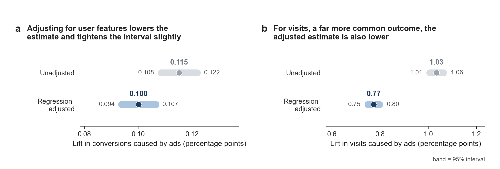

# 01a · Ad incrementality on a 14.0M-user randomized experiment

**[Explore this study interactively →](https://lyz44git.github.io/ad-measurement-and-metrics/01.html#s01a)**

> **Takeaway.** Assignment to the ad arm raised the visit rate by about one percentage point (3.82% to 4.85%) and the
> conversion rate from 0.19% to 0.31%, in Criteo's released sample of the experiment. The pre-specified uplift model
> did not beat a plain response model at ranking users for targeting, so on this evidence uplift modeling does not earn
> its extra complexity.

## Question

How many site visits and conversions did the ads cause, compared with what would have happened without them?
Which groups of users showed larger average effects, and does targeting them beat targeting the users most likely
to visit?

## Data

Criteo Uplift Prediction Dataset v2.1 (Diemert, Betlei, Renaudin and Amini 2018): 13,979,592 rows, 85% assigned to
the ad arm, 12 anonymized features, and exposure, visit and conversion flags. The experiment was designed, run and
released by Criteo, which pooled records from several tests with non-uniform subsampling. The file has no user
identifier; each row is treated as one user record.

Download `criteo-research-uplift-v2.1.csv.gz` from the [Criteo AI Lab dataset page](https://ailab.criteo.com/criteo-uplift-prediction-dataset/) into
`data_raw/criteo_uplift_v2.1/` (git-ignored). `python code/00_check_criteo.py <path>` prints the file's md5 and the
visit and conversion rates by arm.

## Method

The analysis plan, [`docs/10_plan_criteo_incrementality_uplift.md`](docs/10_plan_criteo_incrementality_uplift.md), is dated
2026-11-12 and was hashed before the run (`logs/10_plan_hash.txt`, which also records the hash after a
one-sentence wording edit on 2026-11-16). Visit is the primary outcome and conversion the secondary one.

1. **Incrementality.** Intent-to-treat effects with Neyman standard errors, and a regression-adjusted estimate (AIPW
   with linear outcome models).
2. **Randomization check.** Standardized mean differences of the features, and the held-out AUC of a model predicting
   assignment.
3. **Effect on exposed users.** Only 3.6% of the ad arm saw an ad; exposure is treated as one-sided non-compliance.
   The estimate assumes that assignment affects outcomes only through exposure. Its standard error treats the exposure
   share as fixed; a delta-method standard error that does not is almost the same (0.40 against 0.41 pp for visits).
4. **Targeting.** A response model P(visit | X), T-, X- and DR-learners and a causal forest, trained on 50% of users,
   selected on 20% and scored once on the remaining 4.19M users with the Qini coefficient and a paired bootstrap.

## Results

Full tables: [`docs/11_results_criteo_incrementality_uplift.md`](docs/11_results_criteo_incrementality_uplift.md).

| | Unadjusted | Regression-adjusted |
|---|---|---|
| Visit rate, control → ad arm | 3.82% → 4.85% (+1.03 pp, SE 0.015) | +0.77 pp (SE 0.013) |
| Conversion rate, control → ad arm | 0.19% → 0.31% (+0.115 pp, SE 0.003) | +0.100 pp (SE 0.003) |
| Visit effect among exposed users | 28.7 pp (SE 0.41) | 21.5 pp (SE 0.35) |

[](https://lyz44git.github.io/ad-measurement-and-metrics/01.html#s01a)

- Assignment is slightly predictable from the features (held-out AUC 0.509; largest standardized difference 0.049),
  so both columns are reported, as the plan requires. The diagnostics do not show which column is closer to the true
  effect.
- The conversion count of study 02a uses the unadjusted column: 0.115 pp × 11,882,655 ad-arm rows = 13,687 additional
  conversions (95% interval 12,887 to 14,488). The adjusted column gives 11,902 (11,148 to 12,657). The 23,031
  conversions credited by the exposure count are 68% above the first estimate and 93.5% above the second. No interval
  is given for these ratios.
- The effect is concentrated: the top tenth of test users by predicted uplift gained 6.0 pp against 1.05 pp overall,
  and the top fifth by T-learner score accounts for 75% of incremental visits. Ranking by the response model gives the
  same share (76%), so this concentration is not specific to the uplift model.
- **The pre-specified superiority test did not pass.** The selected T-learner showed no ranking gain over the response
  model on Qini (difference −1.2 × 10⁻⁴ per user, 95% CI −3.0 to +0.6).
- Predicted uplift is well calibrated in deciles 1–9, where decile 1 has the highest predicted uplift (6.6 pp
  predicted, 6.0 pp realized). Decile 10 is predicted negative (−0.79 pp) but realized +0.68 pp, so the model does
  not identify a group the ad harms.

## Reproduce

```bash
python code/10_run_criteo.py        # author's run: about 7 minutes on 16 cores; writes out/criteo/ and models/
python code/20_readout_sensitivity.py   # conversion count under both estimators and delta-method SE; writes out/criteo/readout_sensitivity.json
python -m pytest code/tests -q      # runs on simulated data; service tests are skipped until models/ exists
```

The estimators and the evaluation code are in `code/upliftkit`, with a local scoring endpoint for the selected model
(`code/upliftkit/service.py`), tested in-process only.
`code/20_readout_sensitivity.py` reads only committed result files of studies 01a, 01c and 02a.

## Scope

- The released data pool several tests with non-uniform subsampling, so absolute lifts are not population effects.
  Method comparisons apply to this release and the stated data split.
- This is an analysis of released experimental data, not the design or operation of an experiment.
