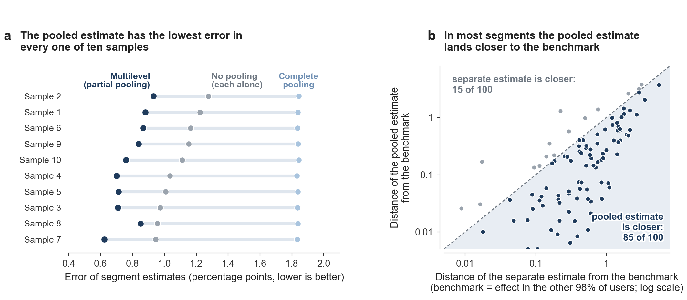

# 01b · Segment-level ad effects from small samples

> **Takeaway.** When a lift readout has to be split across 100 segments on a 2% sample, a Bayesian multilevel model
> cuts the error of the segment estimates by 27% against separate per-segment estimates, and did so in 10 of 10
> samples. Its 90% intervals are conservative (96% coverage).

## Question

A small experiment sample gives noisy segment-level effects. Does partial pooling across segments give estimates
closer to a benchmark (the segment effect on the other 98% of users) than estimating each segment on its own, or than giving every segment the overall effect?

## Data

The Criteo experiment used in [study 01a](../01a_ad_incrementality) (13,979,592 users). Pass the path to
`criteo-research-uplift-v2.1.csv.gz` to the first script.

## Method

The analysis plan, [`design/analysis_plan.md`](design/analysis_plan.md), was fixed before any outcome was computed.
The SHA-256 in `logs/plan_hash.txt` is that of the original file; the published copy differs only in one line, where
a local directory path was replaced. Deviations are in [`design/deviations.md`](design/deviations.md).

1. **Overall effect.** Beta-Binomial posterior of the lift in visit and conversion rates on the full data, next to the
   frequentist difference in means.
2. **Segments and samples.** 100 equal-size segments by rank on six features; ten disjoint 2% samples of users
   (about 279,500 users each, about 41,900 of them in the control arm). The benchmark for a sample is the segment effect computed on the
   other 98% of users.
3. **Estimators.** No pooling (per-segment difference in means), complete pooling (the overall difference for every
   segment), and a multilevel binomial model with segment-specific baselines and effects (NumPyro, NUTS, 4 chains).
4. **Decision rule.** The multilevel model helps if its RMSE against the benchmark is below no pooling in at least 8
   of 10 samples and the 95% interval of the mean paired difference is below zero.

## Results

Sources: [`out/part1_overall.json`](out/part1_overall.json), [`out/part2_summary.json`](out/part2_summary.json).

**Overall.** Visit lift +1.034 pp (95% credible interval 1.006 to 1.063), P(lift > 0) = 1.000; the frequentist
estimate and interval agree to three decimals. Conversion lift +0.115 pp.

**Segment effects, mean over the ten 2% samples.**

| | No pooling | Complete pooling | Multilevel |
|---|---|---|---|
| RMSE against the benchmark (pp) | 1.085 | 1.837 | 0.788 |
| Mean absolute error (pp) | 0.745 | 1.276 | 0.431 |
| Benchmark lift of the 20 segments picked (pp; all segments 0.96, best possible 4.03) | 3.68 | n/a | 3.78 |
| Coverage of 90% intervals | 87.5% | n/a | 96% |



- **The pre-specified rule was met.** The multilevel model had the lower RMSE in 10 of 10 samples; mean paired
  difference −0.297 pp (95% CI −0.349 to −0.245), a 27% reduction.
- Its top-20 picks had a benchmark lift at least as high as the no-pooling picks in 9 of 10 samples.
- Convergence after the reruns in deviation 1: maximum R-hat 1.0097, minimum bulk ESS 504.

## Reproduce

```bash
pip install -r ../../02_without_an_experiment/02c_marketing_mix_modeling/requirements-mmm.txt   # NumPyro and JAX
python code/01_build.py /path/to/criteo-research-uplift-v2.1.csv.gz derived
python code/02_overall_bayes.py derived out
python code/03_segments_bayes.py derived out
python code/03_segments_bayes.py derived out 3000 3000 4,7,9      # reruns of deviation 1
python code/03b_summarize.py out
python code/04_build_report.py
```

A rerun of these commands reproduced the summary files exactly. The last command writes an HTML summary of the output
files to [`out/criteo_bayes_report.html`](out/criteo_bayes_report.html).

## Scope

- The data are subsampled non-uniformly, so absolute lifts are not population effects; the comparison between
  estimators is valid.
- The benchmark has its own sampling error, so interval coverage is approximate.
- [Study 01d](../01d_private_segment_effects) repeats the comparison when the counts carry privacy noise.
