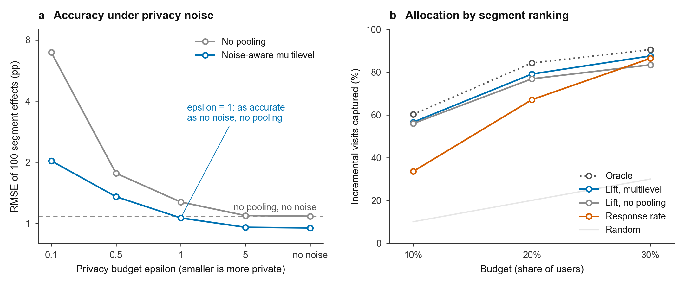

# 01d · Segment effects from privacy-protected counts

> **Takeaway.** When only noisy segment counts may be released, a multilevel model that knows the noise scale keeps
> segment effects usable. With Laplace noise at epsilon = 1 its error (1.06 points) is no higher than that of
> per-segment estimates on the unprotected counts (1.08), and on the same noisy counts it beat per-segment
> estimates in at least 9 of 10 samples at every epsilon. A second test in the same plan did not meet its rule:
> allocating spend to segments by estimated lift beat allocating by response rate at 10% and 20% budgets, but not at
> 30%.

## Questions

1. If the counts behind a segment-level lift readout are released with differential-privacy noise, how much accuracy
   is left, and does a model that accounts for the noise recover some of it?
2. Does ranking segments by estimated lift allocate a limited budget better than ranking them by response rate?

## Data

The Criteo experiment used in [study 01a](../01a_ad_incrementality), with the 100 segments, the ten 2% samples and
the benchmark of [study 01b](../01b_bayesian_segment_effects): the benchmark for a sample is the segment effect on the
other 98% of users. Pass the path to the `criteo_compact.parquet` file written by study 01b's `code/01_build.py`.

## Method

The analysis plan, [`design/analysis_plan.md`](design/analysis_plan.md), was fixed before any outcome of this study
was computed. The SHA-256 in `logs/plan_hash.txt` is that of the original file; the published copy differs in three
places, where a local directory path and the names of two local project folders were replaced. The plan has four
parts: Parts A and C are reported here, Part B is [study 02a](../../02_without_an_experiment/02a_attribution_metric_validation)
and Part D is part 1 of [study 03a](../../03_planning_a_test/03a_lift_study_sizing). Deviations are in
[`design/deviations.md`](design/deviations.md).

**Part A, privacy.**

1. **Release.** For each sample, the visit count and the user count of every segment-by-arm cell get independent
   Laplace noise of scale 2 / epsilon (one user changes two counts by at most 1 each), which makes the release
   epsilon-differentially private. Epsilon is 0.1, 0.5, 1 or 5; three noise draws per sample and epsilon.
2. **Estimators,** both from the noisy counts only: the difference of noisy rates in each segment (no pooling), and a
   multilevel normal model whose sampling variance adds the variance of the noise (NumPyro, NUTS, 4 chains of 500
   warm-up and 500 draws).
3. **Decision rule.** The multilevel model helps under privacy noise if, at every epsilon and without noise, its
   RMSE against the benchmark is below no pooling in at least 8 of 10 samples.

**Part C, allocation.** For each sample, segments are ranked by the multilevel estimate of study 01b, by the
no-pooling estimate, by the control-arm visit rate (response) and by the benchmark itself (oracle). A budget of 10%,
20% or 30% of users buys the top segments; the value is the share of all benchmark incremental visits they hold.
Decision rule: ranking by lift beats ranking by response if the multilevel ranking captures more in at least 8 of 10
samples at every budget.

## Results

Sources: [`out/a_private_summary.json`](out/a_private_summary.json), [`out/c_allocation.json`](out/c_allocation.json).

**Part A.** RMSE of 100 segment effects against the benchmark, in percentage points, mean of 10 samples:

| Epsilon | No pooling | Noise-aware multilevel | Multilevel better in |
|---|---|---|---|
| 0.1 | 6.95 | 2.03 | 10 of 10 |
| 0.5 | 1.77 | 1.35 | 10 of 10 |
| 1 | 1.27 | 1.06 | 10 of 10 |
| 5 | 1.09 | 0.96 | 9 of 10 |
| no noise | 1.08 | 0.95 | 9 of 10 |

**Part C.** Share of benchmark incremental visits captured, mean of 10 samples:

| Budget (share of users) | Multilevel lift ranking | No-pooling lift ranking | Response-rate ranking | Oracle | Random | Multilevel above response in |
|---|---|---|---|---|---|---|
| 10% | 56.6% | 56.0% | 33.5% | 60.2% | 10% | 10 of 10 |
| 20% | 79.1% | 76.9% | 67.1% | 84.3% | 20% | 10 of 10 |
| 30% | 87.6% | 83.5% | 86.5% | 90.6% | 30% | 4 of 10 |



- **The pre-specified rule of Part A was met.** The gain from the model grows as the privacy budget shrinks: at
  epsilon = 0.1 no pooling is off by 6.95 points and the multilevel model by 2.03.
- **Epsilon = 1 costs nothing against the usual readout:** the private multilevel estimate (1.06) is as accurate as
  per-segment estimates without any noise (1.08).
- **The pre-specified rule of Part C was not met.** Lift ranking captured more than response ranking in 10 of 10
  samples at the 10% and 20% budgets, and in 4 of 10 at 30%, where the two rankings pick nearly the same segments.
- 10 of 130 fits had a largest R-hat between 1.01 and 1.019; as the plan says they are listed and were not
  rerun. The published code was reorganized into functions; a rerun reproduces every number of the original run
  ([`logs/rerun_check.txt`](logs/rerun_check.txt)).

## Reproduce

```bash
pip install -r ../../02_without_an_experiment/02c_marketing_mix_modeling/requirements-mmm.txt   # NumPyro and JAX
python code/a_private_aggregates.py ../01b_bayesian_segment_effects/derived/criteo_compact.parquet out   # about 3 minutes
python code/c_allocation.py ../01b_bayesian_segment_effects/derived/criteo_compact.parquet out
```

`tests/` checks the noise scale of the release, the variance formula against the simulated spread of the estimate,
that a smaller privacy budget gives a larger error, and the allocation share; it needs only the root
`requirements.txt`.

## Scope

- One release per sample. Repeated releases of the same data would spend more privacy budget; composition is not
  studied here.
- The Laplace mechanism on counts is a textbook mechanism, not a production privacy system.
- The normal model used here is less accurate without noise (0.95) than the binomial model of study 01b (0.79);
  it is used because its variance can absorb the noise.
- Part C has no auction or cost data: it is allocation across segments, not bidding. Bidding on logged prices is in
  [study 02d](../../02_without_an_experiment/02d_attribution_and_bidding).
