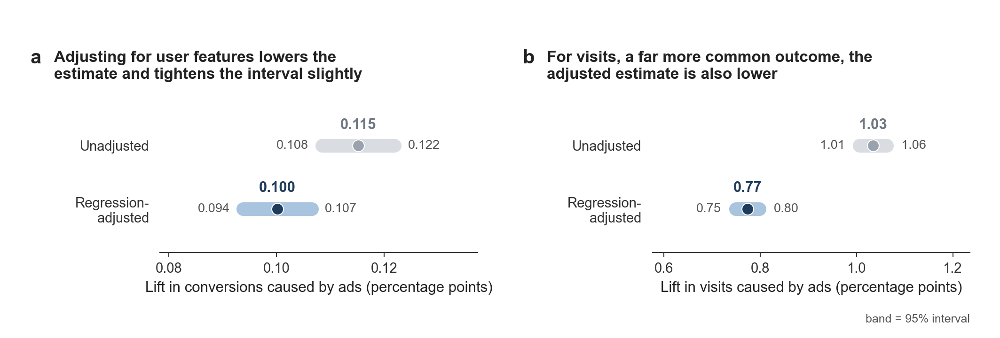

# 1. With an experiment: what did the ads cause, and for whom?

**[Explore these studies interactively →](https://lyz44git.github.io/ad-measurement-and-metrics/01.html)**

The four studies read the same randomized experiment (Criteo, 14.0M users): the effect (01a), the effect by
segment (01b), the definitions and checks behind the numbers (01c), and segment effects when the counts carry
privacy noise (01d). For the overall effect and its readout, read 01a and 01c; for using segment estimates, read
01b and 01d.

| Study | Question | Key result |
|---|---|---|
| [`01a_ad_incrementality`](01a_ad_incrementality) | How many site visits did the ads cause, as opposed to visits that would have happened anyway? | In Criteo's 14.0M-user randomized experiment, assignment to the ad arm raised the visit rate from 3.82% to 4.85% (+1.03 points; +0.77 after regression adjustment) and the conversion rate from 0.19% to 0.31%. A pre-specified uplift model did not show a ranking gain over a plain response model. |
| [`01b_bayesian_segment_effects`](01b_bayesian_segment_effects) | Can segment-level ad effects be read from a 2% sample? | A Bayesian multilevel model had a lower error than separate per-segment estimates in 10 of 10 samples; the mean RMSE over the ten samples fell by 27% (1.08 to 0.79 points). |
| [`01c_sql_metric_readout`](01c_sql_metric_readout) | Is every number of the readout defined, checked and reproducible from the raw file? | One SQL query per table, with each metric's numerator and denominator stated first, reproduces 29 of 29 published quantities of studies 01a and 02a. The data checks pass; 16% of rows are identical to another row and the file has no user identifier, so counts are counts of rows, not of distinct users. A conversion endpoint needs about 20 times the users of a visit endpoint for the same relative lift. |
| [`01d_private_segment_effects`](01d_private_segment_effects) | If segment counts are released with differential-privacy noise, how much accuracy is left? | With Laplace noise at epsilon = 1, a multilevel model that knows the noise scale has an error of 1.06 points, against 1.08 for per-segment estimates and 0.95 for the same model on unprotected counts; on the same noisy counts it beat per-segment estimates in at least 9 of 10 samples at every epsilon. A second pre-specified test, ranking segments by estimated lift when 30% of users can be reached, did not meet its rule. |

## Main figure of each study

**[01a · Ad incrementality on a 14.0M-user randomized experiment](01a_ad_incrementality)**

**[01b · Segment-level ad effects from small samples](01b_bayesian_segment_effects)**

**[01d · Segment effects from privacy-protected counts](01d_private_segment_effects)**

Study 01c has no figure; see its [data checks and reconciliation tables](01c_sql_metric_readout#results).

Method, data, decision rules and limitations are in each study's README; the four questions are introduced in
the [main README](../README.md).
