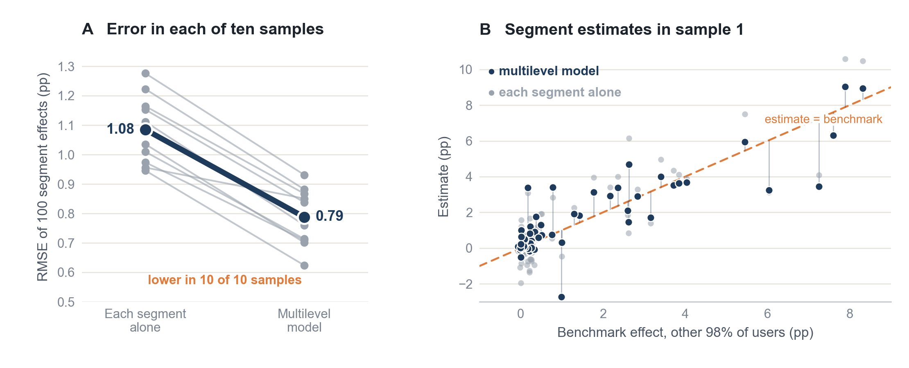
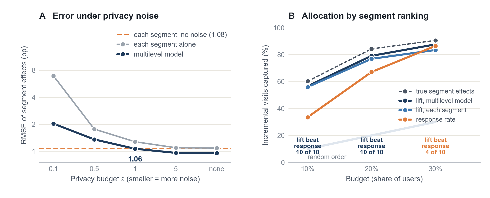

# 1. With an experiment: what did the ads cause, and for whom?

**[Explore these studies interactively →](https://lyz44git.github.io/ad-measurement-and-metrics/01.html)**

The four studies read the same randomized experiment (Criteo, 14.0M users): the effect (01a), the effect by
segment (01b), the definitions and checks behind the numbers (01c), and segment effects when the counts carry
privacy noise (01d).

| Study | Question | Key result |
|---|---|---|
| [`01a_ad_incrementality`](01a_ad_incrementality) | How many site visits did the ads cause, as opposed to visits that would have happened anyway? | In Criteo's 14.0M-user randomized experiment, assignment to the ad arm raised the visit rate from 3.82% to 4.85% (+1.03 points; +0.77 after regression adjustment) and the conversion rate from 0.19% to 0.31%. A pre-specified uplift model did not rank users for targeting better than a plain response model. |
| [`01b_bayesian_segment_effects`](01b_bayesian_segment_effects) | Can segment-level ad effects be read from a 2% sample? | A Bayesian multilevel model cut the error of 100 segment estimates by 27% against separate per-segment estimates (0.79 against 1.08 points), in 10 of 10 samples. |
| [`01c_sql_metric_readout`](01c_sql_metric_readout) | Is every number of the readout defined, checked and reproducible from the raw file? | One SQL query per table, with each metric's numerator and denominator stated first, reproduces the readout of studies 01a and 02a in 29 of 29 comparisons. The data checks pass; 16% of rows are identical to another row and the file has no user identifier, so counts are counts of rows. A conversion endpoint needs about 20 times the users of a visit endpoint for the same relative lift. |
| [`01d_private_segment_effects`](01d_private_segment_effects) | If segment counts are released with differential-privacy noise, how much accuracy is left? | With Laplace noise at epsilon = 1, a multilevel model that knows the noise scale is as accurate (1.06 points) as per-segment estimates on unprotected counts (1.08), and it beat per-segment estimates on the same noisy counts in at least 9 of 10 samples at every epsilon. A second pre-specified test, allocating spend by estimated lift, did not meet its rule at a 30% budget. |

## Main figure of each study

**[01a · Ad incrementality on a 14.0M-user randomized experiment](01a_ad_incrementality)**

**[01b · Segment-level ad effects from small samples](01b_bayesian_segment_effects)**

**[01d · Segment effects from privacy-protected counts](01d_private_segment_effects)**

Study 01c has no figure; the results are the tables in the study's README.

Method, data, decision rules and limitations are in each study's README; the four questions are introduced in
the [main README](../README.md).
