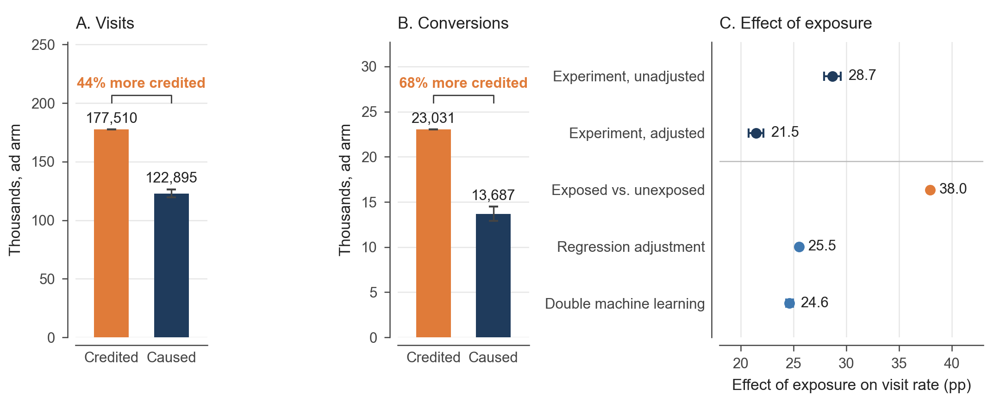

# 02a · Validating an attribution metric against a randomized experiment

> **Takeaway.** On the same experiment, exposure-based attribution credited 23,031 conversions in the ad arm, while
> the experiment puts the conversions caused by the ads at 13,687: 68% more. Attribution counts should not drive
> budget decisions without an experimental calibration. Without an experiment, covariate adjustment moved the
> per-exposed-user visit effect from a naive 38.0 points to 24.6-25.5, between the two experimental estimates (21.5
> and 28.7); this comparison cannot say how much of the bias was removed. The counts are reproduced from the raw file in
> SQL in [study 01c](../../01_with_an_experiment/01c_sql_metric_readout).

## Question

An exposure-based attribution metric credits the ad with every visit or conversion by a user who saw it. How far is
that from what the ad actually caused, and can covariate adjustment close the gap when no experiment is available?

## Data

The Criteo experiment used in [study 01a](../../01_with_an_experiment/01a_ad_incrementality): 13,979,592 users, of whom 428,212 in the ad arm
were exposed. Pass the path to `criteo-research-uplift-v2.1.csv.gz` as the first argument, or place the file as
described in study 01a.

## Method

A descriptive comparison with no decision rule.

1. **Attributed outcomes.** Visits and conversions by exposed users in the ad arm.
2. **Incremental outcomes.** The intent-to-treat effect multiplied by the number of users in the ad arm.
3. **Per-exposed-user effect on visits, three ways:** the naive exposed-minus-unexposed difference; OLS with the 12
   features as covariates (HC1 standard errors); and cross-fitted double machine learning with gradient-boosted
   nuisance models on a random 2,000,000 users.
4. **Benchmark.** The experimental effect on exposed users from study 01a, unadjusted and regression-adjusted.

## Results

Source: [`out/attribution_vs_experiment.json`](out/attribution_vs_experiment.json).

| | Exposure-attributed | Incremental (experiment) | Overstatement |
|---|---|---|---|
| Visits | 177,510 | 122,895 | 44% |
| Conversions | 23,031 | 13,687 | 68% |



| Per-exposed-user effect on visits | pp |
|---|---|
| Naive difference | 38.0 |
| OLS with covariates | 25.5 |
| Double machine learning | 24.6 |
| Experimental benchmark (unadjusted / regression-adjusted) | 28.7 / 21.5 |

- Attribution credits the ad with 44% more visits and 68% more conversions than it caused.
- The naive estimate is 9 to 17 points above the two experimental estimates (28.7 unadjusted, 21.5
  regression-adjusted); both covariate-adjusted estimates fall between them.

## Reproduce

```bash
python code/attribution_vs_experiment.py /path/to/criteo-research-uplift-v2.1.csv.gz   # about 1 minute
```

`code/attribution_vs_experiment.py` exposes the estimators as functions; `tests/test_attribution.py` checks them on
simulated data with a known effect and confounded exposure.

Study 01a must have been run first, since its output supplies the adjusted benchmark. The double machine learning
estimate can differ in the third decimal between runs because the gradient-boosting fits are multi-threaded
(24.60 and 24.63 pp in two runs).

## Scope

- Single-channel, user-level attribution: the data have one exposure flag per user and no touch paths, so this is not
  multi-touch or cross-channel attribution.
- The experimental benchmark assumes assignment affects visits only through exposure.
