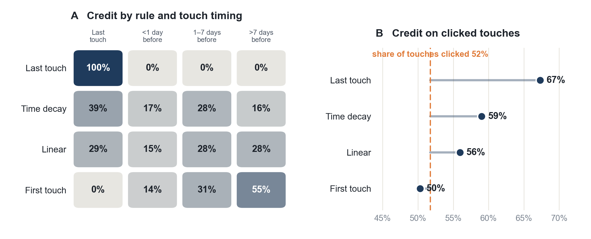

# 02b · Multi-touch attribution on 6.1M display-ad user paths

**[Explore this study interactively →](https://lyz44git.github.io/ad-measurement-and-metrics/02.html#s02b)**

> **Takeaway.** Last-touch reporting hides most of the path: 65% of converting paths have several touches, and last
> touch gives no credit to 82% of the touches in them. A time-decay rule fitted to observed touch-to-conversion delays
> leaves 39% of the credit on the last touch. These rules split credit; they do not show which touches caused the
> conversion, which needs an experiment (study 01a).

## Question

When a user sees several ads before converting, how much does the choice of credit rule change which touches get
credit? The rules split credit; none of them is validated against an experiment here.
[Study 02d](../02d_attribution_and_bidding) asks whether the choice of rule changes what a bidder buys.

## Data

Criteo Attribution Modeling for Bidding dataset ([Diemert et al. 2017](https://doi.org/10.1145/3124749.3124752), AdKDD; CC BY-NC-SA 4.0):
16,468,027 display impressions, 6,142,256 users, 675 campaigns and 30 days, with 327,860 converting users. This is
attribution across the touches of a path within one display network, not cross-channel attribution.

Download `criteo_attribution_dataset.tsv.gz` from Criteo's dataset page on Hugging Face into `data_raw/`
(git-ignored). The file labels conversions on clicked impressions only, so the per-conversion touch counts in the file
profile ([`out/00_profile.json`](out/00_profile.json)) understate path length; paths here are rebuilt from all
impressions (deviation 1).

## Method

The analysis plan, [`design/analysis_plan.md`](design/analysis_plan.md) (Part B; Part A is study 02c), was fixed before
the run; its SHA-256 is in `logs/plan_hash.txt`. Deviations are in [`design/deviations.md`](design/deviations.md).

1. **Paths.** One path per user: for converters, every impression up to the first conversion, clicked or not; for
   other users, every impression. Users are split 70/30 into training and test by a hash of the user id.
2. **Rule-based credit.** Last touch, first touch, linear, and time decay, exp(−λ × delay), with λ estimated by maximum
   likelihood from the training converters' touch-to-conversion delays.
3. **Path conversion model.** Logistic regression on counts of eight touch types (clicked or not, by recency relative
   to the last touch) and log(1 + touches), compared on test AUC with a model using the number of touches alone
   (paired user bootstrap, 500 draws).
4. **Model-based credit.** Removal effects from the path model are computed but not used in any conclusion
   (deviation 2).

## Results

Source: [`out/mta.json`](out/mta.json).

Among the 64,159 multi-touch conversions of test users (349,355 touches, 5.4 per path):

| Rule | Share of credit on the last touch | Share of credit on clicked touches |
|---|---|---|
| Last touch | 100% | 67% |
| First touch | 0% | 50% |
| Linear | 29% | 56% |
| Time decay (half-life 7.9 days) | 39% | 59% |

[](https://lyz44git.github.io/ad-measurement-and-metrics/02.html#s02b)

- 65.2% of converting paths have more than one touch, and last touch gives no credit to 81.6% of the touches in
  multi-touch converting paths. Clicked impressions are 52% of those touches.
- Moving from last touch to time decay shifts 3.6% of conversion credit between campaigns. Of the 64,159 multi-touch
  conversions of test users, 44.7% touch two or more campaigns ([`out/campaign_span.json`](out/campaign_span.json)).
- The path model separates converting from non-converting paths with test AUC 0.827, against 0.624 for the number of
  touches alone (difference 0.203, 95% CI 0.201 to 0.205).

## Reproduce

```bash
python code/load_attribution.py data_raw/criteo_attribution_dataset.tsv.gz derived out
python code/mta.py derived/criteo_attr.parquet out
python code/campaign_span_count.py derived/criteo_attr.parquet out   # added later; share of paths spanning campaigns
```

`tests/` checks the path construction, that every rule gives each conversion one unit of credit, that time decay
favors later touches, and that the decay-rate estimator recovers a known half-life on simulated delays.

## Scope

- One display network over 30 days; not cross-channel, cross-device or offline attribution.
- No impression in this file was randomized, so no rule here measures incrementality.
- Costs in the file are transformed, so no return on spend is computed.
