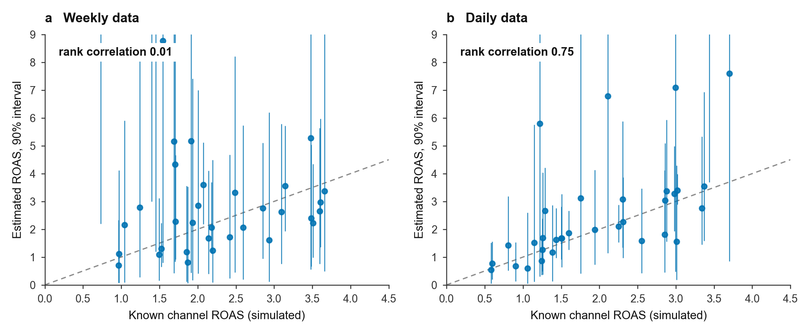
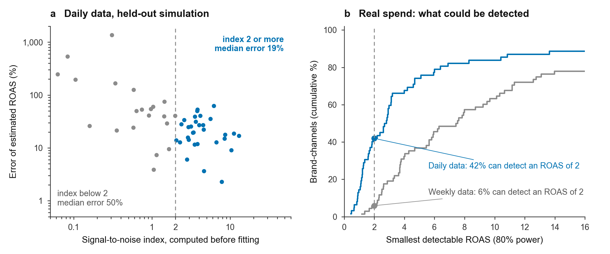

# 02c · Marketing mix models: which brands have enough signal to measure a channel's return?

> **Takeaway.** A marketing mix model recovers a channel's return only where that channel's spend moves enough on its
> own, and this can be checked before fitting. In a pre-specified test on held-out simulations with real spend,
> brand-channels with a signal-to-noise index of 2 or more were recovered within 19% (rank correlation 0.80 with the
> truth); the rest were off by 50%. Only 19% of brand-channels reach that level on weekly data, against 55% on daily
> data, and pooling the brands in one model did not help. Model ROAS should be checked this way first and calibrated
> with experiments (studies 01a and 03b) before it guides a budget.

## Questions

1. Can a marketing mix model fitted to a brand's own spend and revenue recover how much each channel returns, and
   does it forecast revenue better than a model without media?
2. Does fitting all brands in one model help?
3. Can a number computed before fitting tell which brand-channels the model can measure?

## Data

Conjura, "Multi-Region Marketing Mix Modelling (MMM) Dataset for Several eCommerce Brands" (Figshare 25314841,
CC BY 4.0): daily spend by channel and purchases for 93 anonymized e-commerce brands. Download `conjura_mmm_data.csv`
into `data_raw/` (git-ignored).

Revenue is purchases at original price minus discounts. Google spend is the sum of the five Google columns and Meta
spend the sum of the three Meta columns; TikTok (3% of rows) is left out. The data have no price, promotion calendar,
offline media or competitor information.

## Method

Each part has its own plan, fixed and hashed before that part was run (hashes in `logs/`). Parts 2 and 3 were added
after the results of the part before them had been read, and each plan states what had been seen.

**Part 1, one model per brand** ([`design/analysis_plan.md`](design/analysis_plan.md), Part A; Part B is study 02b).
The daily run is a deviation from the weekly plan, made after the weekly results were seen
([`design/deviations.md`](design/deviations.md)).

1. **Brands.** One series per brand across all territories. A brand is eligible with two years of consecutive data
   (104 weeks, or 728 days for the daily run) and Google and Meta spend above 0 in at least 80% of periods.
2. **Model.** Per brand, Bayesian (NumPyro, NUTS, 2 chains of 500 warm-up and 500 draws): trend, two annual Fourier
   harmonics (plus day of week in the daily run) and, for each channel, a coefficient on a Hill saturation curve of
   geometrically adstocked spend.
3. **Holdout.** The last 13 weeks (91 days for the daily run), scored by weighted absolute percentage error (wMAPE)
   against the same model without media and a seasonal-naive forecast. Decision rule: the media model is preferred if
   it has the lower wMAPE in more than half of the brands and the 95% bootstrap interval of the mean difference is
   below 0.
4. **Parameter recovery.** For 20 brands, real spend with simulated revenue: known channel returns drawn from
   Uniform(0.5, 4), the model refitted, and estimated returns compared with the truth.

**Part 2, all brands in one model** ([`design/followup_plan.md`](design/followup_plan.md)). The same model, with each
brand's carry-over, saturation and effect-size parameters drawn from a distribution shared across brands (partial
pooling; 4 chains of 1,000 warm-up and 1,000 draws). Recovery is tested on all eligible brands in two simulations,
one with brand-specific carry-over and saturation (primary) and one with the same shapes for every brand, against the
per-brand model fitted to the same simulated revenue. Decision rule: pooling improves recovery if its median absolute
relative error is lower and the 95% bootstrap interval of the mean difference is below 0.

**Part 3, a signal-to-noise index** ([`design/detectability_plan.md`](design/detectability_plan.md)). For each brand
and channel:

    index = sqrt(n) x SD(part of the channel's revenue contribution not explained by trend, season, day of week
            and the other channel) / SD(revenue around trend and season)

It is the t-statistic the channel's effect would have if its carry-over and saturation were known, and it needs no
model fit. The index and the threshold of 2 were suggested by the weekly simulation with brand-specific shapes and
then tested on three simulations that had not been examined: daily data with brand-specific shapes (T1, primary),
daily data with common shapes (T2) and weekly data with common shapes (T3). Predictions: the index is negatively
rank-correlated with the error of the per-brand estimate (95% interval below 0), and brand-channels with an index of 2
or more have a median error below 25% and below that of the rest.

## Results

### Part 1: one model per brand

Sources: [`out/mmm_summary.json`](out/mmm_summary.json) (weekly), [`out/mmm_summary_daily.json`](out/mmm_summary_daily.json)
(daily); per-brand tables in `out/mmm_brands*.csv` and recovery draws in `out/mmm_recovery*.csv`.

| | Weekly (plan) | Daily (deviation 1) |
|---|---|---|
| Eligible brands / converged (R-hat < 1.05) | 34 / 30 | 31 / 27 |
| Holdout wMAPE, median: media model / no media / seasonal naive | 0.19 / 0.22 / 0.32 | 0.35 / 0.38 / 0.42 |
| Media model better than no-media model | 19 of 30 | 16 of 27 |
| Mean wMAPE difference, media minus no media (95% CI over brands) | +0.012 (−0.064 to 0.102) | −0.008 (−0.118 to 0.123) |
| Recovery: rank correlation of true and estimated ROAS (converged refits) | 0.01 (18 of 20) | 0.75 (17 of 20) |
| Recovery: coverage of 90% intervals / median absolute relative error | 89% / 35% | 94% / 28% |
| Model ROAS, median across brands: Google / Meta | 4.4 / 3.5 | 3.1 / 2.7 |
| Revenue / total spend, median across converged brands | 5.9 | 6.4 |
| Media share of revenue, median across brands | 61% | 43% |



- **The pre-specified forecasting rule was not met** in either run: the interval of the mean wMAPE difference
  includes 0.
- Weekly brand-level ROAS is not recovered (0.01). Daily data make it recoverable in rank (0.75), with wide intervals.
  Model ROAS is well below revenue per unit of spend, as expected when part of revenue would occur without media.
- Moving 10% of spend toward the channel with the higher marginal return has a model-implied median gain of about 1%
  of revenue; its 90% interval is above 0 in 16 of 27 brands in the daily run. This is not validated.

### Part 2: pooling brands

Sources: [`out/mmm_pooled_summary.json`](out/mmm_pooled_summary.json),
[`out/mmm_pooled_summary_daily.json`](out/mmm_pooled_summary_daily.json), `out/mmm_pooled_recovery*.csv`.
Recovery rows cover the brand-channels converged under both models; each cell is per-brand model / pooled model.

| | Weekly | Daily |
|---|---|---|
| **Brand-specific shapes (primary):** brand-channels | 66 | 54 |
| Rank correlation of true and estimated ROAS | 0.19 / 0.20 | 0.56 / 0.53 |
| Median absolute relative error | 44% / 45% | 26% / 26% |
| Coverage of 90% intervals | 92% / 88% | 94% / 85% |
| **Common shapes:** rank correlation | 0.31 / 0.33 | 0.74 / 0.74 |
| Median absolute relative error | 57% / 48% | 26% / 31% |
| **Holdout forecast, real revenue:** pooled model better than the no-media model | 15 of 32 | 18 of 28 (fit not converged) |
| Mean wMAPE difference, pooled minus no media (95% CI over brands) | +0.045 (−0.064 to 0.167) | −0.012 (−0.106 to 0.097) (fit not converged) |

- **Neither pre-specified rule was met.** Pooling did not lower the median error or raise the rank correlation at
  either frequency. On weekly data it lowered the mean error (the 95% interval of the difference is below
  0) by shrinking a few extreme estimates, but the rule also required a lower median.
- The pooled model's 90% intervals covered the truth less often than the per-brand model's.
- With all eligible brands, the per-brand weekly model has a rank correlation of 0.19 to 0.31 with the truth, against
  0.01 in the 20-brand check of part 1. Both say that weekly ROAS is not recovered.
- The pooled fit to real daily revenue did not converge (largest R-hat 48, 322 divergent transitions), so its
  forecasts are not interpreted; the weekly fit had a largest R-hat of 1.18. The fits to simulated revenue converged
  (largest R-hat 1.01).

### Part 3: which brand-channels can be measured

Source: [`out/detectability.json`](out/detectability.json); the index of every brand-channel is in
`out/detectability.csv`. Error is the absolute relative error of the per-brand ROAS estimate.

| Simulation | Brand-channels | Rank correlation of index and error (95% CI) | Index 2 or more: share / median error / rank correlation with truth | Index below 2: median error / rank correlation with truth |
|---|---|---|---|---|
| T1: daily, brand-specific shapes (primary) | 54 | −0.49 (−0.68 to −0.24) | 61% / 19% / 0.80 | 50% / 0.35 |
| T2: daily, common shapes | 50 | −0.47 (−0.65 to −0.26) | 62% / 18% / 0.75 | 40% / 0.77 |
| T3: weekly, common shapes | 64 | −0.83 (−0.90 to −0.70) | 20% / 25% / 0.55 | 75% / 0.28 |
| Not a test: weekly, brand-specific shapes (where the index was found) | 66 | −0.72 (−0.85 to −0.53) | 20% / 17% / 0.48 | 71% / 0.15 |



- **The pre-specified rule was met.** In T1 and T2 both predictions held. In T3 the first held and the second missed
  its limit by a hair (median error 25.1% against 25%).
- **Most weekly brand-channels have too little signal.** Counting every brand-channel of the simulation with brand-specific
  shapes, 19% have an index of 2 or more on weekly data (13 of 68) and 55% on daily data (34 of 62). This, and not the model, is why weekly ROAS is not
  recovered, and why pooling does not help.
- **On real spend,** the smallest ROAS detectable with 80% power, for an assumed carry-over and saturation shape, has
  a median of 7.5 on weekly data (quartiles 3.7 to 12.8) and 2.7 on daily data (1.2 to 5.0). An ROAS of 2 could be
  detected for 6% of brand-channels on weekly data and 42% on daily data. For comparison, model ROAS on real data is
  2.7 to 4.4 and revenue per unit of total spend about 6.
- The pooled model's estimates follow the same pattern (daily, brand-specific shapes: median error 24% with an index
  of 2 or more, 52% below).

## Reproduce

```bash
pip install -r requirements-mmm.txt
python code/run_mmm.py data_raw/conjura_mmm_data.csv out W 14   # part 1, weekly (plan), about 2 minutes on 14 processes
python code/run_mmm.py data_raw/conjura_mmm_data.csv out D 14   # part 1, daily, about 2 minutes
python code/run_pooled.py data_raw/conjura_mmm_data.csv out W 12   # part 2, weekly, about 35 minutes
python code/run_pooled.py data_raw/conjura_mmm_data.csv out D 12   # part 2, daily, about 2 hours
python code/detectability.py data_raw/conjura_mmm_data.csv out     # part 3, under a minute; reads the part 2 output
```

MCMC draws depend on package versions and hardware, so numbers can differ slightly from those in `out/`; the
versions used are in `requirements-mmm.txt`.

`tests/` checks the adstock and saturation transforms, the brand eligibility rule, both recovery simulations, the data
preparation and decision rule of the pooled model, and the index and its scoring, all on synthetic data; it needs
only the root `requirements.txt`.

## Scope

- Observational: spend responds to expected demand, so model ROAS is not a causal estimate, and no experiment
  calibrates it here.
- The recovery tests are simulations on real spend. They show whether the model can recover returns of the assumed
  form, not whether real returns have that form.
- The index uses the true contribution in a simulation, which an analyst never has; on real data it rests on an
  assumed shape. It ignores uncertainty about carry-over and saturation, so it is an upper bound on what the model
  can learn.
- Two channels; no price, promotion, offline media or competitor data.
- Spend is in each brand's own currency, so totals are not compared across brands.
