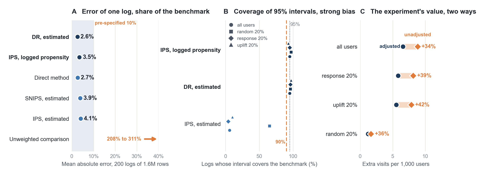

# 02e · What is a targeting policy worth before it has run?

**[Explore this study interactively →](https://lyz44git.github.io/ad-measurement-and-metrics/02.html#s02e)**

> **Takeaway.** Yes, it can be read from a biased log, if the log is large enough. On logs of about 1.6 million rows
> that favor likely visitors, so that an unweighted comparison gives 3 to 4 times the lift, the doubly robust
> estimator (DR) with an estimated probability of assignment is off by 2.5% to 2.7% of a feature-adjusted
> experimental benchmark in a single log, and inverse probability weighting (IPS) with the logged probability by 3.0%
> to 3.9%, for each of three targeting policies; their 95% intervals cover the benchmark in 97.5% to 99% of logs. Both
> pre-specified rules were met. Under a stronger bias DR stays within 5% to 6%, while IPS with an estimated
> probability falls 29% to 35% short and its intervals almost never cover the benchmark. Two earlier designs, with
> logs of about 108,000 rows, did not meet their rules; why is below.

## Question

A team wants to know how many extra visits a new rule for choosing which users may be shown ads would bring, but it
has only the log of the current rule, which favored users who were already likely to visit. In that log the outcome
under the new rule is never observed for the users the two rules treat differently. How close do off-policy
estimates computed from such a log come to the value the randomized experiment gives for the same rule?
[Study 02a](../02a_attribution_metric_validation) checks a count of past conversions against the experiment; this
study checks an estimate of what a rule that has not run would bring.

## Data

Criteo Uplift Prediction Dataset v2.1, the experiment of [study 01a](../../01_with_an_experiment/01a_ad_incrementality):
13,979,592 rows, outcome `visit`. A random 30% of rows (4,192,415) fits the policies' models and an assignment
model; the other 70% is the pool that the logs are drawn from and the benchmark is computed on. Rows of the pool whose
estimated assignment probability lies outside its 0.5th to 99.5th percentile are dropped, which leaves 9,689,305
rows. Pass the path to `criteo-research-uplift-v2.1.csv.gz`.

## Method

The plan of this design, [`design/analysis_plan_v3.md`](design/analysis_plan_v3.md), was fixed after the two earlier
designs and a calculation of the attainable precision, and before any log of this design was drawn (SHA-256 in
`logs/plan_v3_hash.txt`).

1. **Policies.** Assign to ads: every user; the top 20% by a response model P(visit | X); the top 20% by a
   T-learner's predicted uplift; a fixed random 20%. LightGBM, fitted on the model part.
2. **Assignment model.** In this pooled release the probability of assignment varies slightly with the features
   (held-out ROC AUC 0.509). A LightGBM model r̂(x) of it is fitted on the model part; on the trimmed pool it lies
   between 0.83 and 0.92.
3. **Benchmark.** The lift of each policy over assigning nobody, in extra visits per 1,000 users, by AIPW on the whole
   pool with r̂(x) and cross-fitted outcome models. It is an estimate from the experiment, not a known value. The logs
   are drawn from the same rows, so the pool's own sampling error does not enter the comparison.
4. **Logs.** Rejection sampling from the experiment (Gentzel, Pruthi and Jensen 2021): every row of the pool is kept,
   a treated row with probability c · e(x) / r̂(x) and a control row with probability c · (1 − e(x)) / (1 − r̂(x)).
   If r̂(x) is the assignment probability, the probability of assignment among kept rows is
   e(x) = sigmoid(β · z(x)), clipped to [0.02, 0.98], where z is the standardized logit of the response model: likely
   visitors are more often assigned. Three settings: mild (β = 0.1), moderate (β = 0.25) and strong (β = 1); 100, 200
   and 100 logs.
5. **Precision calculated before the run.** For each setting, the expected rows of a log and the standard error that
   IPS with the logged propensity would have on one log follow from the pool without drawing a log
   ([`code/design_calc_v3.py`](code/design_calc_v3.py)). In the moderate setting: about 1.65 million rows and a mean
   absolute error of 3.9% to 4.4% for the three larger policies and 10.2% for the random 20% policy.
6. **Estimators.** An unweighted comparison of the rows whose logged assignment agrees with the policy with the rows
   assigned to no ads; the direct method (DM, outcome models only); IPS and DR with the logged e(x); IPS,
   self-normalized IPS (SNIPS) and DR (Dudík, Langford and Li 2011) with a propensity model fitted on the log. Outcome
   and propensity models are LightGBM with 300 trees, cross-fitted in two folds. 95% normal intervals from per-row
   contributions.
7. **Decision rules (moderate setting; all users, response 20% and uplift 20%).** (1) IPS with the logged propensity
   and (2) DR with an estimated propensity, the primary rule, each have a **mean absolute error of one log** below 10%
   of the benchmark and 95% interval coverage of at least 90%. The random 20% policy is reported and not part of the
   rules: its lift is a fifth of the others and its calculated error was 10.2%, at the threshold itself.

## Results

Sources: [`out/ope_v3.json`](out/ope_v3.json), [`out/design_calc_v3.json`](out/design_calc_v3.json); every estimate
of every log is in `out/ope_v3_logs.csv`.

**Benchmark** (extra visits per 1,000 users):

| Policy | AIPW with r̂ (benchmark, SE) | IPS with r̂ | Unadjusted |
|---|---|---|---|
| All users | 6.58 (0.15) | 6.43 | 8.83 (+34%) |
| Response model 20% | 5.84 (0.14) | 5.70 | 8.15 (+39%) |
| Uplift model 20% | 5.54 (0.12) | 5.48 | 7.85 (+42%) |
| Random 20% | 1.21 (0.07) | 1.15 | 1.65 (+36%) |

The unadjusted value, which takes the assignment share as the same for every user, is 34% to 42% higher: in this
release a slightly uneven assignment share among the most likely visitors moves it, as study 01a's gap between its
unadjusted and adjusted effects (1.03 against 0.77 points) also shows.

**Moderate setting** (logs of 1.65 million rows, half of them assigned to ads). In each cell, the mean error over 200
logs and the mean absolute error of one log, as shares of the benchmark; then coverage of the 95% intervals for the
three policies of the rules:

| Estimator | All users | Response 20% | Uplift 20% | Random 20% | Coverage |
|---|---|---|---|---|---|
| Unweighted comparison | +311% / 311% | +272% / 272% | +208% / 208% | +334% / 334% |  |
| Direct method | +1% / 2.9% | 0% / 2.9% | 0% / 2.3% | +10% / 9.8% |  |
| **IPS, logged propensity** | **−2% / 3.6%** | **−3% / 3.9%** | **−1% / 3.0%** | −5% / 8.9% | **97.5% to 99.0%** |
| DR, logged propensity | 0% / 2.6% | 0% / 2.7% | 0% / 2.4% | +1% / 6.6% | 98.0% to 98.5% |
| **DR, estimated propensity** | **0% / 2.6%** | **0% / 2.7%** | **0% / 2.5%** | +1% / 6.7% | **98.0% to 98.5%** |
| SNIPS, estimated propensity | −3% / 3.6% | −4% / 4.2% | −4% / 4.0% | −5% / 8.8% |  |
| IPS, estimated propensity | −3% / 3.8% | −4% / 4.3% | −4% / 4.0% | −6% / 9.4% | 96.5% to 98.0% |

- **Both pre-specified rules were met.** The mean absolute error of one log is 3.0% to 3.9% for IPS with the logged
  propensity, close to the 3.9% to 4.4% calculated before the run, and 2.5% to 2.7% for DR with an estimated
  propensity. Coverage is 97.5% to 99%.
- **Coverage is above the nominal 95%.** Each log holds about 17% of the pool and the benchmark is computed on the
  whole pool, so a log's error and the benchmark's share part of the sampling noise; the intervals, which allow for
  all of it, are therefore conservative here.
- **The random 20% policy**, outside the rules, is off by 6.7% (DR) and 8.9% (IPS) in one log: its lift is 1.2 visits
  per 1,000, a fifth of the others, on the same noise.
- **Ranking the three 20% policies** in the benchmark's order: DR in 100% of logs, IPS with the logged propensity in
  92%, the unweighted comparison in 100%, because it ranks policies by how likely to visit the users they treat are,
  which happens to be the order here.

**Strong setting** (logs of 1.36 million rows; the unweighted comparison is 6.7 to 10.5 times the benchmark):

| Estimator | Mean error | Mean absolute error, one log | Coverage |
|---|---|---|---|
| IPS, logged propensity | −1% to −3% | 6.6% to 8.0% | 93% to 95% |
| **DR, estimated propensity** | **+1%** | **5.2% to 5.7%** | **95% to 97%** |
| Direct method | +7% to +10% | 7.3% to 10.0% |  |
| SNIPS, estimated propensity | −26% to −32% | 25.6% to 31.6% |  |
| IPS, estimated propensity | −29% to −35% | 28.6% to 35.3% | 4% to 10% |

(three larger policies). The stronger the bias of the log, the more an estimate depends on having either the
recorded probability or an outcome model. IPS with an estimated probability is close in the moderate setting and
fails here: among untreated rows that were very likely to be assigned, the weight 1/(1 − ê) is convex in the
estimate, so small errors in ê near 1 raise the weights of untreated likely visitors, overstate the visit rate without
ads and shrink the lift. DR's outcome model carries most of the estimate where those weights are unreliable.

**Mild setting** (100 logs, the unweighted comparison 1.9 to 2.3 times the benchmark): every weighted estimator and DM
are within 2.1% to 3.9% for the three larger policies.

[](https://lyz44git.github.io/ad-measurement-and-metrics/02.html#s02e)

## How this design came about

**First design** ([`design/analysis_plan.md`](design/analysis_plan.md); results in [`out/ope.json`](out/ope.json)).
It built logs as if every user had been assigned with probability 0.85 and took the unadjusted lift as the benchmark.
Its rule, a mean bias of DR within 10% with 90% coverage, was not met: DR was 32% to 35% below that value. Two
follow-ups, each planned and hashed before it ran ([`design/followup_plan.md`](design/followup_plan.md),
[`design/followup_plan_2.md`](design/followup_plan_2.md); [`out/followup.json`](out/followup.json),
[`out/followup2.json`](out/followup2.json)), found that the propensity model was well calibrated, that a model of
assignment on the features has a held-out AUC of 0.509 and that the feature-adjusted lift of every policy is 28% to
32% below the unadjusted one. The constant 0.85 was therefore not the logging probability.

**Second design** ([`design/analysis_plan_v2.md`](design/analysis_plan_v2.md); [`out/ope_v2.json`](out/ope_v2.json),
[`out/ope_v2_accuracy.json`](out/ope_v2_accuracy.json)). It built the logs and the benchmark on r̂(x). On average
over 200 logs IPS with the logged propensity was within 3% of the benchmark and DR within 6%, but a single log was
off by 22% to 53%, so its rules, a mean absolute error below 10%, were not met. The code had compared the absolute
mean error instead ([`design/erratum.md`](design/erratum.md)). Three faults, none in the estimators:

1. The logs were too small for the rule. A log kept 5.4% of 2,000,000 candidate rows, about 108,000, because the
   experiment assigns only 15% of users to control and a few rows with an extreme r̂ capped the keep constant. At that
   size IPS has a standard error of about a quarter of the lift, so no single log could be within 10%. The attainable
   precision had not been calculated before the rule was written.
2. Its "moderate" setting overstated the lift about tenfold in the unweighted comparison; it is this design's strong
   setting.
3. The rule's wording and the code named different quantities.

**This design** fixes the three: every row of the trimmed pool is a candidate, the precision is calculated before the
rule is set, two milder settings are added, and the code compares the quantity the plan names, with the functions
written for the erratum. It was planned with the results of the first two designs known and is drawn from the same
experiment, so it is a third design on data already seen, not an independent replication. After the run, the
"unadjusted" column of the benchmark was found to have been computed as an unweighted comparison rather than as the
policy value with a constant assignment share; [`code/fix_unadjusted_v3.py`](code/fix_unadjusted_v3.py) recomputes it
and keeps the first value in the result file. No estimate or rule uses that column.

In a sensitivity check on 20 logs of the first design, not committed, keeping identical rows in one cross-fitting fold
gave the same bias, so the file's duplicate rows (study 01c: 16% of rows have an exact twin) are an unlikely cause.
One deviation from the first plan, made on simulated data before the Criteo file was read, is in
[`design/deviations.md`](design/deviations.md): the nuisance models use 300 trees, not 100.

## Reproduce

```bash
python code/design_calc_v3.py /path/to/criteo-research-uplift-v2.1.csv.gz out    # precision before the run, 2 minutes
python code/run_ope_v3.py /path/to/criteo-research-uplift-v2.1.csv.gz out        # this design, about an hour on 32 cores
python code/fix_unadjusted_v3.py /path/to/criteo-research-uplift-v2.1.csv.gz out # the unadjusted column, 2 minutes
python code/run_ope_v2.py /path/to/criteo-research-uplift-v2.1.csv.gz out        # second design, about 25 minutes
python code/accuracy_from_logs.py out                                            # second design's single-log errors
python code/run_ope.py /path/to/criteo-research-uplift-v2.1.csv.gz out           # first design, about 10 minutes
python code/run_followup.py /path/to/criteo-research-uplift-v2.1.csv.gz out      # first follow-up, about 20 minutes
python code/run_followup2.py /path/to/criteo-research-uplift-v2.1.csv.gz out     # second follow-up, about 6 minutes
```

`tests/` checks on simulated experiments that the policy value from the experiment recovers a known lift, that logs
have the intended propensity and the experiment's feature distribution (for both samplers), that IPS and DR recover
the lift where the unweighted comparison does not, that a propensity model with too few trees is compressed toward
0.5, that when the assignment share varies with the features a constant-share benchmark is biased while AIPW with the
true share and logs built on it are not, and that a mean error near zero does not imply a small mean absolute error.

## Scope

- The logs are built from a randomized experiment, so every confounder is among the features; a real log need not
  have that property, and an estimated propensity is then likely to do worse, not better.
- The benchmark and the logs both rest on the estimated assignment probability r̂(x). The agreement of AIPW and IPS
  with r̂ and the small error of IPS with the logged propensity support it; neither is a known population value.
- The accuracy figures are for logs of 1.4 to 1.6 million rows. With about 108,000 rows (second design) one log was
  off by 22% or more; the error of one log scales roughly with one over the square root of its size.
- A policy here chooses who may be assigned to ads, not which ad or what bid; only 3.6% of the ad arm saw an ad, so the
  lift per assigned user is small next to the visit rate.
- One display network; absolute visit rates are not population rates because of the data's subsampling.
