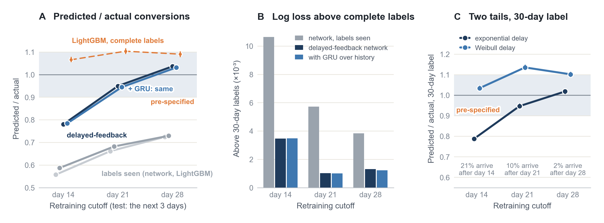

# 02f · Can a conversion model trained before its labels arrive be corrected for the delay?

**[Explore this study interactively →](https://lyz44git.github.io/ad-measurement-and-metrics/02.html#s02f)**

> **Takeaway.** Partly. Across three cutoffs, two models retrained on the conversions seen by the cutoff predict 27%
> to 44% too few, because recent impressions whose conversions are still to come count as failures. A delayed-feedback
> network (Chapelle 2014) in PyTorch brings predicted over actual conversions to 0.95 and 1.04 when retrained on days
> 21 and 28 and to 0.78 on day 14, so the pre-specified rule, which required all three cutoffs, was not met. At day 14
> no impression has been followed for longer than 14 days, while 21% of conversions take longer, and the forecast
> depends on how the model extrapolates: a heavier-tailed delay is within 4% there and 10% to 14% too high later.
> ROC AUC changes little across models (0.77 to 0.80); what moves is the level of the probabilities, which a bid is
> priced on. Adding a GRU over each user's last 20 impressions did not measurably improve log loss.

## Question

The bidders of [study 02d](../02d_attribution_and_bidding) price impressions with a model of expected credit, trained
there on complete labels. A conversion model retrained every day must learn from recent impressions whose conversions have not happened yet,
so its training labels count late converters as non-converters. How much does this bias its predictions, and can a
model of the delay correct it? The log records every conversion up to 30 days after each impression, so the labels a
model could not see at the time can be used to score it.

## Data

Criteo Attribution Modeling for Bidding dataset, the log of studies
[02b](../02b_multi_touch_attribution) and [02d](../02d_attribution_and_bidding):
16,468,027 impressions of 675 campaigns over 31 days, with conversions recorded up to day 61. 4.9% of impressions are
followed by a conversion within 30 days; the delay has a median of 3.7 days and a 90th percentile of 21 days. Pass
the path to the `criteo_attr.parquet` file written by study 02b's `code/load_attribution.py`.

## Method

The analysis plan, [`design/analysis_plan.md`](design/analysis_plan.md), was fixed before any model was fitted
(SHA-256 in `logs/plan_hash.txt`). The results of studies 02b and 02d and a profile of the delays were known.

1. **Cutoffs.** Models are retrained at days 14, 21 and 28 on the impressions before the cutoff, with the label as
   seen at the cutoff, and scored on the next three days of impressions against their 30-day labels.
2. **Features known when the impression is bought** (as in 02d): campaign, time since the user's last click, number
   of the user's earlier impressions and clicks, time since the previous impression, hour of day.
3. **Five models.** LightGBM on the labels seen; a PyTorch network (campaign embedding and two hidden layers) on the
   labels seen; the same network as a **delayed-feedback model**, which predicts the conversion probability and an
   exponential delay rate and is fitted by maximum likelihood with each impression's elapsed time as censoring; the
   delayed-feedback model with a **GRU over the user's last 20 impressions**; and LightGBM on the 30-day labels, which
   no real system has at the cutoff (the reference).
4. **Metrics.** Predicted over actual conversions, log loss, ROC AUC and PR AUC, with 95% intervals from 200
   bootstrap draws of test users.
5. **Decision rules.** (1) The delay model corrects the bias if at all three cutoffs its ratio is within 0.90 to 1.10
   and its log loss is below the naive network's. (2) The history adds to the delay model if at all three cutoffs the
   GRU version's log loss is lower, with the interval of the difference below zero.

Networks: Adam, learning rate 0.001, batch size 8,192, three epochs, Apple MPS backend.

## Results

Source: [`out/delay.json`](out/delay.json).

| Cutoff | Training impressions | Conversion share seen at the cutoff / within 30 days | Test impressions |
|---|---|---|---|
| Day 14 | 7,776,135 | 2.86% / 4.81% | 1,505,551 |
| Day 21 | 11,405,791 | 3.34% / 4.90% | 1,597,224 |
| Day 28 | 15,046,374 | 3.64% / 4.88% | 1,421,653 |

**Predicted over actual conversions on the next three days** (95% interval):

| Model | Day 14 | Day 21 | Day 28 |
|---|---|---|---|
| LightGBM, labels seen | 0.557 | 0.661 | 0.724 |
| Network, labels seen | 0.587 | 0.682 | 0.729 |
| **Delayed-feedback network** | **0.780 (0.774 to 0.788)** | **0.950 (0.941 to 0.959)** | **1.036 (1.026 to 1.045)** |
| Delayed-feedback network with GRU | 0.784 | 0.945 | 1.031 |
| LightGBM, 30-day labels (reference) | 1.066 | 1.104 | 1.090 |

**Log loss** (lower is better), and the share of the gap between the naive network and the reference that the delay
model closes:

| Model | Day 14 | Day 21 | Day 28 |
|---|---|---|---|
| Network, labels seen | 0.1836 | 0.1736 | 0.1725 |
| Delayed-feedback network | 0.1765 | 0.1689 | 0.1700 |
| LightGBM, 30-day labels | 0.1730 | 0.1679 | 0.1687 |
| Gap closed | 67% | 82% | 66% |

- **The first pre-specified rule was not met** because of day 14. The delay model beats the naive network at every
  cutoff (log-loss difference −0.0072, −0.0047 and −0.0025, all intervals below zero) and is within the 0.90 to 1.10
  band on days 21 and 28, but not on day 14 (0.78). With two weeks of data no impression has been observed for longer
  than 14 days, and the exponential delay, fitted to what can be seen, has to extrapolate the long tail of delays.
- **The second rule was not met.** The GRU version's log loss is within 0.0001 of the delay network's at every
  cutoff, with intervals that include zero: no improvement was detected. The histories of this log are short (2.7
  impressions per user), and counts and recency are already among the features.
- **Ranking changes little.** ROC AUC is 0.779 to 0.791 for the naive network, 0.783 to 0.791 for the delay
  model and 0.790 to 0.797 for the reference. The models differ mainly in the level of their predictions, which is
  what a bid or a forecast uses.
- **The reference over-predicts too**, by 7% to 10%, although it is trained on complete labels. The test impressions
  therefore differ from the training ones in ways that the delay does not explain; the source is not isolated here.

[](https://lyz44git.github.io/ad-measurement-and-metrics/02.html#s02f)

## Follow-ups: what two weeks of data cannot show

Two follow-up plans were written after the main results and hashed before they ran
([`design/followup_plan.md`](design/followup_plan.md), [`design/followup_plan_2.md`](design/followup_plan_2.md)).
Sources: [`out/followup.json`](out/followup.json), [`out/followup2.json`](out/followup2.json).

**What the data can show.** At a cutoff of T days no training impression has been watched for more than T days, so
conversions that take longer are never seen and every model has to extrapolate them. At day 14 that is 21% of the
conversions in the log:

| Cutoff | Share of 30-day conversions arriving later than the cutoff | Delay network's shortfall (1 − ratio) |
|---|---|---|
| Day 14 | 20.7% | 22.0% |
| Day 21 | 9.9% | 5.0% |
| Day 28 | 2.0% | −3.6% |

The two columns are measured on different impressions: the first on every conversion of the log, the second on the
three test days. They are close at day 14 and not elsewhere; at day 28 the model predicts too many although 2% of
conversions still arrive later. The table shows how much of the outcome lies beyond what could be observed at each
cutoff. It does not show that this share is the cause of the shortfall. For scale, 41% of the conversions that the
day-14 training impressions would have within 30 days had not arrived by the cutoff (2.86% seen against 4.81%).

**A heavier-tailed delay.** The first follow-up replaced the exponential delay with a Weibull delay. As pre-specified,
it scored p(x), the probability of a conversion at any time, and predicted 2.0 to 3.5 times the actual conversions:
the fitted Weibull (shape about 0.4, scales of 100 days or more) puts most conversions after day 30, which the 30-day
label does not count. The pre-specified rule was not met. The prediction for a 30-day label is p(x) · F(30), the
probability of converting within 30 days, and the second follow-up scored that for both networks:

| Cutoff | Exponential delay | Weibull delay | Training loss, exponential / Weibull |
|---|---|---|---|
| Day 14 | 0.788 (0.781 to 0.796) | **1.034 (1.026 to 1.044)** | 0.146 / 0.112 |
| Day 21 | **0.947 (0.938 to 0.956)** | 1.135 (1.125 to 1.146) | 0.182 / 0.144 |
| Day 28 | **1.018 (1.008 to 1.027)** | 1.101 (1.091 to 1.112) | 0.208 / 0.169 |

Predicted over actual 30-day conversions, 95% intervals. The better ratio at each cutoff is in bold; the paired
differences in calibration error and log loss exclude zero at every cutoff.

- **No delay distribution wins everywhere.** With two weeks of data the heavier tail is within 4%; with three or four
  weeks the exponential is closer. The Weibull fits the delays seen in training better at every cutoff and still
  over-predicts by 10% to 14% when more of the tail is visible. How well a model fits what it has seen does not tell
  which tail is right for what it has not.
- **The exponential network's p(x) is its 30-day prediction to within 2%** (F(30) of 0.98 or more), so the main
  results stand. Across the runs reported here its day-14 ratio ranged from 0.770 to 0.788. The network's initial
  weights are drawn before the seed is set and training ran on the MPS backend, so runs are not identical; the
  source of the variation is not isolated.
- In practice the tail comes from history: a system retrained daily would fit the delay distribution on impressions
  old enough for their labels to be complete, which a one-month log cannot provide at day 14.

## Reproduce

```bash
python code/run_delay.py /path/to/derived/criteo_attr.parquet out    # about 25 minutes on an Apple M3 Ultra (MPS)
python code/run_followup.py /path/to/derived/criteo_attr.parquet out   # first follow-up, about 9 minutes
python code/run_followup2.py /path/to/derived/criteo_attr.parquet out  # second follow-up, about 7 minutes
```

`tests/` checks on small simulated logs that features and histories use only earlier impressions, that labels
after the cutoff are hidden, that the delayed-feedback loss matches its formula, that the delay model removes the
under-prediction that a naive model has when delays are exponential, and that the grouped ROC and PR AUC match
scikit-learn with ties and weights.

## Scope

- One display network and a 30-day window. The label is any conversion by the user within 30 days of the impression;
  nothing here concerns what the ads caused.
- The exponential delay is the published choice. A more flexible delay distribution (Yoshikawa and Imai 2018) is a
  candidate, but with a two-week window any model still has to assume the delays it cannot see; testing a tail
  needs impressions whose labels are complete, from an earlier period.
- The study checks the calibration of a forecast. It does not test whether a bidder using the corrected model would
  buy better.
- Retraining is simulated at three cutoffs on one month of data, not run as a production system.
