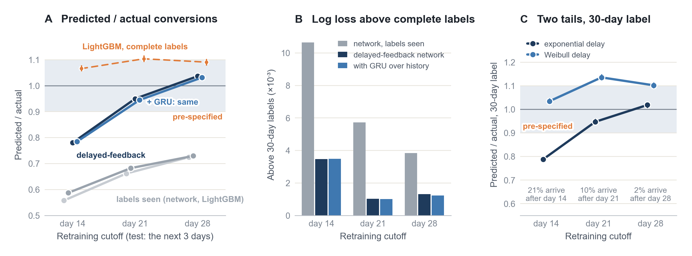

# 2. Without an experiment: when can the usual metrics be trusted?

**[Explore these studies interactively →](https://lyz44git.github.io/ad-measurement-and-metrics/02.html)**

Studies 02a and 02c check a metric used in place of an experiment against a benchmark: the experiment of
[study 01a](../01_with_an_experiment/01a_ad_incrementality), or a simulation with known returns. Study 02b shows how
much the credit given to each touch depends on the rule chosen, and study 02d whether that changes what a bidder
buys; these two have no benchmark. Study 02e checks estimates of what a new targeting
rule would bring against a benchmark from the experiment, and study 02f checks conversion forecasts made before the
labels arrive against the labels that arrive later.

| Study | Question | Key result |
|---|---|---|
| [`02a_attribution_metric_validation`](02a_attribution_metric_validation) | Can an exposure-based attribution metric be trusted as a measure of ad impact? | It credited 23,031 conversions where the experiment puts those caused by the ads at an estimated 13,687 (unadjusted; about 11,902 after regression adjustment) (68% more than the unadjusted estimate; 44% more for visits). Without an experiment, covariate adjustment moved the per-exposed-user effect from a naive 38.0 points to 24.6-25.5, between the two experimental estimates (21.5 regression-adjusted, 28.7 unadjusted); these are associations within the ad arm and the experimental figures are complier effects, so the band is descriptive, not a bound. |
| [`02b_multi_touch_attribution`](02b_multi_touch_attribution) | When a user sees several ads before converting, how much does the credit rule change which touch gets credit? | On 6.1M display-ad user paths, 65% of converting paths had several touches and last touch gave no credit to 82% of the touches in them; a time-decay rule fitted to observed delays (half-life 7.9 days) left 39% of the credit on the last touch. |
| [`02c_marketing_mix_modeling`](02c_marketing_mix_modeling) | Can a marketing mix model recover each channel's return from a brand's own spend and revenue, and can one tell in advance when it will? | In simulations on the real spend of 31 to 34 e-commerce brands, recovery depended on a signal-to-noise index computed from the planted contribution before the marketing mix model is fitted (a simulation diagnostic): in a pre-specified held-out test, the median error of a channel's estimated return was 19% for brand-channels with an index of 2 or more (rank correlation 0.80 with the truth) and 50% for the rest. Only 19% of brand-channels reach that level in the weekly simulation, against 55% in the daily one, which also differs in planted returns, noise and carry-over. Pooling the brands in one model did not help, and media terms did not reliably improve holdout forecasts. |
| [`02d_attribution_and_bidding`](02d_attribution_and_bidding) | If a bidder values impressions by expected credit, does the attribution rule change what it buys? | Hardly: in a replay on 4.6M logged impressions with their prices, a last-touch bidder and a time-decay bidder share 90% of their spend at half the logged budget, where bidding with the other rule's model costs at most 2.2% of credit (3.1% at a quarter of the budget). The pre-specified 5% threshold was not met. |
| [`02e_off_policy_evaluation`](02e_off_policy_evaluation) | What is a targeting policy worth before it has run? | On 200 logs that favor likely visitors, the mean of inverse probability weighting with the logged assignment probability is within 3% of a feature-adjusted benchmark from the experiment for four policies, and that of the doubly robust estimator with an estimated probability within 6%, with 94% to 97% interval coverage. One log of about 108,000 rows is off by 22% to 53% on average, so the accuracy rules of the plan (mean absolute error below 10%) were not met. With an estimated probability, inverse weighting loses 67% to 83% of the lift; an unweighted comparison gives 6 to 10 times the benchmark. A first design that assumed a constant assignment share also missed its rule, and why is part of the result. |
| [`02f_delayed_conversions`](02f_delayed_conversions) | Can a conversion model trained before its labels arrive be corrected for the delay? | Partly: across three cutoffs, two models trained on the conversions seen by the cutoff predict 27% to 44% too few. A delayed-feedback network in PyTorch brings predicted over actual conversions to 0.95 and 1.04 at days 21 and 28 and to 0.78 at day 14, so the pre-specified rule was not met. At day 14 no impression has been followed for longer than 14 days, 21% of conversions take longer, and the forecast depends on the assumed tail. Adding a GRU over the user's recent impressions did not measurably improve log loss. |

## Main figure of each study

**[02a · Validating an attribution metric against a randomized experiment](02a_attribution_metric_validation)**

**[02b · Multi-touch attribution on 6.1M display-ad user paths](02b_multi_touch_attribution)**

**[02c · Marketing mix models: which brands have enough signal to measure a channel's return?](02c_marketing_mix_modeling)**

Study 02d has no figure; the results are the tables in the study's README.

**[02e · Off-policy evaluation against a randomized experiment](02e_off_policy_evaluation)**

**[02f · Conversion models before the labels arrive](02f_delayed_conversions)**

Method, data, decision rules and limitations are in each study's README; the four questions are introduced in
the [main README](../README.md).
