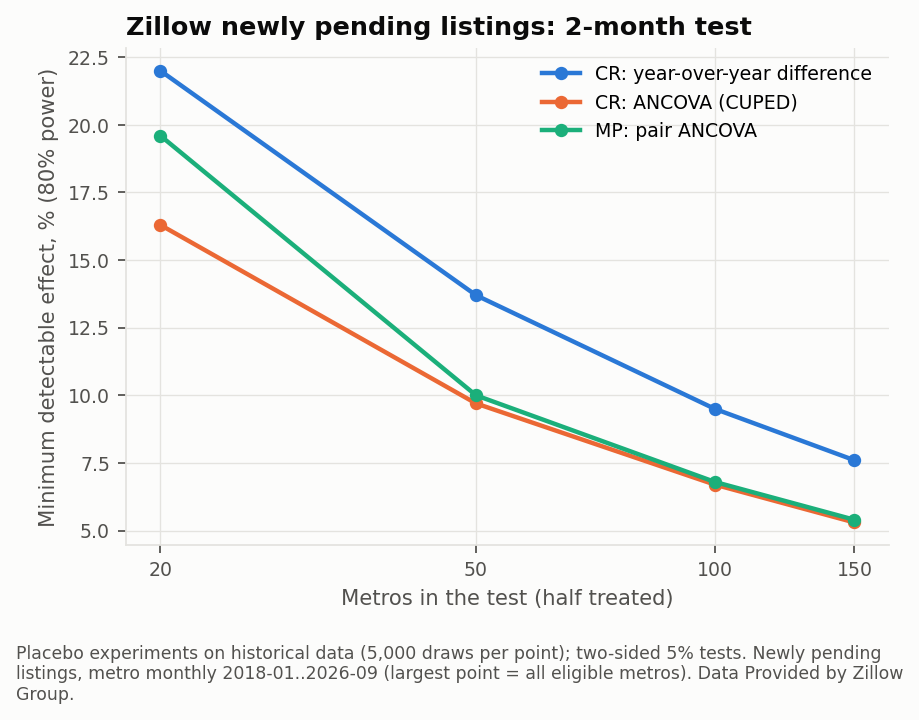

# 03 · Sizing market-level (geo) experiments

> **Takeaway.** Analyze market-level tests with regression adjustment on pre-period volume rather than year-over-year
> growth (detectable effect 6.7% against 9.5% at 100 metros), plan for effects of 5% or more, skip matched pairs, and
> use randomization inference when the target is total volume.

## Question

When a change can only be randomized by market (metro), for example because prices or processes are set per market,
how many metros and months does a test need? Which design detects the smallest effect, and does the usual t-test keep
its 5% false-positive rate?

## Data

Zillow Research public data: newly pending listings, metro level, monthly, 2018-01 to 2026-09. Data Provided by
Zillow Group. Download `Metro_new_pending_uc_sfrcondo_month.csv` from zillow.com/research/data; the file is not stored
in this repository.

Of 900 metros with data, 372 have complete series and 158 meet the size threshold. Seven with coverage breaks are
dropped ([`out/coverage_breaks.csv`](out/coverage_breaks.csv)), leaving 151 metros that account for 62% of all
volume ([`out/pool_summary.csv`](out/pool_summary.csv)).

## Method

Placebo experiments on historical data; no real experiment is run.

1. **Null draws.** Each draw picks a start month and N metros and assigns half to treatment. With no true effect, the
   share of draws that reject at 5% is the false-positive rate.
2. **Power.** Adding a known lift to the treated metros gives power; the minimum detectable effect (MDE) is the
   smallest lift detected with 80% power in a two-sided 5% test.
3. **Grid.** 5,000 draws per cell, for 1-, 2- and 3-month tests with 20, 50, 100 and 150 metros.
4. **Designs compared.** Difference in means; year-over-year difference; regression adjustment on the same months a
   year earlier and the last three months (ANCOVA, the idea behind CUPED); a volume-weighted version; and the same
   estimators within matched pairs of metros.
5. **Inference check.** For the two regression-adjusted estimators, randomization inference (2,000 draws for
   2-month tests, 199 re-randomizations each) alongside the t-test.

## Results

Sources: [`out/design_summary.csv`](out/design_summary.csv),
[`out/randomization_inference_check.csv`](out/randomization_inference_check.csv).

Minimum detectable effect with 80% power, 2-month test:

| Design | 20 metros | 50 | 100 | 150 |
|---|---|---|---|---|
| Year-over-year difference | 22.0% | 13.7% | 9.5% | 7.6% |
| Regression-adjusted (ANCOVA / CUPED) | 16.3% | 9.7% | 6.7% | 5.3% |
| Matched pairs, regression-adjusted | 19.6% | 10.0% | 6.8% | 5.4% |

- **Regression adjustment is the main gain.** At 100 metros it lowers the MDE from 9.5% under a year-over-year
  comparison to 6.7%. A plain difference in levels cannot detect even a 50% change, because metros differ in size.
  The user-level counterpart, adjustment for user features, is in [study 08](../08_lift_study_sizing).
- **Market tests detect only large effects:** 5.3% with all 150 metros, 16.3% with 20.
- **Matched pairs add nothing once the estimate is adjusted**, and cost degrees of freedom with few metros.
- **Longer tests help little:** 1, 2 and 3 months give 7.2%, 6.7% and 6.4% at 100 metros, because metro-level shocks
  persist from month to month.
- **The volume-weighted estimate needs a different test.** Weighting metros by volume (the lift in total volume) makes
  the t-test reject a true null in 5.7% to 9.1% of 2-month tests, worst with few metros, because a few large metros
  dominate. Randomization inference keeps the rate between 4.2% and 5.8%, at the cost of a larger MDE (8.8% at 100
  metros).



## Reproduce

```bash
python code/geo_experiment_power.py /path/to/Metro_new_pending_uc_sfrcondo_month.csv   # about 20 seconds
```

The script is seeded; a re-run reproduces `out/` exactly. `tests/test_geo_power.py` runs the same simulation on
synthetic panels.

## Scope

- Simulation on historical data, not a real experiment.
- Assumes no interference between markets; the outcome is listing volume only.
