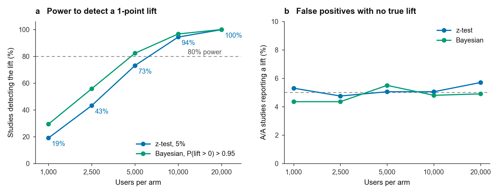
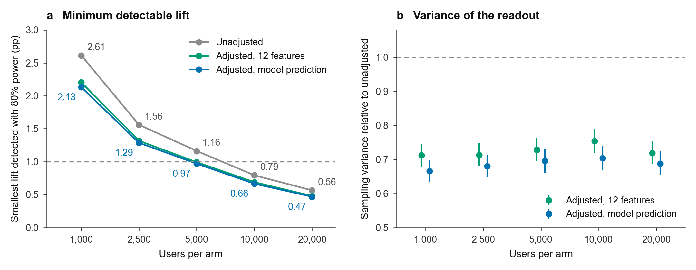

# 03a · Sizing user-level lift studies, with and without covariate adjustment

> **Takeaway.** An unadjusted readout needs about 6,500 users per arm to detect a one-point lift on a 3.8% base rate
> with 80% power: power is 19% at 1,000 per arm, 73% at 5,000 and 94% at 10,000. Adjusting the readout for a model
> prediction of the outcome, built from user features recorded before the ad, cuts its sampling variance by about 31%
> and the required sample to about 4,400 per arm, with false-positive rates still near 5%.

## Question

Lift studies that survey users, such as brand-lift studies, run on a few thousand respondents per arm. How often
would a study of that size detect a real effect of about one point, how often would it report one that is not there,
and how much smaller can the study be if the readout adjusts for what is known about each user beforehand?

## Data

The Criteo experiment used in [study 01a](../../01_with_an_experiment/01a_ad_incrementality): 13,979,592 users, visit rate 3.82% in the control
arm and 4.85% in the ad arm. Site visit stands in for the survey response. No survey data are used. Part 1 needs only
the arm sizes and visit counts ([study 01b](../../01_with_an_experiment/01b_bayesian_segment_effects) writes them to `out/part1_overall.json`);
part 2 needs the user-level file.

## Method

**Part 1, unadjusted readout.** A design study with no decision rule.

1. For each size (1,000 to 20,000 users per arm), draw 2,000 studies by sampling users without replacement from each
   arm of the experiment.
2. Read each study with a two-sided z-test at 5% and with a Beta-Binomial posterior, calling a detection when
   P(lift > 0) > 0.95.
3. A/A studies draw both arms from the control arm and give the false-positive rate.

**Part 2, covariate adjustment.** Added after part 1 under [`design/followup_plan.md`](design/followup_plan.md), fixed
before any adjusted estimate was computed (SHA-256 in `logs/followup_plan_hash.txt`). The plan uses the numbers the
studies had when it was written: its study 01 is 01a here and its study 03 is 03b.

1. Users are split at random into two halves. A gradient-boosted model of visit on the 12 user features is trained on
   the control-arm users of one half; its prediction is computed for every user of the other half, from which all
   studies are drawn.
2. Each study is read three ways: the difference in visit rates; OLS on treatment and the 12 features; and OLS on
   treatment and the model prediction.
3. Readouts are compared by the variance of their estimates across the 2,000 studies of each size and by the minimum
   detectable effect that follows from it. Decision rule: adjustment helps if at every size the 95% interval of its
   variance relative to the unadjusted readout is below 1, its A/A rejection rate is between 3.5% and 6.5%, and its
   interval coverage is at least 93%.

## Results

### Part 1: power of the unadjusted readout

Source: [`out/lift_study_sizing.json`](out/lift_study_sizing.json).

| Users per arm | Power, z-test | Bayesian detection | 95% CI coverage | A/A false positives, z-test / Bayesian |
|---|---|---|---|---|
| 1,000 | 19% | 29% | 95.9% | 5.3% / 4.4% |
| 2,500 | 43% | 56% | 94.5% | 4.8% / 4.4% |
| 5,000 | 73% | 82% | 95.3% | 5.1% / 5.5% |
| 10,000 | 94% | 97% | 94.6% | 5.1% / 4.8% |
| 20,000 | 99.9% | 100% | 95.5% | 5.7% / 4.9% |



The smallest size on this grid with at least 80% power is 10,000 users per arm. The Bayesian rule detects more often
because it is one-sided.

### Part 2: covariate adjustment

Source: [`out/covariate_adjustment.json`](out/covariate_adjustment.json).

| Users per arm | Minimum detectable lift (pp): unadjusted / 12 features / model prediction | Variance relative to unadjusted, model prediction (95% CI) | A/A rejections: unadjusted / 12 features / model prediction |
|---|---|---|---|
| 1,000 | 2.61 / 2.20 / 2.13 | 0.67 (0.63 to 0.70) | 4.4% / 4.4% / 4.2% |
| 2,500 | 1.56 / 1.32 / 1.29 | 0.68 (0.65 to 0.71) | 4.3% / 4.1% / 4.3% |
| 5,000 | 1.16 / 0.99 / 0.97 | 0.70 (0.66 to 0.73) | 6.3% / 5.1% / 5.8% |
| 10,000 | 0.79 / 0.69 / 0.66 | 0.70 (0.67 to 0.74) | 5.5% / 5.8% / 5.7% |
| 20,000 | 0.56 / 0.48 / 0.47 | 0.69 (0.65 to 0.72) | 5.9% / 5.0% / 4.5% |



- **The pre-specified rule was met for both adjusted readouts.** Adjusting for the model prediction cut the sampling
  variance by 30% to 33% at every size; the 12 raw features cut it by 25% to 29%. Interval coverage stayed between
  94% and 97%.
- **Required sample for a one-point lift at 80% power:** about 6,500 users per arm unadjusted, 4,700 with the 12
  features and 4,400 with the model prediction, a 31% saving.
- The model prediction explains 31% of the variance of the outcome among held-out control users (AUC 0.95), which is
  the share of variance the adjustment removes.
- The same idea at market level, adjustment on pre-period volume, lowered the minimum detectable effect from 9.5% to
  6.7% in [study 03b](../03b_geo_experiment_design).

Assignment in this dataset is slightly predictable from the features (study 01a), so the adjusted readouts estimate a
smaller lift on these data (0.68 to 0.73 points against 1.01 unadjusted). The comparison above therefore uses sampling
variance and minimum detectable effect, which do not depend on the size of this experiment's lift.

## Reproduce

```bash
python code/lift_study_sizing.py                                                    # part 1, a few seconds
python code/covariate_adjustment.py /path/to/criteo-research-uplift-v2.1.csv.gz     # part 2, about 5 minutes
```

`tests/` checks on made-up experiments that power rises with sample size, that intervals cover the true lift about
95% of the time, that rejections stay near 5% when there is no lift, and that adjusting for a covariate that explains
half of the outcome halves the variance of the readout.

## Scope

- Design only: no survey was run and no brand outcome (awareness, recall, intent) is measured.
- One base rate, taken from this experiment. The gain from adjustment depends on how well the features predict the
  outcome; survey outcomes usually have weaker covariates than these.
