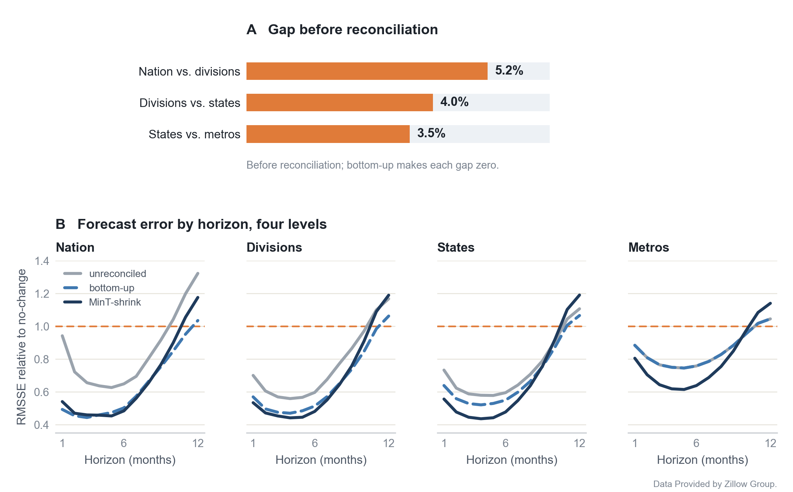

# 03c · Hierarchical forecasts of a marketplace metric that add up across levels

**[Explore this study interactively →](https://lyz44git.github.io/ad-measurement-and-metrics/03.html#s03c)**

> **Takeaway.** Forecasts made separately for the US, divisions, states and metros disagree with each other by 3.5% to
> 5.2%. Bottom-up reconciliation removes the gap at no cost in accuracy (at or below the unreconciled error in 11 of
> 12 cases). MinT-shrink lowered state and metro error by 7% to 10% with an ETS base, but the gain did not hold with
> an ARIMA base or a second target, so bottom-up is the safe default here.

## Question

Can monthly for-sale housing inventory be forecast at the national, Census-division, state and metro levels so that
the levels add up, without losing accuracy? Which reconciliation method should be the default? A plan for a
market-level test ([study 03b](../03b_geo_experiment_design)) needs such a baseline at every level at which the
result will be read.

## Data

Zillow Research public metro files (for-sale inventory and new listings, all homes, raw monthly), 2018-03 to 2026-09,
downloaded by hand on 2026-11-09. **Data Provided by Zillow Group.** No Zillow data are stored in this repository:
per-origin forecasts stay in a git-ignored `tmp/` folder and only aggregate error tables are kept in `reports/`.
The Census 2023 CBSA delineation file (`list1_2023.xlsx`) is used for a descriptive crosswalk only.

Place the files as `data_external/zillow/v1_20261109/Metro_invt_fs_uc_sfrcondo_month.csv`,
`data_external/zillow/v1_20261109/Metro_new_listings_uc_sfrcondo_month.csv` and
`data_external/census/list1_2023.xlsx` (git-ignored), or set `HF_ZILLOW_DIR` and `HF_CENSUS_XLSX`.

## Method

The pre-analysis plan, [`docs/pre_analysis_plan.md`](docs/pre_analysis_plan.md), was hashed before any forecast was
scored (`docs/pre_analysis_plan.sha256`); `scripts/run_backtest.py` refuses to run if the plan changes. The plan
refers to `metro_market_ssm`, an earlier unpublished project from which the data folder layout and one data-quality
rule were taken.

1. **Hierarchy.** United States → 9 Census divisions → 51 states (with DC) → 809 metros, plus a Remainder node so that
   every level sums exactly to the US row: 873 nodes.
2. **Base forecasts.** One `statsforecast` AutoETS model per node; AutoARIMA as a pre-specified robustness run.
3. **Reconciliation.** Bottom-up, top-down, OLS, WLS-structural and MinT-shrink, implemented in NumPy and checked
   against `hierarchicalforecast`.
4. **Backtest.** 24 monthly origins (2023-11 to 2025-10), horizons 1 to 12. A month's value counts as known the
   following month, and everything is rebuilt at each origin from the data known then.
5. **Scores.** RMSSE by level against no-change and seasonal-naive baselines, coherence error, and Diebold–Mariano
   tests with the Harvey–Leybourne–Newbold correction.

## Results

Full results and limits: [`reports/memo.md`](reports/memo.md). Tables: [`reports/results_tables.md`](reports/results_tables.md).

| Run | Level | Unreconciled RMSSE | Bottom-up / unreconciled | MinT-shrink / unreconciled |
|---|---|---|---|---|
| Inventory, ETS (primary) | US | 1.861 | 0.806 | 0.810 |
| | division | 1.674 | 0.863 | 0.868 |
| | state | 1.512 | 0.939 | 0.902 |
| | metro | 1.587 | 1.000 | 0.928 |
| Inventory, ARIMA | US | 1.589 | 0.692 | 0.807 |
| | division | 1.610 | 0.908 | 0.969 |
| | state | 1.454 | 0.948 | 1.014 |
| | metro | 1.651 | 1.000 | 1.025 |
| New listings, ETS | US | 0.370 | 1.007 | 1.047 |
| | division | 0.417 | 0.962 | 0.992 |
| | state | 0.425 | 0.980 | 0.995 |
| | metro | 0.592 | 1.000 | 1.005 |

- Unreconciled forecasts disagreed with the sum of their children by 5.16% (US), 4.00% (divisions) and 3.50% (states)
  on average; every reconciliation method removed the gap exactly.
- The gains are at short horizons: for inventory with an ETS base, MinT-shrink had 0.44 to 0.81 of no-change's error
  at horizons 1 to 6, and no method beat no-change at horizon 12.
- OLS reconciliation was worse than unreconciled forecasts at the state and metro levels in all three runs, because it
  spreads national corrections evenly over metros of very different sizes.

[](https://lyz44git.github.io/ad-measurement-and-metrics/03.html#s03c)

## Reproduce

```bash
JOBS=16 ./run_all.sh    # tests, three backtests (about 13 minutes with 16 workers), tables, number checks
python ../../figures/make_study_figures.py   # redraws the figure from reports/tables/
```

Run from this folder with the root `requirements.txt` installed. The tests need no data: they build a synthetic
hierarchy and check that no future value leaks into a forecast, that reconciled forecasts add up, and that the
reconciliation matches `hierarchicalforecast`. Tests that read the Zillow file are skipped when it is absent.

## Layout

| Path | Contents |
|---|---|
| `src/hierfc/data.py` | as-of table (a value is known one month after its month), member panel |
| `src/hierfc/hierarchy.py` | summing matrix, Census divisions, Remainder nodes |
| `src/hierfc/reconcile.py` | bottom-up, top-down, OLS, WLS-structural, MinT-shrink |
| `src/hierfc/models.py` | AutoETS and AutoARIMA base forecasts, no-change, seasonal naive |
| `src/hierfc/backtest.py` | rolling-origin loop |
| `src/hierfc/metrics.py` | RMSSE, MAE, coherence error, Diebold–Mariano test |
| `src/hierfc/quality.py` | descriptive crosswalk and coverage-break flags |
| `scripts/` | one backtest run, report tables and figure, checks of the memo's numbers |

## Scope

- Pseudo-real-time: one data vintage is used, so revisions to earlier months are not replayed.
- Point forecasts only; no prediction intervals are reconciled.
- 24 origins from one period (2023-11 to 2025-10).
