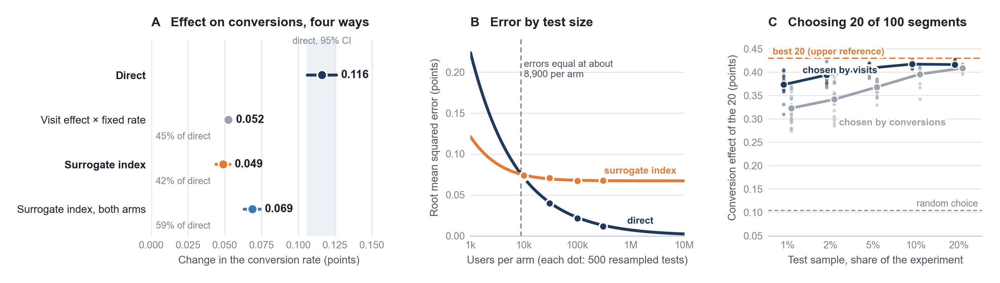

# 03d · Can the effect on visits stand in for the effect on conversions?

**[Explore this study interactively →](https://lyz44git.github.io/ad-measurement-and-metrics/03.html#s03d)**

> **Takeaway.** Visits cannot give the size of the effect on conversions, but they point to where it is. An estimate
> that converts the extra visits at the rate predicted for visitors of their kind is 0.049 points, 42% of the 0.116
> measured directly (a third after adjustment for the features), so the pre-specified equivalence margin of ±20% was
> not met. Across 100 user segments, however, the effects on visits and on conversions rise and fall together (a
> correlation of 0.95 after removing sampling noise; 90% interval 0.88 to 0.95), and in a 2% test, too small to read
> conversions by segment, choosing the 20 segments with the largest visit effect picks segments with a 15% larger
> conversion effect than choosing by the conversion effect itself, in 20 of 20 samples. Both rules of that follow-up
> were met. Use visits to decide where; measure conversions to decide how much.

## Question

Conversions are the outcome an advertiser pays for, but they are rare: a test powered for conversions needs about
20 times the users of one powered for visits ([study 01c](../../01_with_an_experiment/01c_sql_metric_readout)), and
covariate adjustment saves about a third ([study 03a](../03a_lift_study_sizing)). If the
effect on conversions could be read from the effect on visits, the test could be much smaller. How close does a
visit-based estimate come to the conversion effect measured directly in the same experiment, and at what test size
is the biased but precise estimate the better one?

## Data

Criteo Uplift Prediction Dataset v2.1, the experiment of [study 01a](../../01_with_an_experiment/01a_ad_incrementality):
13,979,592 rows, twelve anonymized features, and flags for assignment, visit and conversion. No row has a conversion
without a visit. A random half of the rows (6,992,375; the **historical** half) is used only to fit the surrogate
models; every effect below is estimated on the other half (6,987,217 rows: 5,938,623 in the ad arm, 1,048,594 in the
control arm). Pass the path to `criteo-research-uplift-v2.1.csv.gz`.

## Method

The analysis plan, [`design/analysis_plan.md`](design/analysis_plan.md), was fixed before any model was fitted
(SHA-256 in `logs/plan_hash.txt`). The headline rates of studies 01a and 01c were known; no estimate in this study had
been computed.

1. **Direct.** The difference in conversion rates between arms.
2. **Visit effect times a fixed rate.** The difference in visit rates, times the conversion rate of control-arm
   visitors in the historical half (5.11%).
3. **Surrogate index (primary).** Each user's surrogate is S = visit × q(X), where q(X) is a LightGBM model of the
   chance that a visitor converts, fitted on the 39,958 control-arm visitors of the historical half: the data a team
   would have before showing ads to anyone new. The estimate is the difference in mean S between arms (the surrogate
   index of Athey, Chetty, Imbens and Kang).
4. **Surrogate index, both arms (sensitivity).** As 3, with q(X) fitted on visitors of both arms; it uses converted
   users of the ad arm, which a team would not have in advance.
5. **Decision rule.** Visits stand in for conversions if the 90% interval of (surrogate index − direct) / direct lies
   inside ±20%. Intervals come from 200 bootstrap draws of rows, with q(X) held fixed.
6. **Test size.** For n users per arm, the root mean squared error of each estimator against the direct estimate on
   the full half, from the per-arm variances and the bias, checked on 500 draws at each of four sizes.

## Results

Source: [`out/surrogate.json`](out/surrogate.json).

| Estimate of the effect on the conversion rate | Points (95% CI) | Share of the direct estimate | Difference from direct (90% CI) |
|---|---|---|---|
| Direct | 0.116 (0.106 to 0.126) | 100% | |
| Visit effect × fixed conversion rate | 0.052 (0.050 to 0.054) | 45% | −55% (−58% to −52%) |
| **Surrogate index** | **0.049 (0.044 to 0.053)** | **42%** | **−58% (−61% to −54%)** |
| Surrogate index, model fitted on both arms | 0.069 (0.063 to 0.074) | 59% | −41% (−45% to −36%) |

| | Ad arm | Control arm |
|---|---|---|
| Visit rate | 4.85% | 3.83% |
| Conversion rate | 0.309% | 0.193% |
| Conversion rate among visitors | 6.36% | 5.03% |
| Mean predicted conversion rate among visitors, q(X) | 4.86% | 4.88% |

- **The pre-specified rule was not met.** The surrogate index is 42% of the direct estimate; the interval of the
  difference, −61% to −54%, is far outside ±20%.
- **What the index leaves out.** Visitors in the two arms have the same mean predicted conversion rate (4.86% against
  4.88%), yet 6.36% of ad-arm visitors convert against 5.03% of control-arm visitors. The index gives every visitor
  the control-arm rate for their features, so it cannot contain that difference. Visiting happens after assignment
  and the visitors of the two arms need not be the same kind of users, so the comparison is descriptive: it does not
  show which visitors the ads added or by which path the ads raised conversions. Fitting q(X) on both arms gives a
  higher estimate (59% of the direct one) because the model then sees conversions of the ad arm.
- **Where the two errors cross.** The gap between the two estimates is 0.067 points. With the direct estimate on the
  full half as the benchmark and equal arms, the root mean squared errors of the two estimators are equal at 8,864
  users per arm, where each is about 65% of the effect. The four sizes checked by resampling are all above that
  point:

| Users per arm | Error of direct estimate (formula / 500 draws) | Error of surrogate index (formula / 500 draws) |
|---|---|---|
| 10,000 | 0.071 / 0.072 | 0.074 / 0.074 |
| 30,000 | 0.041 / 0.040 | 0.070 / 0.071 |
| 100,000 | 0.022 / 0.021 | 0.068 / 0.067 |
| 300,000 | 0.013 / 0.012 | 0.067 / 0.067 |

  Root mean squared error in points against the full-half direct estimate of 0.116.
- **By segment** (deciles of the predicted visit rate without ads, descriptive): the share recovered ranges from 10%
  to about 100% across the lower deciles, whose effects are small and imprecise. In the top decile, which has a
  control visit rate of 32% and most of the conversion effect, it is 30% (0.249 of 0.837 points).

[](https://lyz44git.github.io/ad-measurement-and-metrics/03.html#s03d)

## Follow-up: estimates adjusted for the features

Study [02e](../../02_without_an_experiment/02e_off_policy_evaluation) found that in this pooled release the probability of assignment to the ad
arm varies slightly with the features (held-out AUC 0.509), which moves unadjusted effects. A follow-up plan
([`design/followup_plan.md`](design/followup_plan.md), hashed before it ran; it names that study by its working
number, 05c) re-estimated both effects by AIPW with an
assignment model fitted on the historical half and outcome models cross-fitted on the experiment half. Source:
[`out/followup.json`](out/followup.json).

| | Unadjusted (main result) | AIPW, estimated assignment probability | AIPW, constant assignment share |
|---|---|---|---|
| Effect on visits (points) | 1.03 | 0.73 | 0.73 |
| Effect on conversions, direct (points) | 0.116 | 0.099 | 0.102 |
| Surrogate index (points) | 0.049 | 0.033 | 0.032 |
| **Visit-based estimate as a share of the direct one** | **42%** | **33% (29% to 37%)** | **31% (28% to 35%)** |

- **The conclusion holds.** Adjusted, the visit-based estimate is a third of the direct one. Adjustment lowers the
  visit effect by 28% and the conversion effect by 15%, so the share falls.
- The crossover above was calculated for the unadjusted estimates. It was not estimated for the adjusted comparison,
  where the absolute gap is about the same (0.066 against 0.067 points).

## Follow-up 2: do visits point to the right segments?

A team often needs to know where the effect is larger, for instance which segments to target, rather than its exact
size, and a small test has too few conversions to tell. A second follow-up plan
([`design/followup_plan_2.md`](design/followup_plan_2.md), hashed before it ran) asked whether visits can do that.
Segments are the 100 of [study 01b](../../01_with_an_experiment/01b_bayesian_segment_effects) (equal-size groups by
rank on six features). Source: [`out/followup2.json`](out/followup2.json).

**Direction.** On the experiment half, the visit effect of a segment ranges from −0.17 to 8.4 points and its
conversion effect from −0.04 to 1.20 points; the top 20 segments by conversion effect hold 82% of it. Across the 100
segments the two effects have a correlation of 0.92, and 0.95 (90% interval 0.88 to 0.95) once the sampling noise of
each segment's two estimates, including their shared noise, is removed. **Rule 1** (at least 0.7, lower end at least
0.5) **was met.**

**Choosing segments in a small test.** In each of 20 disjoint 2% samples of the historical half (279,592 users, about
2,800 per segment and 420 of them in the control arm), the 20 segments with the largest visit effect and, separately,
the 20 with the largest conversion effect were chosen and scored by their conversion effect on the experiment half,
which shares no user with the sample:

| Sample (share of the experiment) | Chosen by visit effect (points) | Chosen by conversion effect (points) | Visits better in | Share of attainable gain: visits / conversions |
|---|---|---|---|---|
| 1% | 0.373 | 0.323 | 18 of 20 | 83% / 67% |
| **2%** | **0.394** | **0.342** | **20 of 20** | **89% / 73%** |
| 5% | 0.408 | 0.368 | 20 of 20 | 93% / 81% |
| 10% | 0.417 | 0.396 | 19 of 20 | 96% / 90% |
| 20% | 0.416 | 0.408 | 16 of 20 | 96% / 93% |

Random choice gives 0.105 points and the 20 best segments on the experiment half 0.430; the share of attainable gain
is the position between the two, and the upper reference is biased upward because the same data choose and score.
**Rule 2** (higher on average in 2% samples, and in at least 15 of 20) **was met.**

- A segment's conversion count in a 2% sample is a handful, so choosing by conversions is mostly noise; visits are
  about 20 times as frequent and move with conversions across segments, so choosing by visits is closer to right. As
  the sample grows the conversion-based choice catches up: at 20% of the experiment the two are within 2%.
- This is the same trade as the crossover above, seen in a decision: a biased but precise signal beats an unbiased but
  noisy one when the test is small.
- The correlation is across these 100 segments of six anonymized features; it need not hold for other groupings, and
  it says nothing about the size of the effect, which visits still understate.

## Reproduce

```bash
python code/run_surrogate.py /path/to/criteo-research-uplift-v2.1.csv.gz out    # about 4 minutes on 32 cores
python code/run_followup.py /path/to/criteo-research-uplift-v2.1.csv.gz out     # follow-up, about 10 minutes
python code/run_followup2.py /path/to/criteo-research-uplift-v2.1.csv.gz out    # follow-up 2, under a minute
```

`tests/` checks on simulated experiments that the surrogate index recovers the effect when visits carry all of it,
that it understates the effect when the ads also raise conversion among visitors, the equivalence rule, that the
crossover is where the two error curves meet, that the resampled error of the direct estimate matches the formula, and
that the noise-corrected correlation of follow-up 2 recovers a known correlation from noisy segment estimates.

## Scope

- One experiment on one display network, pooled and subsampled non-uniformly by the data's authors, so the size of
  the gap is specific to these data. A conversion here is any conversion in the logging window, not a long-run
  outcome; what carries over is the check itself, a proxy effect compared with the outcome effect in an experiment
  that measures both.
- The intervals hold the fitted q(X) fixed, so they do not include the uncertainty of refitting it. The 90% interval
  of the relative difference, −61% to −54%, is far from the ±20% margin.
- A surrogate index can pass where this one fails, if the proxy carries the effect, for example a proxy measured later
  in the funnel. Here the only proxy the file records is a visit.
