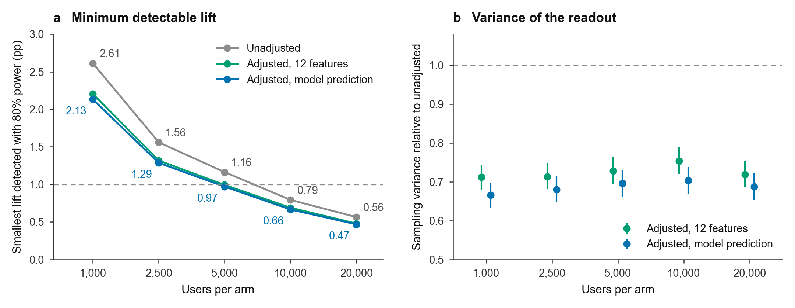
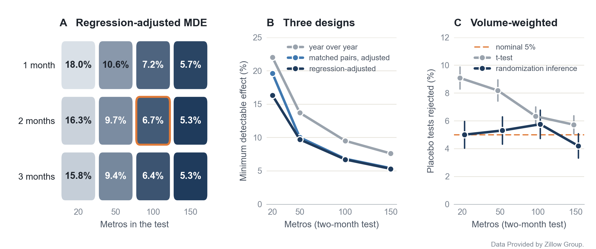
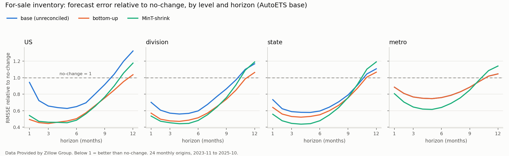

# 3. Planning a test: how large must it be, and what is the baseline?

Where a budget decision needs incremental evidence that the metrics of section 2 cannot give, the next step is an
experiment. Studies 03a and 03b size it, by user and by market; in both, adjusting for what is known before the
test is the main way to make it smaller. Study 03c forecasts the baseline of a metric so that national, state and
metro levels agree.

| Study | Question | Key result |
|---|---|---|
| [`03a_lift_study_sizing`](03a_lift_study_sizing) | How many users per arm does a lift study need, and how much does covariate adjustment save? | For a one-point lift in site visits on a 3.8% base rate, an unadjusted readout needs about 6,500 users per arm for 80% power. Adjusting for 12 pre-treatment user features cuts this to about 4,700, and adjusting for a model prediction built from them to about 4,400, with false-positive rates near 5%. |
| [`03b_geo_experiment_design`](03b_geo_experiment_design) | If a change can only be randomized by market, how large a test is needed, and does the usual t-test keep its 5% false-positive rate? | Across 5,000 placebo tests per design on 151 U.S. metros, adjusting for pre-period volume lowered the smallest detectable change in a two-month, 100-metro test from 9.5% to 6.7%. For the volume-weighted estimate the t-test rejected a true null 5.7-9.1% of the time; randomization inference kept it between 4.2% and 5.8%. |
| [`03c_hierarchical_forecasting`](03c_hierarchical_forecasting) | Can the baseline of a metric be forecast at national, state and metro levels so that the levels add up, without losing accuracy? | Separate forecasts of for-sale housing inventory disagreed across levels by 3.5-5.2%. Bottom-up reconciliation removed the gap with error at or below the unreconciled forecasts in 11 of 12 cases; MinT-shrink cut state and metro error by 7-10% with one base model but not with another. |

## Main figure of each study

**[03a · Sizing user-level lift studies, with and without covariate adjustment](03a_lift_study_sizing)**

**[03b · Sizing market-level (geo) experiments](03b_geo_experiment_design)**

**[03c · Hierarchical forecasts of a marketplace metric that add up across levels](03c_hierarchical_forecasting)**

Method, data, decision rules and limitations are in each study's README; the four questions are introduced in
the [main README](../README.md).
