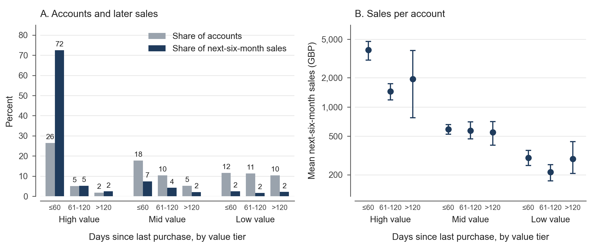

# 04 · Customer metric definitions and retention on retail transactions

> **Takeaway.** The "new customer" count depends on its definition: of the 1,036 accounts this retailer would label
> new under a 3-month look-back, 640 (62%) had bought in the prior 12 months, so acquisition metrics here use a
> 12-month look-back. Among high-value accounts, a purchase-model score ranks who buys again within six months better
> than recency alone (AUC 0.79 against 0.75). For ranking sales over the next 12 months, a simple past-sales rule did
> better than the purchase model in this one holdout.

## Questions

1. Does the "new customer" metric count returning buyers as new, and do the metric tables reproduce in SQL?
2. Which high-value customers are least likely to buy again?
3. Does a purchase model rank future customer value better than a simple past-sales rule?

## Data

UCI Machine Learning Repository, Online Retail II (id 502, CC BY 4.0): transactions of a UK online gift retailer with
many wholesale accounts, 2009-12-01 to 2011-12-09. Of 1,067,371 raw lines, 794,163 lines and 5,875 accounts remain
after removing exact duplicates, lines without a customer ID, non-merchandise codes and non-positive prices
([`out/10_ltv_audit.json`](out/10_ltv_audit.json)). Sales are gross. The data contain no marketing treatment, so all
results are predictive or descriptive.

Download `online_retail_II.xlsx` from the UCI repository into `data_raw/` (git-ignored).

## Method

1. **Cleaning and audit** (`10_ltv_load.py`): duplicates, missing IDs, credit notes and non-merchandise codes counted
   and removed, with every count written to the audit file.
2. **Metric definitions** (`12_ltv_segments.py`, `14_ltv_extension.py`): the new-customer definition is tested for
   contamination by returning buyers under different look-back windows; cohorts and segments are then defined once
   and rebuilt in SQL to confirm that both implementations give the same tables.
3. **Retention risk and early value** (`14_ltv_extension.py`): a ranking of high-value accounts by expected
   purchases, and first-month value of new accounts, both evaluated on later months.
4. **Purchase and spend models** (`btyd_impl.py`, checked by `11_btyd.py`): BG/NBD for purchase frequency and
   Gamma-Gamma for spend per purchase, implemented from the published likelihoods and checked by parameter recovery
   on simulated data. Compared out of time with a last-6-months sales rule and a LightGBM model.

Step 14 was run under [`design/analysis_plan.md`](design/analysis_plan.md), fixed before the run (SHA-256 in
`logs/plan_hash.txt`); deviations are in [`design/deviations.md`](design/deviations.md).

## Results

Sources: [`out/12_ltv_segments.json`](out/12_ltv_segments.json),
[`out/14_ltv_extension.json`](out/14_ltv_extension.json).

### Metric definitions

**New-customer definition.** With a 3-month look-back, 1,036 accounts would be labeled new, of which 640 (62%) had
bought in the prior 12 months. Cohorts here use a 12-month look-back:

```sql
-- an account is new in a month if it bought in that month and on no day of the previous 12 months
SELECT a.cid, a.mon FROM m a
WHERE NOT EXISTS (SELECT 1 FROM days d
                  WHERE d.cid = a.cid AND d.day < a.mon AND d.day >= a.mon - INTERVAL 12 MONTH)
```

**SQL reconciliation.** The segment table and the cohort repeat-rate matrix, rebuilt in DuckDB SQL
([`out/14_sql_queries.sql`](out/14_sql_queries.sql)), match the Python results in all 92 cells. Both implementations
use rank-based terciles with boundary accounts in the upper group (deviation 1).


### Retention and early value

**Retention risk.** Among the 1,442 accounts in the top third of 12-month sales (84% of those sales), the purchase
model ranks repeat buyers better than recency alone:

| Ranking | AUC for a repeat purchase within 6 months (95% CI) |
|---|---|
| Purchase-model expected purchases | 0.790 (0.759 to 0.820) |
| Recency alone | 0.752 (0.714 to 0.787) |
| Difference | +0.038 (0.003 to 0.071) |

Repurchase rate by score tercile, lowest to highest: 65.5%, 88.8%, 96.3%.

**Early value of new accounts.** Among 708 new accounts (cohorts 2010-12 to 2011-05), the top quartile by first-month
sales produced 58.9% of sales in months 1–5 (95% CI 47.9% to 68.4%); 59.9% of them bought again, against 35.0% in the
bottom quartile.

**High-value segment.** Accounts that bought in the last 60 days and were in the top third of 6-month sales made up
26.5% of 2,716 active accounts and produced 72.5% of their next-six-month sales; 91.7% bought again.

**Clustering check.** K-means on recency, frequency, spend and return behavior, with the number of clusters chosen by
bootstrap out-of-bag stability, selects two clusters (adjusted Rand index 0.92 on average, 10th percentile 0.89). Its
high-value cluster is 36.8% of accounts and produced 76.5% of next-six-month sales, close to the rule above
([`out/12_ltv_segments.json`](out/12_ltv_segments.json)).



### Purchase model against a simple rule

| Holdout | Spearman, purchase model | Spearman, past-sales rule | Top-decile share of actual sales, model / rule |
|---|---|---|---|
| 6 months from 2011-06-01 (2,716 accounts) | 0.650 | 0.587 | 59.1% / 59.2% |
| 12 months from 2010-12-01 (4,239 accounts) | 0.584 | 0.621 | 60.8% / 60.2% |

The model ranks better on the 6-month holdout. **On the 12-month holdout the pre-specified rule was not met**: the
past-sales rule ranks better (Spearman difference −0.037, 95% CI −0.056 to −0.020). A LightGBM model on a fixed
6-month look-back did not differ from the rule on any metric.

## Reproduce

Each script takes its paths as arguments:

```bash
python code/10_ltv_load.py data_raw/online_retail_II.xlsx derived out
python code/11_btyd.py out/11_btyd_recovery.json
python code/12_ltv_segments.py derived out code
python code/13_ltv_figs.py out
python code/14_ltv_extension.py derived out code
```

`tests/` checks the purchase and spend models on simulated customers and runs the published SQL against an
independent pandas implementation on synthetic purchases.

## Scope

- Not lifetime value in the strict sense: no margin, discounting or acquisition cost, and horizons of 6 and 12 months.
- No causal effect of any acquisition or retention action is estimated.
- At 12 months the purchase model does not beat a simple past-sales rule.
