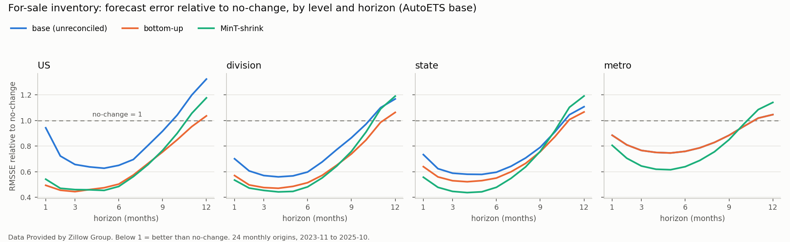

# Hierarchical forecasts of US for-sale inventory: a pre-registered backtest

2026-11-09. Pre-analysis plan `docs/pre_analysis_plan.md`, SHA-256
`e551b5625e394e78e0428d83eeeb55dc714cea6087fe49df4dbb991ad5effba0`, recorded 2026-11-10 02:58 UTC before any
forecast was scored; `scripts/run_backtest.py` refuses to run if the plan changes. Tables between
`<!-- BEGIN -->` / `<!-- END -->` markers are written by `scripts/make_report.py`; every other number in this memo is
checked against the generated `reports/results_tables.md` by `scripts/check_memo.py`.
**Data Provided by Zillow Group.**

## Summary

- **What was built.** A 873-node hierarchy of monthly for-sale inventory (US → 9 Census divisions → 51 states →
  809 metros, plus a Remainder node so every level adds up to Zillow's US row), one AutoETS model per node, five
  reconciliation methods, and a 24-origin pseudo-real-time backtest at horizons 1–12, under a plan hashed before any
  forecast was scored. Two pre-specified robustness runs: an AutoARIMA base (R1) and new listings as the target (R2).
- **Coherence.** Unreconciled forecasts disagreed with the sum of their children by 5.16% (US), 4.00% (divisions)
  and 3.50% (states) on average. Every reconciliation method removed the gap exactly.
- **Bottom-up was the safe default.** Its RMSSE was at or below the unreconciled forecasts' in 11 of 12
  specification × level cells (worst case 1.007× base; Table 0).
- **MinT-shrink helped in the primary run but the gain was not robust.** With an ETS base it had the lowest error at
  the state and metro levels (RMSSE −9.8% and −7.2% vs unreconciled; better at h = 1 in 18 and 20 of 24 origins,
  p = 0.001 for both). With an ARIMA base it was worse than unreconciled at those levels (+1.4%, +2.5%), and for new
  listings it changed little (−0.5%, +0.5%). It was the best non-baseline method in 2 of 12 cells; bottom-up in 7.
- **The gains are at short horizons.** For inventory with an ETS base, MinT-shrink had 0.44–0.81 of no-change's
  error at h = 1–6 (all levels), but no method beat no-change at h = 12; at the metro level MinT-shrink was
  significantly worse than no-change at h = 12 (better in 1 of 24 origins, p = 0.003).
- **Scale-blind reconciliation hurt.** OLS was worse than unreconciled at the state and metro levels in all three runs
  (primary metro RMSSE 4.714 vs 1.587, with 8.66% of metro forecasts negative): it spreads national corrections evenly
  over metros whose sizes differ by orders of magnitude.

**Table 0. Across the three pre-specified runs (RMSSE over h = 1–12).**

<!-- BEGIN:cross_spec -->
| Specification | Level | Best non-baseline method | Base RMSSE | Bottom-up / base | MinT-shrink / base | MinT-shrink vs base | Best overall incl. seasonal naive |
|---|---|---|---:|---:|---:|---:|---|
| Primary | US | bottom-up | 1.861 | 0.806 | 0.810 | -19.0% | bottom-up |
| Primary | division | bottom-up | 1.674 | 0.863 | 0.868 | -13.2% | bottom-up |
| Primary | state | MinT-shrink | 1.512 | 0.939 | 0.902 | -9.8% | MinT-shrink |
| Primary | metro | MinT-shrink | 1.587 | 1.000 | 0.928 | -7.2% | MinT-shrink |
| R1 | US | bottom-up | 1.589 | 0.692 | 0.807 | -19.3% | bottom-up |
| R1 | division | bottom-up | 1.610 | 0.908 | 0.969 | -3.1% | bottom-up |
| R1 | state | bottom-up | 1.454 | 0.948 | 1.014 | +1.4% | bottom-up |
| R1 | metro | base (unreconciled) | 1.651 | 1.000 | 1.025 | +2.5% | base (unreconciled) |
| R2 | US | base (unreconciled) | 0.370 | 1.007 | 1.047 | +4.7% | seasonal naive |
| R2 | division | bottom-up | 0.417 | 0.962 | 0.992 | -0.8% | seasonal naive |
| R2 | state | bottom-up | 0.425 | 0.980 | 0.995 | -0.5% | seasonal naive |
| R2 | metro | base (unreconciled) | 0.592 | 1.000 | 1.005 | +0.5% | base (unreconciled) |

Across 12 specification x level cells: bottom-up RMSSE <= base in 11, worst bottom-up / base 1.007; MinT-shrink RMSSE < base in 8, > base in 4; MinT-shrink was the best non-baseline method in 2, bottom-up in 7.
<!-- END:cross_spec -->

## 1. Question and design

Can monthly for-sale inventory be forecast at the national, Census-division, state and metro levels so that the
levels add up, without losing accuracy? The hierarchy is United States → 9 divisions → 51 states (incl. DC) → 809
metros, plus a Remainder node (US minus the 809 metros: non-metro areas and metros with incomplete data) that is
carried through every level so that each level sums exactly to Zillow's US row.

- **Base forecasts**: one `statsforecast` AutoETS model per node (873 nodes), seasonal period 12.
- **Reconciliation** (all linear, ỹ = S G ŷ): bottom-up, top-down (proportions of the last 12 months), OLS,
  WLS-structural and MinT-shrink (Schäfer–Strimmer shrinkage of the in-sample one-step residual covariance). Own numpy
  implementation; a test matches `hierarchicalforecast` 1.5.3.
- **Baselines**: no-change and seasonal naive (both coherent by construction).
- **Pseudo-real-time backtest**: 24 monthly origins (as-of months 2023-11 to 2025-10). A month's value counts as
  known the following month; at each origin everything (models, Remainder, top-down shares, MinT covariance, error
  scale) is rebuilt from the data known then. Horizons 1–12; last target month 2026-09.
- **Scores**: RMSSE (error scaled by the node's mean squared one-step change in its training window, averaged over the
  level's nodes and origins), its ratio to no-change, MAE in listings, and incoherence |parent − Σ children| / parent.
  Pre-specified tests: Diebold–Mariano with the Harvey–Leybourne–Newbold correction at h = 1 and h = 12.

## 2. Data

Zillow Research public metro file `Metro_invt_fs_uc_sfrcondo_month.csv` (all homes, raw monthly), hand-downloaded
2026-11-09, 2018-03 to 2026-09. Members are the metros with no gap from 2018-03 to 2023-10 (what was known at the
first origin).

<!-- BEGIN:facts_inventory_ets -->
| Fact | Value |
|---|---|
| Zillow metros in file | 927 |
| member metros (complete 2018-03 to first origin - 1) | 809 |
| nodes / leaves | 873 / 810 |
| nodes per level (excl. Remainder) | US 1, division 9, state 51, metro 809 |
| Remainder share of US, full data | 9.8%–15.7% |
| member cells carried forward, full data | 4 |
| training months per origin | 68–91 |
| MinT shrinkage lambda range | 0.18–0.20 |
| members matched to a 2023 CBSA | 777 of 809 (346 metropolitan, 431 micropolitan) |
| matched members whose state = CBSA title's first state | 777 |
| coverage-break flags (first training window, not masked) | 1 level shifts, 1 spikes, 2 members |
| backtest runtime | 2.3 min |
<!-- END:facts_inventory_ets -->

## 3. Results (primary: inventory, AutoETS base)

**Table 1. RMSSE over h = 1–12 by level and method; in brackets, ratio to no-change (below 1 = better). Bold = best
non-baseline method at that level.**

<!-- BEGIN:compact_inventory_ets -->
| Level | base (unreconciled) | bottom-up | top-down | OLS | WLS-structural | MinT-shrink | seasonal naive | no-change |
|---|---:|---:|---:|---:|---:|---:|---:|---:|
| US (1) | 1.861 (0.79) | **1.500 (0.64)** | 1.861 (0.79) | 1.809 (0.77) | 1.578 (0.67) | 1.508 (0.64) | 2.406 (1.02) | 2.352 (1.00) |
| division (9) | 1.674 (0.74) | **1.444 (0.63)** | 1.838 (0.81) | 2.085 (0.92) | 1.584 (0.70) | 1.454 (0.64) | 2.146 (0.94) | 2.274 (1.00) |
| state (51) | 1.512 (0.71) | 1.420 (0.67) | 1.745 (0.82) | 3.297 (1.55) | 1.650 (0.78) | **1.364 (0.64)** | 1.928 (0.91) | 2.123 (1.00) |
| metro (809) | 1.587 (0.84) | 1.587 (0.84) | 1.739 (0.92) | 4.714 (2.50) | 2.477 (1.31) | **1.473 (0.78)** | 1.932 (1.02) | 1.887 (1.00) |
<!-- END:compact_inventory_ets -->

*Figure 1. RMSSE relative to no-change by horizon. At the metro level bottom-up is identical to base (bottom-up keeps
the leaves' base forecasts). Data Provided by Zillow Group.*

**Table 2. RMSSE relative to no-change at selected horizons.**

<!-- BEGIN:horizon_inventory_ets -->
| Level | Method | h=1 | h=3 | h=6 | h=12 |
|---|---|---:|---:|---:|---:|
| US | base (unreconciled) | 0.94 | 0.66 | 0.65 | 1.32 |
| US | bottom-up | 0.49 | 0.44 | 0.50 | 1.04 |
| US | MinT-shrink | 0.54 | 0.46 | 0.48 | 1.18 |
| US | seasonal naive | 3.77 | 1.39 | 0.91 | 1.00 |
| division | base (unreconciled) | 0.70 | 0.57 | 0.60 | 1.17 |
| division | bottom-up | 0.57 | 0.48 | 0.51 | 1.06 |
| division | MinT-shrink | 0.53 | 0.45 | 0.48 | 1.19 |
| division | seasonal naive | 3.27 | 1.23 | 0.82 | 1.00 |
| state | base (unreconciled) | 0.73 | 0.59 | 0.60 | 1.11 |
| state | bottom-up | 0.64 | 0.53 | 0.55 | 1.07 |
| state | MinT-shrink | 0.56 | 0.45 | 0.48 | 1.19 |
| state | seasonal naive | 2.99 | 1.14 | 0.78 | 1.00 |
| metro | base (unreconciled) | 0.88 | 0.77 | 0.76 | 1.05 |
| metro | bottom-up | 0.88 | 0.77 | 0.76 | 1.05 |
| metro | MinT-shrink | 0.81 | 0.64 | 0.64 | 1.14 |
| metro | seasonal naive | 2.82 | 1.27 | 0.87 | 1.00 |

- base (unreconciled), all four levels: h = 1–6 range 0.56–0.94 of no-change; h = 12 range 1.05–1.32.
- bottom-up, all four levels: h = 1–6 range 0.44–0.88 of no-change; h = 12 range 1.04–1.07.
- MinT-shrink, all four levels: h = 1–6 range 0.44–0.81 of no-change; h = 12 range 1.14–1.19.
<!-- END:horizon_inventory_ets -->

**Table 3. Pre-specified comparisons (plan §7).** "A wins" = origins (of 24) where A's mean scaled squared error at
that horizon is lower. In "A at h=1 / h=12", * marks p < 0.05.

<!-- BEGIN:comparisons_inventory_ets -->
| Test | Level | A vs B | RMSSE A / B | h=1: A wins, p | h=12: A wins, p | A at h=1 / h=12 | Verdict (plan §7) |
|---|---|---|---:|---:|---:|---|---|
| P1 | US | MinT-shrink vs base (unreconciled) | 1.508 / 1.861 | 16/24, 0.051 | 12/24, 0.352 | better / better | no clear difference |
| P2 | US | MinT-shrink vs bottom-up | 1.508 / 1.500 | 11/24, 0.916 | 7/24, 0.230 | worse / worse | no clear difference |
| P3 | US | bottom-up vs no-change | 1.500 / 2.352 | 15/24, 0.003 | 8/24, 0.191 | better* / worse | A better |
| P1 | division | MinT-shrink vs base (unreconciled) | 1.454 / 1.674 | 21/24, 0.004 | 12/24, 0.895 | better* / better | A better |
| P2 | division | MinT-shrink vs bottom-up | 1.454 / 1.444 | 16/24, 0.499 | 5/24, 0.182 | better / worse | no clear difference |
| P3 | division | bottom-up vs no-change | 1.444 / 2.274 | 16/24, 0.002 | 5/24, 0.052 | better* / worse | A better |
| P1 | state | MinT-shrink vs base (unreconciled) | 1.364 / 1.512 | 18/24, 0.001 | 8/24, 0.385 | better* / worse | A better |
| P2 | state | MinT-shrink vs bottom-up | 1.364 / 1.420 | 17/24, 0.096 | 4/24, 0.161 | better / worse | no clear difference |
| P3 | state | MinT-shrink vs no-change | 1.364 / 2.123 | 18/24, 0.002 | 3/24, 0.081 | better* / worse | A better |
| P1 | metro | MinT-shrink vs base (unreconciled) | 1.473 / 1.587 | 20/24, 0.001 | 3/24, 0.046 | better* / worse* | A better (mixed: significantly worse at one of h=1/h=12) |
| P2 | metro | MinT-shrink vs bottom-up | 1.473 / 1.587 | 20/24, 0.001 | 3/24, 0.046 | better* / worse* | A better (mixed: significantly worse at one of h=1/h=12) |
| P3 | metro | MinT-shrink vs no-change | 1.473 / 1.887 | 17/24, 0.001 | 1/24, 0.003 | better* / worse* | A better (mixed: significantly worse at one of h=1/h=12) |
<!-- END:comparisons_inventory_ets -->

**Table 4. The Remainder node (non-metro areas and non-member metros), scored on its own.**

<!-- BEGIN:remainder_inventory_ets -->
| Method | RMSSE h1–12 | vs no-change |
|---|---:|---:|
| base (unreconciled) | 2.263 | 0.869 |
| bottom-up | 2.263 | 0.869 |
| top-down | 2.333 | 0.896 |
| OLS | 2.208 | 0.848 |
| WLS-structural | 2.262 | 0.869 |
| MinT-shrink | 1.618 | 0.622 |
| no-change | 2.603 | 1.000 |
| seasonal naive | 2.925 | 1.124 |
<!-- END:remainder_inventory_ets -->

**Reading the primary results.**

- *US and divisions.* Bottom-up had the lowest error (RMSSE 1.500 and 1.444, against 1.861 and 1.674 unreconciled);
  MinT-shrink was close (1.508 and 1.454). Forecasting the national total directly with one ETS model was worse
  than adding up the metro forecasts (1.861 vs 1.500; this comparison was not one of the pre-specified tests).
- *States and metros.* MinT-shrink had the lowest error (1.364 and 1.473; unreconciled 1.512 and 1.587; bottom-up
  1.420 and 1.587).
- *Pre-specified tests (Table 3).* MinT-shrink beat the unreconciled forecasts at h = 1 at the division, state and
  metro levels (p = 0.004, 0.001 and 0.001); at the US level p = 0.051, so under the plan's rule there is no clear
  difference. At h = 12 it was never significantly better, and at the metro level it was significantly worse
  (better in 3 of 24 origins, p = 0.046), so that cell is flagged as mixed. Against bottom-up there was no clear
  difference at the US, division and state levels.
- *Horizons (Table 2, Figure 1).* At h = 1–6 MinT-shrink's error was 0.44–0.81 of no-change (all levels). By h = 12 every
  method was at or above no-change (MinT-shrink 1.14–1.19, bottom-up 1.04–1.07). At h = 12 no-change equals
  "same month last year", which removes all seasonal error, so it is a hard baseline at that horizon.
- *Remainder (Table 4).* MinT-shrink improved the catch-all node the most: RMSSE 1.618 against 2.263 unreconciled
  (0.622 and 0.869 of no-change). Because the Remainder is the US total minus the metros, MinT-shrink can borrow from
  both.
- *Methods that failed.* OLS (metro RMSSE 4.714, 2.50 times no-change; 8.66% of metro forecasts negative) and
  WLS-structural (metro 2.477; 1.61% negative) were worse than the unreconciled forecasts below the division level.
  Top-down was worse than bottom-up at every level below the US (division 1.838, state 1.745, metro 1.739).
- *Implementation check (Table 6).* On the real hierarchy the own MinT-shrink matched `hierarchicalforecast` to
  3.8e-06 listings.

## 4. Robustness (pre-specified)

**R1: AutoARIMA base forecasts (inventory).** Bottom-up was best at the US, division and state levels (RMSSE
1.099, 1.462, 1.379) and the unreconciled forecasts were best at the metro level (1.651; MinT-shrink 1.692).
MinT-shrink was significantly better than the unreconciled forecasts at h = 1 at the division, state and metro
levels (p = 0.008, 0.044, 0.022), but its 1–12-month RMSSE was higher at the state and metro levels, so under the
plan's rule only the division level counts as "better". With this base, both
bottom-up and MinT-shrink beat no-change at the US level even at h = 12 (0.71 and 0.91), while at the metro level the
unreconciled forecasts lost to no-change at h = 12 in all 24 origins (p = 0.000, flagged mixed).

<!-- BEGIN:compact_inventory_arima -->
| Level | base (unreconciled) | bottom-up | top-down | OLS | WLS-structural | MinT-shrink | seasonal naive | no-change |
|---|---:|---:|---:|---:|---:|---:|---:|---:|
| US (1) | 1.589 (0.68) | **1.099 (0.47)** | 1.589 (0.68) | 1.541 (0.66) | 1.260 (0.54) | 1.282 (0.54) | 2.406 (1.02) | 2.352 (1.00) |
| division (9) | 1.610 (0.71) | **1.462 (0.64)** | 1.622 (0.71) | 2.210 (0.97) | 1.671 (0.73) | 1.561 (0.69) | 2.146 (0.94) | 2.274 (1.00) |
| state (51) | 1.454 (0.68) | **1.379 (0.65)** | 1.571 (0.74) | 3.522 (1.66) | 1.686 (0.79) | 1.475 (0.69) | 1.928 (0.91) | 2.123 (1.00) |
| metro (809) | **1.651 (0.87)** | 1.651 (0.87) | 1.654 (0.88) | 5.060 (2.68) | 2.872 (1.52) | 1.692 (0.90) | 1.932 (1.02) | 1.887 (1.00) |
<!-- END:compact_inventory_arima -->

<!-- BEGIN:comparisons_inventory_arima -->
| Test | Level | A vs B | RMSSE A / B | h=1: A wins, p | h=12: A wins, p | A at h=1 / h=12 | Verdict (plan §7) |
|---|---|---|---:|---:|---:|---|---|
| P1 | US | MinT-shrink vs base (unreconciled) | 1.282 / 1.589 | 15/24, 0.123 | 20/24, 0.306 | better / better | no clear difference |
| P2 | US | MinT-shrink vs bottom-up | 1.282 / 1.099 | 9/24, 0.071 | 4/24, 0.293 | worse / worse | no clear difference |
| P3 | US | bottom-up vs no-change | 1.099 / 2.352 | 17/24, 0.002 | 19/24, 0.350 | better* / better | A better |
| P1 | division | MinT-shrink vs base (unreconciled) | 1.561 / 1.610 | 16/24, 0.008 | 10/24, 0.357 | better* / better | A better |
| P2 | division | MinT-shrink vs bottom-up | 1.561 / 1.462 | 10/24, 0.733 | 8/24, 0.461 | worse / worse | no clear difference |
| P3 | division | bottom-up vs no-change | 1.462 / 2.274 | 20/24, 0.001 | 11/24, 0.887 | better* / worse | A better |
| P1 | state | MinT-shrink vs base (unreconciled) | 1.475 / 1.454 | 18/24, 0.044 | 9/24, 0.807 | better* / better | no clear difference |
| P2 | state | MinT-shrink vs bottom-up | 1.475 / 1.379 | 12/24, 0.497 | 5/24, 0.309 | better / worse | no clear difference |
| P3 | state | bottom-up vs no-change | 1.379 / 2.123 | 21/24, 0.001 | 10/24, 0.417 | better* / worse | A better |
| P1 | metro | MinT-shrink vs base (unreconciled) | 1.692 / 1.651 | 16/24, 0.022 | 3/24, 0.208 | better* / worse | no clear difference |
| P2 | metro | MinT-shrink vs bottom-up | 1.692 / 1.651 | 16/24, 0.022 | 3/24, 0.208 | better* / worse | no clear difference |
| P3 | metro | base (unreconciled) vs no-change | 1.651 / 1.887 | 16/24, 0.008 | 0/24, 0.000 | better* / worse* | A better (mixed: significantly worse at one of h=1/h=12) |
<!-- END:comparisons_inventory_arima -->

**R2: new listings (AutoETS base).** 800 member metros; the Remainder is 3.9%–8.6% of the US total; 22 member cells
were carried forward. New listings are a strongly seasonal flow, so no-change is a weak baseline here (most methods are
at 0.22–0.27 of its error above the metro level) and seasonal naive was the best forecaster at the US, division and
state levels (0.337, 0.365, 0.409). Reconciliation changed little: MinT-shrink showed no clear difference from the
unreconciled forecasts or from bottom-up at any level. At h = 12 seasonal naive and no-change are the same forecast,
so that test is undefined ("identical forecasts").

<!-- BEGIN:compact_new_listings_ets -->
| Level | base (unreconciled) | bottom-up | top-down | OLS | WLS-structural | MinT-shrink | seasonal naive | no-change |
|---|---:|---:|---:|---:|---:|---:|---:|---:|
| US (1) | 0.370 (0.24) | 0.373 (0.24) | 0.370 (0.24) | 0.371 (0.24) | 0.375 (0.24) | 0.387 (0.25) | **0.337 (0.22)** | 1.562 (1.00) |
| division (9) | 0.417 (0.27) | 0.401 (0.26) | 0.512 (0.33) | 0.410 (0.26) | 0.404 (0.26) | 0.413 (0.26) | **0.365 (0.23)** | 1.564 (1.00) |
| state (51) | 0.425 (0.27) | 0.417 (0.27) | 0.570 (0.36) | 0.535 (0.34) | 0.421 (0.27) | 0.423 (0.27) | **0.409 (0.26)** | 1.567 (1.00) |
| metro (800) | **0.592 (0.46)** | 0.592 (0.46) | 0.656 (0.51) | 0.777 (0.60) | 0.642 (0.50) | 0.595 (0.46) | 0.661 (0.51) | 1.285 (1.00) |
<!-- END:compact_new_listings_ets -->

<!-- BEGIN:comparisons_new_listings_ets -->
| Test | Level | A vs B | RMSSE A / B | h=1: A wins, p | h=12: A wins, p | A at h=1 / h=12 | Verdict (plan §7) |
|---|---|---|---:|---:|---:|---|---|
| P1 | US | MinT-shrink vs base (unreconciled) | 0.387 / 0.370 | 12/24, 0.192 | 10/24, 0.801 | better / worse | no clear difference |
| P2 | US | MinT-shrink vs bottom-up | 0.387 / 0.373 | 10/24, 0.894 | 11/24, 0.709 | better / worse | no clear difference |
| P3 | US | seasonal naive vs no-change | 0.337 / 1.562 | 14/24, 0.006 | identical forecasts | better* / identical | A better |
| P1 | division | MinT-shrink vs base (unreconciled) | 0.413 / 0.417 | 14/24, 0.124 | 11/24, 0.809 | better / worse | no clear difference |
| P2 | division | MinT-shrink vs bottom-up | 0.413 / 0.401 | 10/24, 0.896 | 13/24, 0.926 | better / worse | no clear difference |
| P3 | division | seasonal naive vs no-change | 0.365 / 1.564 | 17/24, 0.003 | identical forecasts | better* / identical | A better |
| P1 | state | MinT-shrink vs base (unreconciled) | 0.423 / 0.425 | 13/24, 0.151 | 16/24, 0.476 | better / better | no clear difference |
| P2 | state | MinT-shrink vs bottom-up | 0.423 / 0.417 | 11/24, 0.583 | 15/24, 0.632 | better / better | no clear difference |
| P3 | state | seasonal naive vs no-change | 0.409 / 1.567 | 19/24, 0.002 | identical forecasts | better* / identical | A better |
| P1 | metro | MinT-shrink vs base (unreconciled) | 0.595 / 0.592 | 12/24, 0.803 | 14/24, 0.281 | better / better | no clear difference |
| P2 | metro | MinT-shrink vs bottom-up | 0.595 / 0.592 | 12/24, 0.803 | 14/24, 0.281 | better / better | no clear difference |
| P3 | metro | base (unreconciled) vs no-change | 0.592 / 1.285 | 24/24, 0.000 | 24/24, 0.000 | better* / better* | A better |
<!-- END:comparisons_new_listings_ets -->

Full tables for both runs (by horizon, Remainder, negatives, incoherence) are in `reports/results_tables.md`.

## 5. What this does and does not show

**Shows.**
- A working, tested pipeline that produces national, division, state and metro forecasts that add up exactly, with
  as-of masking checked by poisoned-future and leak-injection tests.
- In this sample, coherence was close to free: bottom-up kept or improved accuracy in 11 of 12 cells.
- MinT-shrink can add accuracy at the state, metro and Remainder levels at short horizons (primary run), but whether
  it does depends on the base model and the series.
- Reconciliation that ignores scale (OLS, and to a lesser extent WLS-structural) is harmful when nodes differ in size
  by orders of magnitude.

**Does not show.**
- That MinT-shrink beats bottom-up in general: its RMSSE was below bottom-up's only at the state and metro levels of
  the primary run, and the pre-specified tests found no clear difference from bottom-up at the US, division and state
  levels in any run.
- Any 12-month skill for inventory with an ETS base, or anything about the 1–2-year horizons the Zillow role mentions.
- Real-time performance (one vintage), price forecasting (ZHVI does not add up), county or ZIP levels, or prediction
  intervals.
- Anything about production use.

## 6. Limits

- **One vintage.** All data come from one download (2026-11-09); Zillow's later revisions of listing counts are in the
  history the backtest uses. This is pseudo-real-time (as-of masking), not a real-time vintage study.
- **One period.** 24 origins over two years (2023-11 to 2025-10). At h = 12 neighbouring origins share 11 of 12 target
  months, so the test sample is closer to two independent years; the p-values are descriptive.
- **Counts, not prices.** Inventory adds up; ZHVI does not. A price hierarchy needs a weighted (value) aggregate and is
  not attempted here.
- **The Remainder is a catch-all.** It mixes non-metro areas with metros left out for incomplete data; it is
  forecast as one series and cannot be split by state without Zillow's state-level files.
- **Listing coverage.** Zillow's listing counts depend on its MLS and listing coverage, which changes over time. The
  coverage-break rule flagged only a few members (facts table) and nothing was masked.
- **Point forecasts only.** No prediction intervals or probabilistic reconciliation; no non-negativity constraint
  (negative forecasts are counted in the full table below).
- **Local study.** Run on one laptop in minutes; nothing here is a production system.

## 7. Deviations from the plan

- **D1 (reporting only).** The plan's verdict rule (§7) says reconciliation "helps" if its RMSSE is lower and a DM
  p-value is below 0.05 at h = 1 or h = 12. It did not say what to do when one horizon is significantly better and the
  other significantly worse. Such cells keep the plan's verdict and are flagged "(mixed …)"; the direction at each
  horizon is shown in its own column. Also, "significant" is read as significant in A's favour for "A better" and in
  B's favour for "A worse".
- **D2 (figure).** Figure 1 leaves out seasonal naive (it reaches 3–4× no-change at h = 1 and flattens the other
  lines); its numbers are in Tables 1, 2 and 5.
- **D3 (reporting only).** The coverage-break flags use one pass of the copied rule; the original in
  `metro_market_ssm` repeats the level-shift step up to three times and drops flagged points before looking for
  spikes. The flags are counts in the facts table and change no data.
- **Added check (not in the plan).** `scripts/xcheck_nixtla_real.py` compares the own reconciliation with
  `hierarchicalforecast` on the real 873-node hierarchy at the first origin (Table 6). It changes no result.
- No method, level, origin, metric or specification was added or dropped.

## Appendix: full table (primary)

**Table 5. All methods and levels.** Mean incoherence = mean over parent nodes, origins and horizons of
|parent − Σ children| / actual parent ("0" = below 1e-9). Negative fcst = share of forecasts below zero.

<!-- BEGIN:headline_inventory_ets -->
| Level (nodes) | Method | RMSSE h1–12 | vs no-change | MAE h1–12 (listings) | Mean incoherence | Negative fcst |
|---|---|---:|---:|---:|---:|---:|
| US (1) | base (unreconciled) | 1.861 | 0.791 | 119,754.6 | 5.16% | 0.00% |
| US (1) | bottom-up | 1.500 | 0.638 | 92,425.5 | 0 | 0.00% |
| US (1) | top-down | 1.861 | 0.791 | 119,754.6 | 0 | 0.00% |
| US (1) | OLS | 1.809 | 0.769 | 116,334.8 | 0 | 0.00% |
| US (1) | WLS-structural | 1.578 | 0.671 | 99,223.8 | 0 | 0.00% |
| US (1) | MinT-shrink | 1.508 | 0.641 | 95,389.3 | 0 | 0.00% |
| US (1) | no-change | 2.352 | 1.000 | 144,011.3 | 0 | 0.00% |
| US (1) | seasonal naive | 2.406 | 1.023 | 162,357.1 | 0 | 0.00% |
| division (9) | base (unreconciled) | 1.674 | 0.736 | 11,044.8 | 4.00% | 0.00% |
| division (9) | bottom-up | 1.444 | 0.635 | 9,528.0 | 0 | 0.00% |
| division (9) | top-down | 1.838 | 0.808 | 12,673.7 | 0 | 0.00% |
| division (9) | OLS | 2.085 | 0.917 | 13,299.3 | 0 | 0.19% |
| division (9) | WLS-structural | 1.584 | 0.697 | 10,553.9 | 0 | 0.00% |
| division (9) | MinT-shrink | 1.454 | 0.639 | 9,776.7 | 0 | 0.00% |
| division (9) | no-change | 2.274 | 1.000 | 14,639.8 | 0 | 0.00% |
| division (9) | seasonal naive | 2.146 | 0.944 | 15,554.7 | 0 | 0.00% |
| state (51) | base (unreconciled) | 1.512 | 0.712 | 1,967.0 | 3.50% | 0.00% |
| state (51) | bottom-up | 1.420 | 0.669 | 1,866.9 | 0 | 0.00% |
| state (51) | top-down | 1.745 | 0.822 | 2,457.1 | 0 | 0.00% |
| state (51) | OLS | 3.297 | 1.553 | 2,623.6 | 0 | 3.40% |
| state (51) | WLS-structural | 1.650 | 0.777 | 2,045.1 | 0 | 0.00% |
| state (51) | MinT-shrink | 1.364 | 0.643 | 1,884.1 | 0 | 0.00% |
| state (51) | no-change | 2.123 | 1.000 | 2,766.9 | 0 | 0.00% |
| state (51) | seasonal naive | 1.928 | 0.908 | 2,854.8 | 0 | 0.00% |
| metro (809) | base (unreconciled) | 1.587 | 0.841 | 138.6 | — | 0.00% |
| metro (809) | bottom-up | 1.587 | 0.841 | 138.6 | — | 0.00% |
| metro (809) | top-down | 1.739 | 0.922 | 173.7 | — | 0.00% |
| metro (809) | OLS | 4.714 | 2.499 | 193.4 | — | 8.66% |
| metro (809) | WLS-structural | 2.477 | 1.313 | 152.5 | — | 1.61% |
| metro (809) | MinT-shrink | 1.473 | 0.781 | 135.0 | — | 0.00% |
| metro (809) | no-change | 1.887 | 1.000 | 187.4 | — | 0.00% |
| metro (809) | seasonal naive | 1.932 | 1.024 | 192.1 | — | 0.00% |
<!-- END:headline_inventory_ets -->

**Table 6. Implementation cross-check on the real hierarchy.**

<!-- BEGIN:xcheck_nixtla -->
Own reconciliation vs hierarchicalforecast 1.5.3 MinTrace, origin 2023-11, 873 nodes.

| Method | Max abs. difference (listings) | Max rel. difference |
|---|---:|---:|
| OLS | 1.1e-08 | 3.3e-11 |
| WLS-structural | 4.7e-10 | 1.3e-12 |
| MinT-shrink | 3.8e-06 | 2.0e-10 |
<!-- END:xcheck_nixtla -->

## Reproduce

`./run_all.sh` (tests, the three backtests, tables, figure, memo tables), then `python scripts/check_memo.py`.
