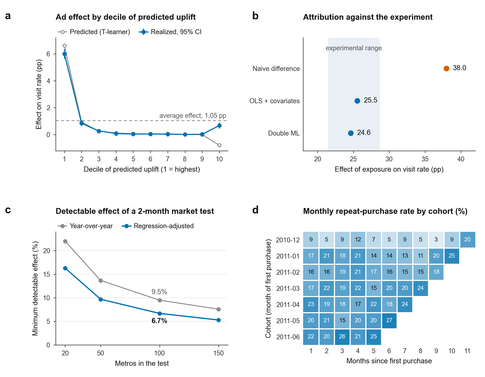

# The ad took a bow for sales it didn't make

[](https://github.com/lyz44git/ad-measurement-and-metrics/actions/workflows/tests.yml)

**Four in ten conversions credited to the ads would have happened anyway.**

Someone sees an ad. Later, they buy. Did the ad make the sale?

The usual tally says yes. Every conversion of a user who saw an ad goes in the ad's column, whether or not that
person was going to convert anyway. (A conversion is the action the advertiser wanted, such as a purchase.) On a
public dataset released by Criteo, that tally gives the ads 23,031 conversions.

Criteo had also run an experiment. Fourteen million users were split at random into a group that could be shown ads
and a group that could not. Comparing the two groups, the ads caused 13,687 conversions. The other 9,300 or so, four
in ten of those credited, would have happened without the ads. The ads took a bow for all 23,031, a tally 68% too
high.

This repository follows that gap through four questions: what the ads did cause, who gets the credit when there is no
experiment, how to plan the next test, and whether the customers being counted are counted correctly. All data are
public. Where a result rests on a pass-or-fail rule, the rule was fixed and hashed before the result was seen, and the
rules that were not met are listed in section 5.



**Figure 1 | The argument of the repository, one panel per step, in reading order.** **a**, Study 01a. Effect of assignment to the ad arm on the visit rate by decile of predicted uplift among 4.19M held-out users: realized effect with its 95% interval (blue), T-learner prediction (gray) and the average effect (dashed). The top fifth of users by this score accounts for 75% of incremental visits; ranking by a plain response model gives the same share. Inset: visit and conversion rates in the ad arm relative to control for all 14.0M users. **b**, Study 02a. Visits and conversions in the ad arm credited by exposure-based attribution, relative to those caused by the ads according to the unadjusted experimental estimate (= 100). **c**, Study 02c. Absolute relative error of a per-brand marketing mix model's channel return against a signal-to-noise index computed before fitting, in a held-out daily simulation on real spend (test T1, 54 brand-channels); lines are group medians and the threshold of 2 was fixed before this test. **d**, Study 03a. Smallest lift in visit rate detectable with 80% power by users per arm, for an unadjusted readout and for readouts adjusted for 12 user features or for a model prediction built from them; dots mark the sample needed for a one-point lift. **e**, Study 04. Monthly repeat-purchase rate of new-account cohorts under a 12-month look-back; a 3-month look-back would label 1,036 accounts new, 62% of which had bought in the prior 12 months. Drawn by [`figures/make_figure1.py`](figures/make_figure1.py) from the result files in each study folder.

## 1. Part of the bow was earned. The ads did work.

Assignment to the ad group raised the visit rate from 3.82% to 4.85% and the conversion rate from 0.19% to 0.31%.
Only 3.6% of that group saw an ad ([01a](01_with_an_experiment/01a_ad_incrementality)).

The effect is concentrated: the fifth of users that a model ranks highest accounts for 75% of the extra visits. A
model built to find the users an ad can persuade ranked them no better than a plain model of who visits anyway
([01a](01_with_an_experiment/01a_ad_incrementality)).

Split a 2% sample into 100 segments and the estimates get noisy. Estimating the segments together, in a multilevel
model, cut their error by 27%, in 10 samples out of 10 ([01b](01_with_an_experiment/01b_bayesian_segment_effects)).

The same approach works when noise is added to the counts to protect privacy. At a privacy budget of epsilon = 1, the
protected estimates are as accurate (1.06 points of error) as unprotected estimates made one segment at a time (1.08)
([01d](01_with_an_experiment/01d_private_segment_effects)).

The readout can be audited line by line. A few SQL queries, each metric's numerator and denominator stated first,
reproduce the rates and effects above and the two counts of the opening; all 29 comparisons with the Python results
agree. The data checks also record that the file has no user ID and that 16% of its rows are identical to another row
([01c](01_with_an_experiment/01c_sql_metric_readout)).

<sub><b>How this is known.</b> A randomized experiment on 13,979,592 users, read as the effect of assignment, with regression adjustment as a check. Uplift models compared with a response model on held-out users. A Bayesian multilevel model on ten 2% samples, scored against the other 98% of users. Laplace noise for differential privacy at four privacy budgets. DuckDB for the SQL.</sub>

## 2. Without an experiment, the rule decides who takes the bow.

Crediting the ads with every outcome of a user who saw one gives them 68% more conversions and 44% more visits than
they caused ([02a](02_without_an_experiment/02a_attribution_metric_validation)).

Compare users who saw an ad with users of the same group who did not, and the apparent effect on the visit rate is
38.0 points. Adjusting for what is known about the users brings it to 24.6-25.5, between the two experimental
estimates (21.5 and 28.7) ([02a](02_without_an_experiment/02a_attribution_metric_validation)).

When a path has several ad contacts, the rule that splits the credit changes the credit a great deal: giving it all to
the last contact leaves 82% of the contacts with none ([02b](02_without_an_experiment/02b_multi_touch_attribution)). It changes little of what a bidder buys. In a
replay on logged impressions and prices, a bidder that values impressions by last-touch credit and one that uses
time-decay credit put 90% of their spend on the same impressions at half the logged budget, and bidding with the other
rule's model lost at most 2.2% of the credit. The bar set in advance was 5% ([02d](02_without_an_experiment/02d_attribution_and_bidding)).

A marketing mix model can measure a channel only where that channel's spend moves enough on its own. A signal-to-noise
index, computed before any model is fitted, says where. In simulations with known returns on real spend, the median
error was 19% for brand-channel pairs with an index of 2 or more and 50% for the rest. Only 19% of pairs reach 2 on
weekly data; 55% do on daily data. Fitting all brands in one model did not help ([02c](02_without_an_experiment/02c_marketing_mix_modeling)).

<sub><b>How this is known.</b> Attribution counts set against the experiment of section 1; regression and double machine learning for the adjusted estimates. Credit rules on 6.1M display-ad paths. A replay of two bidders on 4.6M logged impressions at their logged prices. Marketing mix simulations with known returns on the real spend of 31 to 34 e-commerce brands, with the index tested on simulations it had not seen.</sub>

## 3. To see what the ads caused, run a test. For conversions, a big one.

Detecting a one-point lift in the visit rate takes about 6,500 users per group. Adjusting for what is known about
users before the test brings that to about 4,400 ([03a](03_planning_a_test/03a_lift_study_sizing)).

Conversions are about 20 times rarer than visits, and the test grows by the same factor: detecting a 10% lift takes
849,000 users per group for conversions, against 41,000 for visits ([01c](01_with_an_experiment/01c_sql_metric_readout)).

When only whole markets can be randomized, the test is less sensitive. In placebo tests on housing-market series for
151 U.S. metros, one hundred metros over two months detect a 6.7% change with regression adjustment on pre-period
volume, against 9.5% with a year-over-year comparison ([03b](03_planning_a_test/03b_geo_experiment_design)).

A plan also needs a baseline at every level at which the result will be read. Forecasts of a housing-market series
made separately for the nation, the states and the metros disagreed by 3.5% to 5.2% until they were reconciled
([03c](03_planning_a_test/03c_hierarchical_forecasting)).

<sub><b>How this is known.</b> For users, 2,000 resampled studies per sample size with A/A checks, and the two-proportion sample-size formula. For markets, 5,000 placebo tests per design. For forecasts, 24 rolling forecast origins on a hierarchy of 873 series.</sub>

## 4. The same overcount hides in "new customers."

Counting customers has the problem that counting conversions has: the count takes in people who were already there.
With a three-month look-back, 1,036 accounts of a UK online retailer count as new customers. 640 of them had bought in
the prior 12 months ([04](04_customer_metrics_retention)).

Among high-value accounts, a purchase model ranked who would buy again within six months better than time since the
last purchase alone (AUC 0.79 against 0.75). For ranking sales over the next 12 months, a rule based on past sales did
better than the model ([04](04_customer_metrics_retention)).

<sub><b>How this is known.</b> Two years of transactions (794,163 lines, 5,875 accounts; no ads in these data). The metric tables rebuilt in SQL match the Python results in all 92 cells.</sub>

## 5. No bow for these: six pre-set tests were not passed.

The standard applied to the ads applies to the methods here. Each of these missed a bar that was set before the
result was seen, and is reported as a miss.

- The uplift model did not beat a plain response model at ranking users for targeting ([01a](01_with_an_experiment/01a_ad_incrementality)).
- Adding media to a revenue forecast did not reliably improve it ([02c](02_without_an_experiment/02c_marketing_mix_modeling)).
- Fitting all brands in one marketing mix model did not improve the recovery of channel returns ([02c](02_without_an_experiment/02c_marketing_mix_modeling)).
- Changing the credit rule did not cost a bidder the 5% of credit set as the bar ([02d](02_without_an_experiment/02d_attribution_and_bidding)).
- Ranking segments by estimated lift did not reliably beat ranking by response rate at a 30% budget, though it did at
  10% and 20% ([01d](01_with_an_experiment/01d_private_segment_effects)).
- The purchase model did not beat a past-sales rule at ranking 12-month sales ([04](04_customer_metrics_retention)).

## The studies

One folder per question, with the studies inside it. Each study has its own README with the question, data, method,
results, limits and the commands to reproduce it.

| Study | Question | Data |
|---|---|---|
| **1. With an experiment** ([folder](01_with_an_experiment)) | | |
| [`01a_ad_incrementality`](01_with_an_experiment/01a_ad_incrementality) | How many site visits did the ads cause, as opposed to visits that would have happened anyway? | Criteo experiment |
| [`01b_bayesian_segment_effects`](01_with_an_experiment/01b_bayesian_segment_effects) | Can segment-level ad effects be read from a 2% sample? | Criteo experiment |
| [`01c_sql_metric_readout`](01_with_an_experiment/01c_sql_metric_readout) | Is every number of the readout defined, checked and reproducible from the raw file? | Criteo experiment |
| [`01d_private_segment_effects`](01_with_an_experiment/01d_private_segment_effects) | If segment counts are released with differential-privacy noise, how much accuracy is left? | Criteo experiment |
| **2. Without an experiment** ([folder](02_without_an_experiment)) | | |
| [`02a_attribution_metric_validation`](02_without_an_experiment/02a_attribution_metric_validation) | Can an exposure-based attribution metric be trusted as a measure of ad impact? | Criteo experiment |
| [`02b_multi_touch_attribution`](02_without_an_experiment/02b_multi_touch_attribution) | When a user sees several ads before converting, how much does the credit rule change which touch gets credit? | Criteo attribution log |
| [`02c_marketing_mix_modeling`](02_without_an_experiment/02c_marketing_mix_modeling) | Can a marketing mix model recover each channel's return from a brand's own spend and revenue, and can one tell in advance when it will? | Conjura e-commerce brands |
| [`02d_attribution_and_bidding`](02_without_an_experiment/02d_attribution_and_bidding) | If a bidder values impressions by expected credit, does the attribution rule change what it buys? | Criteo attribution log |
| **3. Planning a test** ([folder](03_planning_a_test)) | | |
| [`03a_lift_study_sizing`](03_planning_a_test/03a_lift_study_sizing) | How many users per arm does a lift study need, and how much does covariate adjustment save? | Criteo experiment |
| [`03b_geo_experiment_design`](03_planning_a_test/03b_geo_experiment_design) | If a change can only be randomized by market, how large a test is needed, and does the usual t-test keep its 5% false-positive rate? | Zillow metro series |
| [`03c_hierarchical_forecasting`](03_planning_a_test/03c_hierarchical_forecasting) | Can the baseline of a metric be forecast at national, state and metro levels so that the levels add up, without losing accuracy? | Zillow metro series |
| **4. Customer metrics** | | |
| [`04_customer_metrics_retention`](04_customer_metrics_retention) | Does the "new customer" metric count returning buyers as new, and which high-value customers are least likely to return? | UCI Online Retail II |

### Studies by method

| Method | Studies |
|---|---|
| Randomized experiment readout: effect of assignment, effect per exposed user | 01a, 01c |
| Regression and covariate adjustment (ANCOVA, model prediction as covariate) | 01a, 03a, 03b |
| Uplift models (T-, X- and DR-learner, causal forest) and targeting curves | 01a |
| Bayesian multilevel models (NUTS) | 01b, 01d, 02c |
| Differential privacy (Laplace mechanism on counts) | 01d |
| SQL metric definitions, data checks and reconciliation (DuckDB) | 01c, 04 |
| Observational causal estimates (regression with robust errors, double machine learning) | 02a |
| Attribution rules; exponential waiting-time model of touch-to-conversion delays | 02b |
| Bidding replay on logged prices with gradient-boosted value models | 02d |
| Marketing mix models (carry-over, saturation), simulation-based recovery, signal-to-noise diagnostic | 02c |
| Power, minimum detectable effect, A/A tests, placebo tests, randomization inference | 01c, 03a, 03b |
| Time-series forecasting (ETS, ARIMA), hierarchical reconciliation, rolling-origin backtests | 03c; holdout forecasts in 02c |
| Stochastic models of purchasing (BG/NBD: Poisson purchases with dropout; Gamma-Gamma spend), cohorts, clustering | 04 |
| Bootstrap and resampling for uncertainty | 01b, 02b, 02d, 03a, 04 |

Where a conclusion depends on a decision rule, the analysis plan was fixed before the run and its SHA-256 is recorded
in the study's `logs/` folder. Follow-up analyses added after a first result have their own plan and are labeled as
follow-ups. Results that did not support the more complex method are reported alongside the rest.

## Data sources and terms

Data are not included in this repository. The randomized experiment used in studies 01a to 01d, 02a and 03a was designed,
run and released by Criteo. Studies 02b and 02d use Criteo's attribution dataset, studies 03b and 03c public Zillow
Research files, study 04 the UCI Online Retail II data, and study 02c a public marketing mix dataset released by Conjura.

| Data | Used in | Terms |
|---|---|---|
| Criteo Uplift Prediction Dataset v2.1 (Diemert, Betlei, Renaudin and Amini 2018, AdKDD) | 01a, 01b, 01c, 01d, 02a, 03a | Research, non-commercial use. The data pool several tests with non-uniform subsampling, so absolute lifts are not population effects. |
| Zillow Research, metro newly pending listings (03b), for-sale inventory and new listings (03c) | 03b, 03c | Data Provided by Zillow Group. Only derived simulation results and aggregate error tables are stored here. |
| UCI Machine Learning Repository, Online Retail II (id 502) | 04 | CC BY 4.0. |
| Criteo Attribution Modeling for Bidding Dataset (Diemert, Meynet, Galland and Lefortier 2017, AdKDD) | 02b, 02d | CC BY-NC-SA 4.0. The derived results in the `out/` folders of studies 02b and 02d are shared under the same license. |
| Conjura, Multi-Region Marketing Mix Modelling (MMM) Dataset for Several eCommerce Brands (Figshare 25314841) | 02c | CC BY 4.0. |

**Use.** This is a non-commercial research project. The data and all derived outputs in this repository are used
for research only.

## Repository layout

One folder per question, with the studies inside it:

```
01_with_an_experiment/
├── 01a_ad_incrementality/
├── 01b_bayesian_segment_effects/
├── 01c_sql_metric_readout/
└── 01d_private_segment_effects/
02_without_an_experiment/
├── 02a_attribution_metric_validation/
├── 02b_multi_touch_attribution/
├── 02c_marketing_mix_modeling/
└── 02d_attribution_and_bidding/
03_planning_a_test/
├── 03a_lift_study_sizing/
├── 03b_geo_experiment_design/
└── 03c_hierarchical_forecasting/
04_customer_metrics_retention/     one study
figures/                           Figure 1 and the scripts that draw the figures
```

Study folders share this structure (not every study needs every folder):

```
study_name/
├── README.md     question, method, findings, limitations, how to run
├── code/         scripts, numbered in run order
├── docs/ or design/   analysis plan written before the run, and any deviations from it
├── out/          result tables (JSON / CSV) and figures
├── logs/         run logs and the SHA-256 of the plan, recorded before the run
└── tests/        checks on simulated data (in `code/tests/` for study 01a)
```

Data go in a git-ignored `data_raw/` folder inside each study; see each README for the download link.

## Setup

```bash
python -m venv .venv && source .venv/bin/activate
pip install -r requirements.txt
```

Tested with Python 3.13 on macOS. Studies 01a and 02a load the full Criteo file and need about 16 GB of memory.
Studies 01b, 01d and 02c also need NumPyro and JAX: `pip install -r 02_without_an_experiment/02c_marketing_mix_modeling/requirements-mmm.txt`.

## Tests

```bash
pytest -q
```

The tests run on simulated data, so they need none of the datasets. They check that the estimators recover a known
effect and do not detect one that is absent, that false-positive rates stay near 5% under a true null, that adjusting
for a predictive covariate lowers the variance of a readout by the expected amount, that the purchase and spend models
recover known parameters, that the published SQL agrees with an independent pandas implementation and that its data
checks catch planted errors, that each attribution rule gives a conversion exactly one unit of credit, that no
bid-time feature uses anything that happens at or after the impression, that the privacy noise has the stated scale,
that reconciled forecasts add up across levels and use no data from after the forecast origin, and that the adstock
and saturation transforms behave as specified. They run on every push (see the badge above).

## License

Code is released under the MIT License (see `LICENSE`). The datasets keep their own terms, listed above; the derived
results of studies 02b and 02d follow CC BY-NC-SA 4.0.

## Notes

Developed with an AI-assisted coding workflow. The research questions, analysis plans and interpretation of results
were led by the author. All results are reproducible from the scripts and public data referenced in each study.
