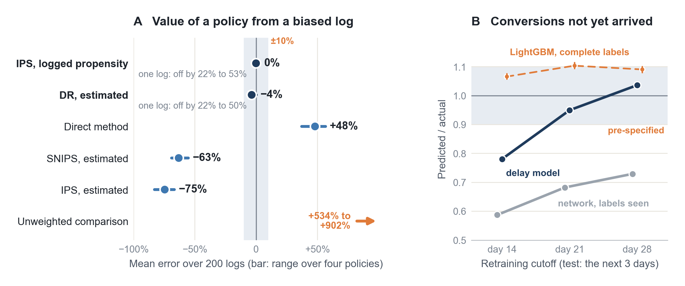
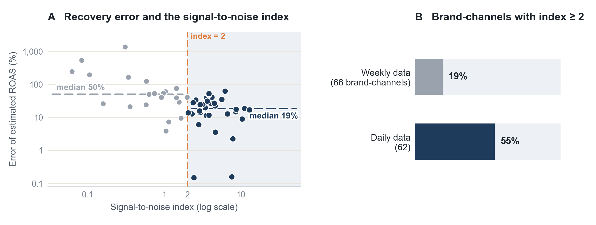
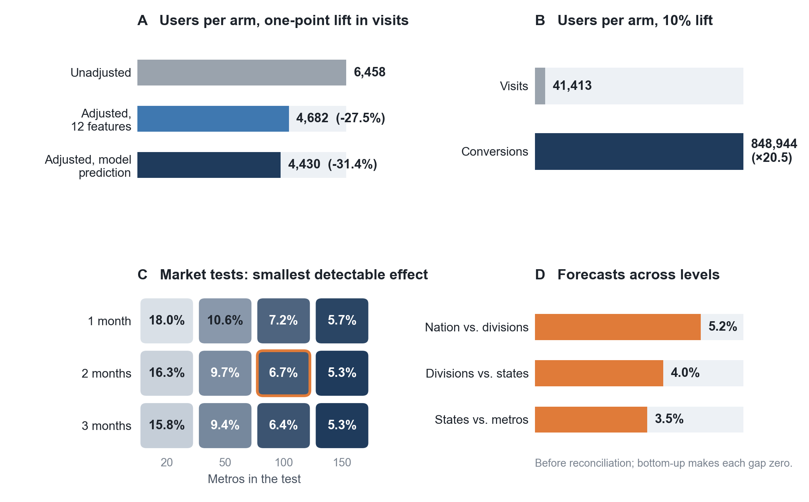
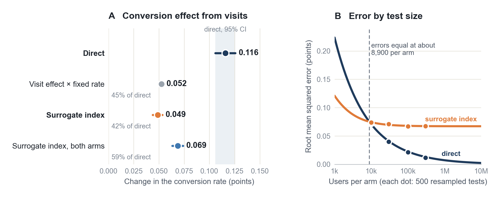

# The ads worked. Proving how much is the hard part.

[](https://github.com/lyz44git/ad-measurement-and-metrics/actions/workflows/tests.yml)

**[Explore the interactive version →](https://lyz44git.github.io/ad-measurement-and-metrics/)** Switch the attribution rule, choose the size of a test, or look further back in a customer's history, and the charts follow.

**In a randomized experiment on 14 million users, advertising raised the conversion rate by 59%. A simple
attribution count would have credited it with 68% more conversions than it caused.**

When a user is shown an ad and later converts, how much of that conversion is due to the ad?

In the experiment studied here, a substantial part. Criteo assigned fourteen million users at random to a group that
could be shown ads or to a group that could not. Users in the first group visited 27% more often and converted 59%
more often, and the ads caused 13,687 conversions, or about 11,902 after regression adjustment. Both are estimates
from the random assignment on Criteo's public release, which pools several tests with non-uniform subsampling. (A
conversion is the action the advertiser wanted, such as a purchase.)

Without the experiment, this number could not have been established. The simplest attribution rule credits the ads
with every conversion by a user who was shown one. It counts 23,031 conversions, 68% more than the ads caused; about
four in ten of the conversions it counts exceed the estimated net lift. A budget based on that count would rest on an
overstated figure.

This repository examines how to measure the effect of advertising correctly. It addresses four questions in turn:
what the ads caused, how credit is assigned when no experiment is available, how to plan the next test, and whether
the customer counts used in reporting are defined correctly. All data are public. Where a result rests on a
pass-or-fail rule, the rule was fixed and hashed before the result was seen; the rules that were not met are listed in
section 5. Section 6 compares the results with published research.

**Scope.** The results establish that the advertising in this experiment was effective and that one simple
attribution rule overstated its effect. They do not assess the reporting of any advertising platform. The size of the
overstatement is specific to this rule and to these data, a subsample of tests run on one display-advertising
network. What generalizes is the method: validating a metric against a randomized experiment.

<a href="https://lyz44git.github.io/ad-measurement-and-metrics/index.html"></a>

**Figure 1. The effect of advertising in the experiment, and the outcomes credited by a simple count.** *Notes:* Panel A shows the visit rate and the conversion rate in the control group and in the ad group, for 14.0 million randomized users, with the relative difference. Panel B compares, within the ad group, the outcomes of users who were shown an ad ("credited", the count that an exposure-based attribution rule assigns to the ads) with the outcomes the ads caused according to the experiment (the difference in rates between groups times the number of users in the ad group), for conversions and for visits; the bar on the caused estimate is its 95% confidence interval. Panel C shows that about 41 of every 100 credited conversions exceed the estimated net lift (the unadjusted estimate). The released data are a non-uniform subsample of several tests, so rates are not population rates. Studies 01a, 01c and 02a.

## 1. The ads were effective: visits rose 27% and conversions 59%.

<a href="https://lyz44git.github.io/ad-measurement-and-metrics/01.html"></a>

**Figure 2. Heterogeneity of the effect and segment-level estimates.** *Notes:* Panel A shows the effect of the ads on the visit rate by decile of predicted uplift among 4.19 million held-out users, with the band giving its 95% confidence interval, the uplift model's prediction (dashed) and the average effect. Panel B shows the root mean squared error of the estimated effects of 100 segments against a benchmark computed on the other 98% of users, in each of ten 2% samples (thin lines) and on average (thick line), for segments estimated separately and for a Bayesian multilevel model. Panel C shows the same error when Laplace noise is added to the counts for differential privacy, by privacy budget; the dashed line is the error of separate estimates without noise. Studies 01a, 01b and 01d.

Assignment to the ad group raised the visit rate from 3.82% to 4.85% and the conversion rate from 0.19% to 0.31%.
Only 3.6% of that group was shown an ad ([01a](01_with_an_experiment/01a_ad_incrementality)).

Adjusted for the 12 user features, the effects are smaller: 0.77 instead of 1.03 points for visits and 0.100 instead
of 0.115 points for conversions ([01a](01_with_an_experiment/01a_ad_incrementality)). In this pooled release the
chance of being assigned to ads varies slightly with the features; study [02e](02_without_an_experiment/02e_off_policy_evaluation) examines this.

The effect is concentrated: the fifth of users ranked highest by a model accounts for 75% of the incremental visits.
An uplift model, designed to identify the users whom an ad can persuade, ranked them no better than a simple model of
which users visit in any case ([01a](01_with_an_experiment/01a_ad_incrementality)).

When a 2% sample is divided into 100 segments, the segment estimates become noisy. Estimating all segments jointly in
a multilevel model reduced their error by 27%, in 10 of 10 samples ([01b](01_with_an_experiment/01b_bayesian_segment_effects)).

The same approach holds when noise is added to the counts to protect privacy. At a privacy budget of epsilon = 1, the
protected multilevel estimates have a mean error (1.06 points) no higher than that of unprotected estimates made one
segment at a time (1.08); for the same multilevel model, the noise raises the mean error from 0.95 to 1.06 points.
The study simulates accuracy; it is not a deployed privacy guarantee ([01d](01_with_an_experiment/01d_private_segment_effects)).

The readout can be audited line by line. A small set of SQL queries, with the numerator and denominator of each
metric stated beforehand, reproduces the rates and effects above and the two conversion counts in the introduction;
all 29 comparisons with the Python results agree. The data checks also record that the file has no user identifier
and that 16% of its rows are identical to another row ([01c](01_with_an_experiment/01c_sql_metric_readout)). The
same four queries return identical values in all 55 output cells on Spark and DuckDB.

<sub><b>Methods.</b> A randomized experiment on 13,979,592 users, read as the effect of assignment, with regression adjustment as a check. Uplift models compared with a response model on held-out users. A Bayesian multilevel model on ten 2% samples, scored against the other 98% of users. Laplace noise for differential privacy at four privacy budgets. DuckDB for the SQL.</sub>

## 2. Without an experiment, the credit depends on the attribution rule.

<a href="https://lyz44git.github.io/ad-measurement-and-metrics/02.html"></a>

**Figure 3. Attribution without an experiment.** *Notes:* Panel A shows estimates of the effect of being shown an ad on the visit rate: two experimental estimates (bold; the shaded band spans them) and three non-experimental estimates, with 95% confidence intervals. Panel B shows, for conversions preceded by several ad contacts, the share of credit that each of four attribution rules assigns to the last contact and to earlier contacts, by how long before the last contact they occurred. Panel C shows the share of credit a bidder loses when it bids with a value model trained on the other attribution rule, at three budgets, with 95% confidence intervals from a bootstrap over users; below each budget is the share of spend the two bidders place on the same impressions, and the dashed line is the threshold fixed before the analysis. Studies 02a, 02b and 02d.

Crediting the ads with every outcome of a user who was shown one assigns them 68% more conversions and 44% more
visits than they caused ([02a](02_without_an_experiment/02a_attribution_metric_validation)).

A direct comparison of users who were shown an ad with users in the same group who were not gives an apparent effect
on the visit rate of 38.0 points. Adjusting for user characteristics lowers it to 24.6-25.5, between the two
experimental estimates (21.5 and 28.7). The adjusted figures are associations within the ad group and the experimental
ones are effects on users exposed because of assignment, so the range between them is descriptive, not a bound
([02a](02_without_an_experiment/02a_attribution_metric_validation)).

The experiment can also check an estimate for a decision not yet taken: the extra visits a new targeting rule would
bring. On 200 logs built from the experiment so that an earlier rule favored likely visitors, weighting by the
recorded probability of assignment gives, on average, a value within 3% of a feature-adjusted benchmark from the
experiment for each of four rules; a doubly robust estimator that has to estimate the probability comes within 6%.
One log of about 108,000 users is far less exact: its error averages 22% to 53% across the rules, above the 10% set
in advance. An unweighted comparison gives 6 to 10 times the benchmark. These estimates value a targeting rule; they
do not divide credit among the ads that precede a conversion ([02e](02_without_an_experiment/02e_off_policy_evaluation)).

When a conversion follows several ad contacts, the rule that divides the credit matters greatly for the credit
itself: assigning all of it to the last contact leaves 82% of the contacts with none ([02b](02_without_an_experiment/02b_multi_touch_attribution)). It matters little
for which impressions a bidder buys. In a replay on logged impressions and prices, a bidder that values impressions by
last-touch credit and one that values them by time-decay credit spent 90% of their budgets on the same impressions at
half the logged budget, and bidding with the other rule's model lost at most 2.2% of the credit, below the 5%
threshold set in advance ([02d](02_without_an_experiment/02d_attribution_and_bidding)).

The bidding replay used complete labels. A model retrained each day has only the conversions that have arrived:
across three cutoffs, two models trained on those predicted 27% to 44% too few. A model of the delay brought
predicted over actual conversions to 0.95 and 1.04 with three and four weeks of data, and to 0.78 with two. At two
weeks no impression has been followed for longer than two weeks, 21% of conversions take longer, and the forecast
depends on how the model extrapolates ([02f](02_without_an_experiment/02f_delayed_conversions)).

<a href="https://lyz44git.github.io/ad-measurement-and-metrics/02.html#s02e"></a>

**Figure 3b. Two checks on estimates made from logs.** *Notes:* Panel A compares off-policy estimates of the extra visits under a targeting policy with a feature-adjusted benchmark from the experiment, on logs that favor likely visitors (moderate setting). Each dot is the mean error over 200 logs as a share of the benchmark, averaged over four policies; the bar spans the four policies, and the shaded band marks ±10%. The gray text gives the mean absolute error of a single log, which is the quantity the plan's accuracy rule names; the rule was not met. IPS is inverse probability weighting, SNIPS its self-normalized form and DR the doubly robust estimator; "logged" and "estimated" refer to the probability of assignment. The unweighted comparison is off the scale. Panel B shows predicted over actual conversions for impressions in the three days after a retraining cutoff, for a network trained on the conversions seen at the cutoff, the same network with a delayed-feedback likelihood, and LightGBM trained on complete 30-day labels (dashed), with 95% intervals; 1 is exact calibration in aggregate, and the shaded band is the pre-specified 0.90 to 1.10. Studies 02e and 02f.

A marketing mix model can measure a channel only where spending on that channel varies sufficiently on its own. In
simulations with known returns on real spending, a signal-to-noise index computed from the planted contribution,
before the marketing mix model is fitted, identifies those cases: the median error was 19% for brand-channel pairs with
an index of 2 or more and 50% for the rest. Only 19% of pairs reach an index of 2 in the weekly simulation, against 55%
in the daily one; the two also differ in planted returns, noise, sample and carry-over, so the gap is not due to
frequency alone. Fitting all brands in a single model did not improve the estimates ([02c](02_without_an_experiment/02c_marketing_mix_modeling)).

<a href="https://lyz44git.github.io/ad-measurement-and-metrics/02.html#s02c"></a>

**Figure 4. When a marketing mix model can measure a channel.** *Notes:* Panel A plots the absolute relative error of a channel's estimated return on ad spend (ROAS) against a signal-to-noise index computed from the planted contribution before the model is fitted, for 54 brand-channel pairs in a held-out simulation with known returns on real daily spending; the dashed line marks the threshold of 2, fixed before the held-out test, and the horizontal lines the median error on each side. Panel B shows the share of brand-channel pairs with an index of 2 or more, in the weekly and the daily simulation. Study 02c.

<sub><b>Methods.</b> Attribution counts set against the experiment of section 1; regression and double machine learning for the adjusted estimates. Credit rules on 6.1M display-ad paths. A replay of two bidders on 4.6M logged impressions at their logged prices. Marketing mix simulations with known returns on the real spend of 31 to 34 e-commerce brands, with the index tested on simulations it had not seen. Inverse propensity, self-normalized and doubly robust estimators on 400 logs built from the experiment by rejection sampling. A delayed-feedback network in PyTorch on 16.5M impressions, retrained at days 14, 21 and 28.</sub>

## 3. Measuring the effect again requires a test, and a large one for conversions.

<a href="https://lyz44git.github.io/ad-measurement-and-metrics/03.html"></a>

**Figure 5. Planning the next test.** *Notes:* Panel A shows the users per arm needed for 80% power to detect a one-percentage-point lift in the visit rate, for an unadjusted readout and for readouts adjusted for 12 user features or for a model prediction built from them. Panel B shows the users per arm needed to detect a 10% relative lift in the visit rate and in the conversion rate. Panel C shows the smallest effect detectable with 80% power by a regression-adjusted market-level test, by number of metros and test length, from placebo tests on housing-market series; the outlined cell is the two-month, 100-metro design discussed in the text. Panel D shows the mean gap between a forecast and the sum of the forecasts one level below it before reconciliation, for a housing-market series; reconciliation removes the gap. Panels C and D: Data Provided by Zillow Group. Studies 03a, 01c, 03b and 03c.

Detecting a one-point lift in the visit rate requires about 6,500 users per group. Adjusting for user
characteristics recorded before the test reduces this to about 4,400 ([03a](03_planning_a_test/03a_lift_study_sizing)).

Conversions are about 20 times rarer than visits, and the required sample grows by the same factor: detecting a 10%
lift requires 849,000 users per group for conversions, against 41,000 for visits ([01c](01_with_an_experiment/01c_sql_metric_readout)).

Visits cannot stand in for conversions in a smaller test. An estimate that converts the extra visits at the rate
predicted for visitors of their kind is 0.049 points, 42% of the 0.116 measured directly, and a third after
adjustment for the user features; the margin of ±20% set in advance was not met. Among visitors, 6.36% converted in
the ad group against 5.03% in the control group. Because assignment can also change who visits, this describes the
gap and does not identify how the ads worked. The errors of the two estimates are equal at about 8,900 users per
group, where each is about 65% of the effect ([03d](03_planning_a_test/03d_surrogate_outcome)).

<a href="https://lyz44git.github.io/ad-measurement-and-metrics/03.html#s03d"></a>

**Figure 5b. How much of the conversion effect a visit-based estimate contains.** *Notes:* Panel A shows unadjusted estimates of the effect of assignment on the conversion rate, on the half of the experiment not used to fit the models: the direct difference between groups (the shaded band repeats its 95% confidence interval), visits times a fixed conversion rate, and a surrogate index from a model of which visitors convert, fitted on control-group visitors of the other half or on visitors of both groups; with 95% confidence intervals and each estimate's share of the direct one. The pre-specified test compared the 90% interval of the relative difference, −61% to −54%, with a margin of ±20%. Panel B shows the root mean squared error of the direct estimate and of the surrogate index against the direct estimate on that half, for equal groups. The curves use the estimated bias and variances, each dot summarizes 500 resampled tests at one of four sizes, and the dashed line marks where the curves cross. Study 03d.

When only whole markets can be randomized, the test is less sensitive. In placebo tests on housing-market series for
151 U.S. metros, a two-month test in 100 metros detects a 6.7% change with regression adjustment on pre-period volume,
against 9.5% with a year-over-year comparison ([03b](03_planning_a_test/03b_geo_experiment_design)).

A test plan also requires a baseline at every level at which the result will be reported. Forecasts of a
housing-market series made separately for each level differed from the sum of the forecasts one level below by 3.5%
to 5.2% at the three parent levels (US, divisions, states) until they were reconciled ([03c](03_planning_a_test/03c_hierarchical_forecasting)).

<sub><b>Methods.</b> For users, 2,000 resampled studies per sample size with A/A checks, and the two-proportion sample-size formula. For markets, 5,000 placebo tests per design. For forecasts, 24 rolling forecast origins on a hierarchy of 873 series. For the visit-based estimate, a surrogate index from a model of which visitors convert, with 500 resampled tests per size.</sub>

## 4. Customer counts require the same scrutiny.

<a href="https://lyz44git.github.io/ad-measurement-and-metrics/04.html"></a>

**Figure 6. Customer counts and customer models.** *Notes:* Panel A shows the 1,036 accounts that a three-month look-back labels as new (bought in March–May 2011, not in December 2010–February 2011), split by whether they had made a purchase in December 2009–November 2010. Panel B shows the accuracy (AUC) of ranking which high-value accounts buy again within six months, by time since the last purchase and by a purchase model. Panel C shows the rank correlation of predicted with actual sales for the purchase model and for a past-sales rule, on a 6-month holdout (cutoff 2011-06-01; accounts with a purchase in the prior six months; rule: sales in those six months) and a 12-month holdout (cutoff 2010-12-01; accounts with any earlier purchase; rule: all earlier sales). The two samples overlap in accounts and differ in cutoff, activity screen and rule, so the difference between them is not due to the horizon alone. Error bars are 95% confidence intervals. Study 04.

Customer counts share a weakness with conversion counts: they include people who were already customers. With a
three-month look-back, 1,036 accounts of a UK online retailer that bought in March–May 2011 are classified as new
customers, of which 640 had made a purchase in December 2009–November 2010 ([04](04_customer_metrics_retention)).

Among high-value accounts, a purchase model ranked which accounts would buy again within six months better than time
since the last purchase alone (AUC 0.79 against 0.75). For ranking sales over the following 12 months, a rule based on
past sales performed better than the model ([04](04_customer_metrics_retention)).

<sub><b>Methods.</b> Two years of transactions (794,163 lines, 5,875 accounts; no ads in these data). The metric tables rebuilt in SQL match the Python results in all 92 cells.</sub>

## 5. Thirteen pre-specified tests were not passed.

Each of the following fell short of a threshold that was fixed before the result was seen.

- The uplift model did not outperform a simple response model in ranking users for targeting ([01a](01_with_an_experiment/01a_ad_incrementality)).
- Adding media variables to a revenue forecast did not reliably improve it ([02c](02_without_an_experiment/02c_marketing_mix_modeling)).
- Fitting all brands in one marketing mix model did not improve the recovery of channel returns ([02c](02_without_an_experiment/02c_marketing_mix_modeling)).
- Changing the attribution rule did not reduce a bidder's captured credit by the 5% set as the threshold ([02d](02_without_an_experiment/02d_attribution_and_bidding)).
- Ranking segments by estimated lift did not reliably outperform ranking by response rate at a 30% budget, although it
  did at 10% and 20% ([01d](01_with_an_experiment/01d_private_segment_effects)).
- The purchase model did not outperform a past-sales rule in ranking 12-month sales ([04](04_customer_metrics_retention)).
- The effect on visits did not recover the effect on conversions within ±20%
  ([03d](03_planning_a_test/03d_surrogate_outcome)).
- A delayed-feedback model did not reach the calibration band at all three retraining cutoffs; it missed at day 14
  ([02f](02_without_an_experiment/02f_delayed_conversions)).
- A GRU over the user's recent impressions did not improve the delayed-feedback model
  ([02f](02_without_an_experiment/02f_delayed_conversions)).
- A Weibull delay did not improve the day-14 calibration of the delayed-feedback model when scored as planned, on
  the probability of converting at any time ([02f](02_without_an_experiment/02f_delayed_conversions)).
- In a first design that assumed a constant assignment share, the mean of doubly robust estimates from biased logs
  did not come within 10% of the experiment's unadjusted policy values ([02e](02_without_an_experiment/02e_off_policy_evaluation)).
- In the second design, inverse probability weighting with the logged probability did not reach a mean absolute error
  below 10% of the benchmark: one log is off by 22% to 53% on average, although the mean over logs is within 3% and
  the interval coverage met its 90% ([02e](02_without_an_experiment/02e_off_policy_evaluation)).
- In the same design, the doubly robust estimator with an estimated probability did not reach it either: 22% to 50%
  for one log, with a mean within 6% and coverage above 90% ([02e](02_without_an_experiment/02e_off_policy_evaluation)).

## 6. Published research reports the same pattern.

Published research also finds that the effect of advertising is real and smaller than a direct comparison
suggests. The full comparison, result by result and with references, is in [RELATED_RESEARCH.md](RELATED_RESEARCH.md).

- **Observational estimates.** On 15 and then 663 experiments at Facebook, adjusting for user characteristics often
  failed to recover the experimental effect ([Gordon et al. 2019](https://doi.org/10.1287/mksc.2018.1135); [Gordon, Moakler, and Zettelmeyer 2023](https://doi.org/10.1287/mksc.2022.1413)). The adjusted
  estimate here falls between the experimental ones, a descriptive comparison of different targets; with one
  experiment that is not a counterexample
  ([02a](02_without_an_experiment/02a_attribution_metric_validation)).
- **Test size.** Informative advertising experiments can need more than 10 million person-weeks ([Lewis and Rao 2015](https://doi.org/10.1093/qje/qjv023)),
  the same arithmetic that makes a conversion test here 20 times larger than a visit test ([01c](01_with_an_experiment/01c_sql_metric_readout)).
- **Targeting.** At eBay the users most likely to buy were the wrong ones to target ([Blake, Nosko, and Tadelis 2015](https://doi.org/10.3982/ECTA12423)).
  In this experiment they were the appropriate ones, the case in which predicting the outcome is sufficient ([Fernández-Loría and Provost
  2022](https://jmlr.org/papers/v23/19-480.html)) ([01a](01_with_an_experiment/01a_ad_incrementality)).
- **Returns differ by setting.** Television advertising for 288 brands had a negative return at the margin for more
  than 80% of them ([Shapiro, Hitsch, and Tuchman 2021](https://doi.org/10.3982/ECTA17674)); the ads in this experiment raised conversions by 59%. A
  relative conversion lift and a return on spend are different quantities, but the variation is the reason to measure
  each case.
- **The same correction in finance.** In annual data advertising appeared to raise stock returns ([Lou
  2014](https://doi.org/10.1093/rfs/hhu019)); with daily data the relation was reverse causality ([Focke, Ruenzi, and Ungeheuer 2020](https://doi.org/10.1093/rfs/hhz142)), while a cleanly
  identified effect on investor attention remains ([Liaukonytė and Žaldokas 2022](https://doi.org/10.1287/mnsc.2021.4003)).
- **Proxies and logged data.** A surrogate index recovers a long-run effect when the treatment acts only through
  the proxies ([Athey et al. 2026](https://doi.org/10.3386/w26463)); here the visit-based index was 42% of the
  directly measured effect on conversions ([03d](03_planning_a_test/03d_surrogate_outcome)). The doubly robust estimator is accurate when either the
  outcome model or the model of the logging policy is good ([Dudík, Langford, and Li 2011](https://arxiv.org/abs/1103.4601));
  in study [02e](02_without_an_experiment/02e_off_policy_evaluation) its mean stayed within 6% of the benchmark where inverse weighting with the same estimated
  propensity lost most of the lift.
- **Where the field is going.** Calibrated on 2,226 experiment–conversion-event pairs from 839 experiments,
  campaign-level measures that include last-click counts explain 88% of the variation in incremental conversions per dollar, against 19% for last-click attribution
  alone ([Gordon, Moakler, and Zettelmeyer 2026](https://www.nber.org/papers/w35044)). Attribution becomes informative once it is calibrated
  against experiments, which this repository does on a small scale.

## The studies

One folder per question, with the studies inside it. Each study has its own README with the question, data, method,
results, limits and the commands to reproduce it.

| Study | Question | Data |
|---|---|---|
| **1. With an experiment** ([folder](01_with_an_experiment)) | | |
| [`01a_ad_incrementality`](01_with_an_experiment/01a_ad_incrementality) | How many site visits did the ads cause, as opposed to visits that would have happened anyway? | Criteo experiment |
| [`01b_bayesian_segment_effects`](01_with_an_experiment/01b_bayesian_segment_effects) | Can segment-level ad effects be read from a 2% sample? | Criteo experiment |
| [`01c_sql_metric_readout`](01_with_an_experiment/01c_sql_metric_readout) | Is every number of the readout defined, checked and reproducible from the raw file? | Criteo experiment |
| [`01d_private_segment_effects`](01_with_an_experiment/01d_private_segment_effects) | If segment counts are released with differential-privacy noise, how much accuracy is left? | Criteo experiment |
| **2. Without an experiment** ([folder](02_without_an_experiment)) | | |
| [`02a_attribution_metric_validation`](02_without_an_experiment/02a_attribution_metric_validation) | Can an exposure-based attribution metric be trusted as a measure of ad impact? | Criteo experiment |
| [`02b_multi_touch_attribution`](02_without_an_experiment/02b_multi_touch_attribution) | When a user sees several ads before converting, how much does the credit rule change which touch gets credit? | Criteo attribution log |
| [`02c_marketing_mix_modeling`](02_without_an_experiment/02c_marketing_mix_modeling) | Can a marketing mix model recover each channel's return from a brand's own spend and revenue, and can one tell in advance when it will? | Conjura e-commerce brands |
| [`02d_attribution_and_bidding`](02_without_an_experiment/02d_attribution_and_bidding) | If a bidder values impressions by expected credit, does the attribution rule change what it buys? | Criteo attribution log |
| [`02e_off_policy_evaluation`](02_without_an_experiment/02e_off_policy_evaluation) | What is a targeting policy worth before it has run? | Criteo experiment |
| [`02f_delayed_conversions`](02_without_an_experiment/02f_delayed_conversions) | Can a conversion model trained before its labels arrive be corrected for the delay? | Criteo attribution log |
| **3. Planning a test** ([folder](03_planning_a_test)) | | |
| [`03a_lift_study_sizing`](03_planning_a_test/03a_lift_study_sizing) | How many users per arm does a lift study need, and how much does covariate adjustment save? | Criteo experiment |
| [`03b_geo_experiment_design`](03_planning_a_test/03b_geo_experiment_design) | If a change can only be randomized by market, how large a test is needed, and does the usual t-test keep its 5% false-positive rate? | Zillow metro series |
| [`03c_hierarchical_forecasting`](03_planning_a_test/03c_hierarchical_forecasting) | Can the baseline of a metric be forecast at national, state and metro levels so that the levels add up, without losing accuracy? | Zillow metro series |
| [`03d_surrogate_outcome`](03_planning_a_test/03d_surrogate_outcome) | Can the effect on visits stand in for the effect on conversions? | Criteo experiment |
| **4. Customer metrics** | | |
| [`04_customer_metrics_retention`](04_customer_metrics_retention) | Does the "new customer" metric count returning buyers as new, and which high-value customers are least likely to return? | UCI Online Retail II |

### Studies by method

| Method | Studies |
|---|---|
| Randomized experiment readout: effect of assignment, effect per exposed user | 01a, 01c |
| Regression and covariate adjustment (ANCOVA, model prediction as covariate) | 01a, 03a, 03b |
| Uplift models (T-, X- and DR-learner, causal forest) and targeting curves | 01a |
| Surrogate index for a rare outcome; bias against variance by test size | 03d |
| Off-policy evaluation (inverse propensity, self-normalized and doubly robust estimators) on logs built from an experiment | 02e |
| Delayed-feedback conversion models and a GRU over user histories (PyTorch) | 02f |
| Spark SQL: the readout queries rerun on Spark and checked cell by cell against DuckDB | 01c |
| Bayesian multilevel models (NUTS) | 01b, 01d, 02c |
| Differential privacy (Laplace mechanism on counts) | 01d |
| SQL metric definitions, data checks and reconciliation (DuckDB) | 01c, 04 |
| Observational causal estimates (regression with robust errors, double machine learning) | 02a |
| Attribution rules; exponential waiting-time model of touch-to-conversion delays | 02b |
| Bidding replay on logged prices with gradient-boosted value models | 02d |
| Marketing mix models (carry-over, saturation), simulation-based recovery, signal-to-noise diagnostic | 02c |
| Power, minimum detectable effect, A/A tests, placebo tests, randomization inference | 01c, 03a, 03b |
| Time-series forecasting (ETS, ARIMA), hierarchical reconciliation, rolling-origin backtests | 03c; holdout forecasts in 02c |
| Stochastic models of purchasing (BG/NBD: Poisson purchases with dropout; Gamma-Gamma spend), cohorts, clustering | 04 |
| Bootstrap and resampling for uncertainty | 01b, 02b, 02d, 03a, 04 |

Where a conclusion depends on a decision rule, the analysis plan was fixed before the run and its SHA-256 is recorded
in the study's `logs/` folder. Follow-up analyses added after a first result have their own plan and are labeled as
follow-ups. Results that did not support the more complex method are reported alongside the rest.

## Data sources and terms

Data are not included in this repository. The randomized experiment used in studies 01a to 01d, 02a, 02e, 03a and 03d was
designed, run and released by Criteo. Studies 02b, 02d and 02f use Criteo's attribution dataset, studies 03b and 03c public Zillow
Research files, study 04 the UCI Online Retail II data, and study 02c a public marketing mix dataset released by Conjura.

| Data | Used in | Terms |
|---|---|---|
| Criteo Uplift Prediction Dataset v2.1 ([Diemert et al. 2018](https://ailab.criteo.com/criteo-uplift-prediction-dataset/), AdKDD) | 01a, 01b, 01c, 01d, 02a, 02e, 03a, 03d | CC BY-NC-SA 4.0 (research, non-commercial use). The data pool several tests with non-uniform subsampling, so absolute lifts are not population effects. |
| Zillow Research, metro newly pending listings (03b), for-sale inventory and new listings (03c) | 03b, 03c | Data Provided by Zillow Group. Only derived simulation results and aggregate error tables are stored here. |
| UCI Machine Learning Repository, Online Retail II (id 502) | 04 | CC BY 4.0. |
| Criteo Attribution Modeling for Bidding Dataset ([Diemert et al. 2017](https://doi.org/10.1145/3124749.3124752), AdKDD) | 02b, 02d, 02f | CC BY-NC-SA 4.0. The derived results in the `out/` folders of studies 02b, 02d and 02f are shared under the same license. |
| Conjura, Multi-Region Marketing Mix Modelling (MMM) Dataset for Several eCommerce Brands, deposited by Anthony Anderson (Figshare 25314841) | 02c | CC BY 4.0. |

**Use.** This is a non-commercial research project. The data and all derived outputs in this repository are used
for research only.

## Repository layout

One folder per question, with the studies inside it:

```
01_with_an_experiment/
├── 01a_ad_incrementality/
├── 01b_bayesian_segment_effects/
├── 01c_sql_metric_readout/
└── 01d_private_segment_effects/
02_without_an_experiment/
├── 02a_attribution_metric_validation/
├── 02b_multi_touch_attribution/
├── 02c_marketing_mix_modeling/
├── 02d_attribution_and_bidding/
├── 02e_off_policy_evaluation/
└── 02f_delayed_conversions/
03_planning_a_test/
├── 03a_lift_study_sizing/
├── 03b_geo_experiment_design/
├── 03c_hierarchical_forecasting/
└── 03d_surrogate_outcome/
04_customer_metrics_retention/     one study
figures/                           Figures 1 to 6, 3b and 5b, and the scripts and shared style that draw every figure
docs/                              interactive figures (GitHub Pages); build_data.py reads every number from the result files
```

Study folders share this structure (not every study needs every folder):

```
study_name/
├── README.md     question, method, findings, limitations, how to run
├── code/         scripts, numbered in run order
├── docs/ or design/   analysis plan written before the run, and any deviations from it
├── out/          result tables (JSON / CSV) and figures
├── logs/         run logs and the SHA-256 of the plan, recorded before the run
└── tests/        checks on simulated data (in `code/tests/` for study 01a)
```

Data go in a git-ignored `data_raw/` folder inside each study; see each README for the download link.

## Setup

```bash
python -m venv .venv && source .venv/bin/activate
pip install -r requirements.txt
```

Tested with Python 3.13 on macOS. Studies 01a and 02a load the full Criteo file and need about 16 GB of memory.
Studies 01b, 01d and 02c also need NumPyro and JAX: `pip install -r 02_without_an_experiment/02c_marketing_mix_modeling/requirements-mmm.txt`.
Study 02f uses PyTorch (in `requirements.txt`; the Apple MPS backend is used when present). The Spark check of 01c needs
PySpark and a Java runtime: `pip install -r 01_with_an_experiment/01c_sql_metric_readout/spark/requirements-spark.txt`.

## Tests

```bash
pytest -q
```

The tests run on simulated data, so they need none of the datasets. They check that the estimators recover a known
effect and do not detect one that is absent, that false-positive rates stay near 5% under a true null, that adjusting
for a predictive covariate lowers the variance of a readout by the expected amount, that the purchase and spend models
recover known parameters, that the published SQL agrees with an independent pandas implementation and that its data
checks catch planted errors, that each attribution rule gives a conversion exactly one unit of credit, that no
bid-time feature uses anything that happens at or after the impression, that the privacy noise has the stated scale,
that reconciled forecasts add up across levels and use no data from after the forecast origin, that the adstock
and saturation transforms behave as specified, that a surrogate index recovers an effect carried by the proxy and
understates one that is not, that logs built from an experiment have the intended propensity and that inverse
weighting and doubly robust estimates recover a known policy value on them, and that a delayed-feedback model removes
the under-prediction that labels still to arrive cause. They run on every push (see the badge above).

## License

Code is released under the MIT License (see `LICENSE`). The datasets keep their own terms, listed above; the derived
results of studies 02b, 02d and 02f follow CC BY-NC-SA 4.0.

## Notes

Developed with an AI-assisted coding workflow. The research questions, analysis plans and interpretation of results
were led by the author. All results are reproducible from the scripts and public data referenced in each study.
