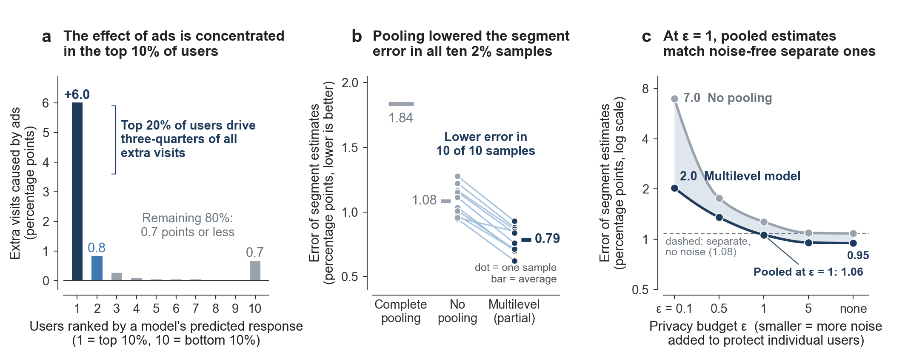
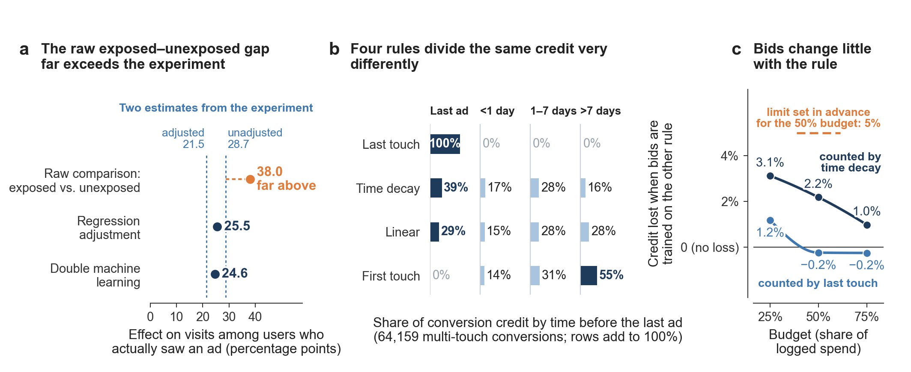
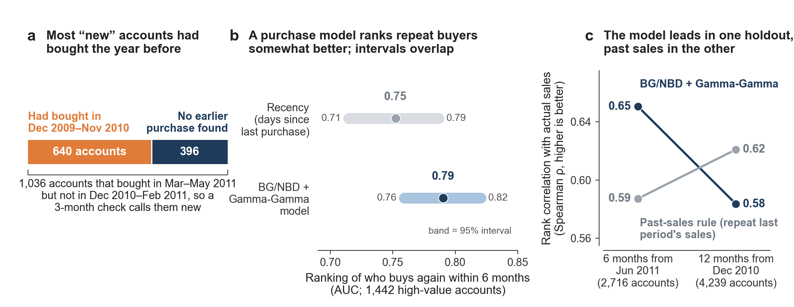

# How many conversions did the ads add?

[](https://github.com/lyz44git/ad-measurement-and-metrics/actions/workflows/tests.yml)

**[Explore the interactive version →](https://lyz44git.github.io/ad-measurement-and-metrics/)** Switch the attribution rule, choose the size of a test, or look further back in a customer's history, and the charts follow.

In Criteo's randomized experiment (public sample, 13,979,592 records), records eligible for ads converted at 0.309%
against 0.194% in the control group: +0.115 percentage points, or +59%. Scaled to the eligible group, that is an
estimated 13,687 additional conversions (95% CI 12,887–14,488). An exposure-based count credits the ads with 23,031,
68% more. The comparison is at group level; it does not identify which conversions the ads caused.

Criteo ran the experiment and released the data. I did the analysis and reproduced the headline numbers in SQL.

**Scope.** The data pool several tests with non-uniform sampling, and only 3.6% of the eligible group was exposed, so
the rates are not population rates and the size of the overstatement is specific to this rule and sample. What
generalizes is the method: validating a metric against a randomized experiment. Decision rules were fixed and hashed
before each result was seen; section 5 lists those not met.

<a href="https://lyz44git.github.io/ad-measurement-and-metrics/index.html"></a>

**Figure 1. Exposure count vs. experimental estimate.** a: share of records with a conversion or visit, by assigned group (13,979,592 records). b: estimated additional outcomes in the eligible group (unadjusted rate difference × 11,882,655 eligible records, 95% CI) vs. outcomes of exposed records. Group-level comparison; the regression-adjusted estimate is lower. Studies 01a, 01c, 02a. Interactive: [a](https://lyz44git.github.io/ad-measurement-and-metrics/01.html#s01a) · [b](https://lyz44git.github.io/ad-measurement-and-metrics/02.html#s02a).

## 1. Users eligible for ads were more likely to record a visit or a conversion.

<a href="https://lyz44git.github.io/ad-measurement-and-metrics/01.html"></a>

**Figure 2. Heterogeneity and segment estimates.** a: realized visit effect by decile of predicted uplift (held-out users). b: RMSE of 100 segment effects against the other 98% of users, ten 2% samples; bars are means. c: the same RMSE under Laplace noise by privacy budget ε; dashed line, no-pooling RMSE without noise. Studies 01a, 01b, 01d. Interactive: [a](https://lyz44git.github.io/ad-measurement-and-metrics/01.html#s01a) · [b](https://lyz44git.github.io/ad-measurement-and-metrics/01.html#s01b) · [c](https://lyz44git.github.io/ad-measurement-and-metrics/01.html#s01d).

Eligibility for ads raised the share of records with a visit from 3.82% to 4.85% (+27%) and with a conversion from
0.194% to 0.309% (+59%) ([01a](01_with_an_experiment/01a_ad_incrementality)).

The effect is concentrated: the fifth of users ranked highest by a model accounts for 75% of the incremental visits.
An uplift model, designed to identify the users whom an ad can persuade, ranked them no better than a simple model of
which users visit in any case ([01a](01_with_an_experiment/01a_ad_incrementality)).

When a 2% sample is divided into 100 segments, the segment estimates become noisy. A multilevel model (partial pooling)
lowered the error in 10 of 10 samples; the average error fell by 27% ([01b](01_with_an_experiment/01b_bayesian_segment_effects)).

With Laplace noise on the counts at a privacy budget of ε = 1, the pooled error is 1.06 points, against 1.08 for
separate estimates and 0.95 for the same model without noise ([01d](01_with_an_experiment/01d_private_segment_effects)).

A SQL readout with pre-stated numerators and denominators reproduces the rates, effects and both conversion counts;
all 29 comparisons with Python meet their tolerances. The file has no user identifier, and 16% of rows are identical
to another row ([01c](01_with_an_experiment/01c_sql_metric_readout)).

<sub><b>Methods.</b> A randomized experiment on 13,979,592 users, read as the effect of assignment, with regression adjustment as a check. Uplift models compared with a response model on held-out users. A Bayesian multilevel model on ten 2% samples, scored against the other 98% of users. Laplace noise for differential privacy at four privacy budgets. DuckDB for the SQL.</sub>

## 2. How well do common metrics work when no experiment is available?

Only 02a can be checked against random assignment; 02b and 02d use a separate Criteo impression log, and 02c brand
spend and revenue.

<a href="https://lyz44git.github.io/ad-measurement-and-metrics/02.html"></a>

**Figure 3. Attribution without an experiment.** a: observational estimates of the per-exposed-user visit effect against the unadjusted and adjusted experimental estimates (two specifications, not an interval; CIs on the study page). b: credit by rule and time before the last touch, 64,159 multi-touch test conversions. c: credit lost when bidding with the other rule's model, replay at logged prices; the 5% rule applies at the 50% budget. Studies 02a, 02b, 02d. Interactive: [a](https://lyz44git.github.io/ad-measurement-and-metrics/02.html#s02a) · [b](https://lyz44git.github.io/ad-measurement-and-metrics/02.html#s02b) · [c](https://lyz44git.github.io/ad-measurement-and-metrics/02.html#s02d).

Crediting the ads with every outcome of a user who was shown one assigns
them 68% more conversions and 44% more visits than the experiment estimates they added ([02a](02_without_an_experiment/02a_attribution_metric_validation)).

A direct comparison of users who were shown an ad with users in the same group who were not gives an apparent effect
on the visit rate of 38.0 points. Adjusting for user characteristics lowers it to 24.6-25.5, between the two
experimental estimates (21.5 and 28.7). The two experimental figures are two specifications of one experiment, not a
confidence interval, so this shows agreement in size and does not prove that confounding was removed ([02a](02_without_an_experiment/02a_attribution_metric_validation)).

The credit rule matters for the credit itself: last touch leaves 82% of the touches on multi-touch paths with none ([02b](02_without_an_experiment/02b_multi_touch_attribution)). It matters
little for which impressions a bidder buys. In a replay at logged prices, at half the logged budget, a bidder that values impressions by last-touch credit
and one that values them by time-decay credit spent 90.4% of their spend on the same impressions, and bidding with the
other rule's model lost 2.2% of the credit under time-decay scoring and −0.2% under last-touch scoring, below the 5%
threshold set in advance for that budget ([02d](02_without_an_experiment/02d_attribution_and_bidding)).

A marketing mix model recovers a channel's return only where its spend varies enough. In simulations with known returns
on the brands' real spend, a signal-to-noise index computed before fitting separates the cases: the median error was 19% for brand-channel pairs with an index of 2 or more and 50% for the rest.
In the simulation 19% of pairs (13 of 68) reach an index of 2 with weekly data and 55% (34 of 62) with daily data. On
real spend, a ROAS of 2 is detectable at 80% power for 6% (weekly) and 42% (daily) of pairs. Fitting all brands in a single model did not meet its pre-set improvement rule ([02c](02_without_an_experiment/02c_marketing_mix_modeling)).

<a href="https://lyz44git.github.io/ad-measurement-and-metrics/02.html#s02c"></a>

**Figure 4. Signal-to-noise index and ROAS recovery, held-out simulation.** a: absolute relative error of estimated ROAS against the index (54 brand-channel pairs, daily data, known returns on real spend); lines are medians on each side of the pre-set threshold of 2. b: share of pairs with index ≥ 2. On real spend, ROAS = 2 is detectable at 80% power for 6% (weekly) and 42% (daily) of pairs. Study 02c. Interactive: [a](https://lyz44git.github.io/ad-measurement-and-metrics/02.html#s02c).

<sub><b>Methods.</b> Attribution counts set against the experiment of section 1; regression and double machine learning for the adjusted estimates. Credit rules on 6.1M display-ad paths. A replay of two bidders on 4.6M logged impressions at their logged prices. Marketing mix simulations with known returns on the real spend of 31 to 34 e-commerce brands, with the index tested on simulations it had not seen.</sub>

## 3. Planning a test: the outcome and the unit of randomization set its size.

<a href="https://lyz44git.github.io/ad-measurement-and-metrics/03.html"></a>

**Figure 5. Test sizing.** a: users per group for 80% power on a +1 pp visit lift, unadjusted and with two covariate adjustments. b: users per group by relative lift; marked values at 10%. c: MDE of a two-month market test by number of metros, placebo tests on Zillow newly pending listings (Data Provided by Zillow Group). Studies 03a, 01c, 03b. Interactive: [a](https://lyz44git.github.io/ad-measurement-and-metrics/03.html#s03a) · [b](https://lyz44git.github.io/ad-measurement-and-metrics/index.html#tests) · [c](https://lyz44git.github.io/ad-measurement-and-metrics/03.html#s03b).

At 80% power, detecting a one-percentage-point lift in the visit rate requires 6,458 users per group. Adjusting for user
characteristics recorded before the test reduces this to 4,430 ([03a](03_planning_a_test/03a_lift_study_sizing)).

Conversions are about 20 times rarer than visits, and the required sample grows by the same factor: detecting a 10%
relative lift requires 848,944 users per group for conversions, against 41,413 for visits ([01c](01_with_an_experiment/01c_sql_metric_readout)).

When only whole markets can be randomized, the test is less sensitive. In placebo tests on Zillow newly pending
listings for 151 U.S. metros, a two-month test in 100 metros detects a 6.7% change with regression adjustment on pre-period volume,
against 9.5% with a year-over-year comparison ([03b](03_planning_a_test/03b_geo_experiment_design)).

Forecasts of for-sale inventory made separately for the nation, the states and the metros differed by 3.5% to 5.2% until they
were reconciled; reconciliation makes the levels agree, it does not make the forecasts accurate ([03c](03_planning_a_test/03c_hierarchical_forecasting)).

<sub><b>Methods.</b> For users, 2,000 resampled studies per sample size with A/A checks, and the two-proportion sample-size formula. For markets, 5,000 placebo tests per design. For forecasts, 24 rolling forecast origins on a hierarchy of 873 series.</sub>

## 4. Counting new customers requires a definition of "new".

<a href="https://lyz44git.github.io/ad-measurement-and-metrics/04.html"></a>

**Figure 6. New-customer definition and customer models.** a: 1,036 accounts buying in Mar–May 2011 with no purchase in Dec 2010–Feb 2011, split by any purchase in Dec 2009–Nov 2010. b: six-month repeat-purchase AUC, 1,442 high-value accounts, 95% CI. c: Spearman ρ with actual sales in two holdouts (from Jun 2011, 2,716 accounts; from Dec 2010, 4,239 accounts). Study 04. Interactive: [a](https://lyz44git.github.io/ad-measurement-and-metrics/04.html#s04).

In the transactions of a UK online retailer (no marketing data), of the 1,036 accounts that bought in March to May 2011
and had not bought in the three months before, 640 had made a purchase between December 2009 and November 2010 ([04](04_customer_metrics_retention)).

Among 1,442 high-value accounts, BG/NBD + Gamma-Gamma ranked six-month repeat buyers better than recency (AUC 0.79
vs 0.75; intervals overlap). From a December 2010 cutoff, a past-sales rule ranked sales better than the model over both 6 and 12 months ([04](04_customer_metrics_retention)).

<sub><b>Methods.</b> Two years of transactions (794,163 lines, 5,875 accounts; no ads in these data). The metric tables rebuilt in SQL match the Python results in all 92 cells.</sub>

## 5. Six headline comparisons that missed their decision rules.

| Study | Rule | Observed result | Decision |
|---|---|---|---|
| [01a](01_with_an_experiment/01a_ad_incrementality) | The uplift model ranks users for targeting better than a response model | No ranking gain shown | Superiority not shown; use the simpler model |
| [02c](02_without_an_experiment/02c_marketing_mix_modeling) | Adding media variables improves a revenue forecast | The interval of the mean paired difference includes 0 | Improvement not shown |
| [02c](02_without_an_experiment/02c_marketing_mix_modeling) | Fitting all brands in one model improves recovery of channel returns | Median error and rank correlation essentially unchanged | Improvement not shown |
| [02d](02_without_an_experiment/02d_attribution_and_bidding) | At the 50% budget, bidding with the other rule's model loses at least 5% of credit under both scorings (joint rule) | 2.2% and −0.2% | The rule barely changes what is bought |
| [01d](01_with_an_experiment/01d_private_segment_effects) | Ranking segments by estimated lift beats ranking by response rate in at least 8 of 10 samples at each budget | Met at 10% and 20%; 4 of 10 at 30% | Not shown at the 30% budget |
| [04](04_customer_metrics_retention) | The purchase model ranks 12-month sales better than a past-sales rule | The past-sales rule ranked better in this holdout | Use the rule for this horizon |

## 6. Where these findings agree with earlier work, and where the comparison stops.

The full comparison, result by result and with references, is in [RELATED_RESEARCH.md](RELATED_RESEARCH.md).

- **Observational estimates.** On 15 and then 663 experiments at Facebook, adjusting for user characteristics often
  failed to recover the experimental effect (Gordon et al. 2019; Gordon, Moakler and Zettelmeyer 2023). The adjusted
  estimate here did land between the experimental ones; with one experiment that is not a counterexample
  ([02a](02_without_an_experiment/02a_attribution_metric_validation)).
- **Test size.** Informative advertising experiments can need more than 10 million person-weeks (Lewis and Rao 2015),
  the same arithmetic that makes a conversion test here 20 times larger than a visit test ([01c](01_with_an_experiment/01c_sql_metric_readout)).
- **Targeting.** At eBay the users most likely to buy were the wrong ones to target (Blake, Nosko and Tadelis 2015).
  In this experiment they were the appropriate ones, the case in which predicting the outcome is sufficient (Fernández-Loría and Provost
  2022) ([01a](01_with_an_experiment/01a_ad_incrementality)).
- **Returns differ by setting.** Television advertising for 288 brands had a negative return at the margin for more
  than 80% of them (Shapiro, Hitsch and Tuchman 2021); in this experiment eligibility for ads raised the
  conversion rate by 59%, a conversion lift rather than a return on spend. This variation is the reason to measure
  each case.
- **The same correction in finance.** In annual data advertising appeared to raise stock returns (Lou
  2014); with daily data the relation was reverse causality (Focke, Ruenzi and Ungeheuer 2020), while a cleanly
  identified effect on investor attention remains (Liaukonyte and Zaldokas 2022).
- **Where the field is going.** Calibrated on 2,226 experiments, campaign-level measures that include last-click
  counts explain 88% of the variation in incremental conversions per dollar, against 19% for last-click attribution
  alone (Gordon, Moakler and Zettelmeyer, working paper). That predictive performance belongs to the paper; this
  repository only checks one exposure count against one experiment and does not test calibration across campaigns.

## The studies

Start from a task: audit a conversion KPI → [02a](02_without_an_experiment/02a_attribution_metric_validation);
size a test → [03a](03_planning_a_test/03a_lift_study_sizing) or [03b](03_planning_a_test/03b_geo_experiment_design);
define a new account → [04](04_customer_metrics_retention).

One folder per question, with the studies inside it. Each study has its own README with the question, data, method,
results, limits and the commands to reproduce it.

| Study | Question | Data |
|---|---|---|
| **1. With an experiment** ([folder](01_with_an_experiment)) | | |
| [`01a_ad_incrementality`](01_with_an_experiment/01a_ad_incrementality) | How many site visits did the ads cause, as opposed to visits that would have happened anyway? | Criteo experiment |
| [`01b_bayesian_segment_effects`](01_with_an_experiment/01b_bayesian_segment_effects) | Can segment-level ad effects be read from a 2% sample? | Criteo experiment |
| [`01c_sql_metric_readout`](01_with_an_experiment/01c_sql_metric_readout) | Is every number of the readout defined, checked and reproducible from the raw file? | Criteo experiment |
| [`01d_private_segment_effects`](01_with_an_experiment/01d_private_segment_effects) | If segment counts are released with differential-privacy noise, how much accuracy is left? | Criteo experiment |
| **2. Without an experiment** ([folder](02_without_an_experiment)) | | |
| [`02a_attribution_metric_validation`](02_without_an_experiment/02a_attribution_metric_validation) | Can an exposure-based attribution metric be trusted as a measure of ad impact? | Criteo experiment |
| [`02b_multi_touch_attribution`](02_without_an_experiment/02b_multi_touch_attribution) | When a user sees several ads before converting, how much does the credit rule change which touch gets credit? | Criteo attribution log |
| [`02c_marketing_mix_modeling`](02_without_an_experiment/02c_marketing_mix_modeling) | Can a marketing mix model recover each channel's return from a brand's own spend and revenue, and can one tell in advance when it will? | Conjura e-commerce brands |
| [`02d_attribution_and_bidding`](02_without_an_experiment/02d_attribution_and_bidding) | If a bidder values impressions by expected credit, does the attribution rule change what it buys? | Criteo attribution log |
| **3. Planning a test** ([folder](03_planning_a_test)) | | |
| [`03a_lift_study_sizing`](03_planning_a_test/03a_lift_study_sizing) | How many users per arm does a lift study need, and how much does covariate adjustment save? | Criteo experiment |
| [`03b_geo_experiment_design`](03_planning_a_test/03b_geo_experiment_design) | If a change can only be randomized by market, how large a test is needed, and does the usual t-test keep its 5% false-positive rate? | Zillow metro series |
| [`03c_hierarchical_forecasting`](03_planning_a_test/03c_hierarchical_forecasting) | Can the baseline of a metric be forecast at national, state and metro levels so that the levels add up, without losing accuracy? | Zillow metro series |
| **4. Customer metrics** | | |
| [`04_customer_metrics_retention`](04_customer_metrics_retention) | Does the "new customer" metric count returning buyers as new, and which high-value customers are least likely to return? | UCI Online Retail II |

### Studies by method

| Method | Studies |
|---|---|
| Randomized experiment readout: effect of assignment, effect per exposed user | 01a, 01c |
| Regression and covariate adjustment (ANCOVA, model prediction as covariate) | 01a, 03a, 03b |
| Uplift models (T-, X- and DR-learner, causal forest) and targeting curves | 01a |
| Bayesian multilevel models (NUTS) | 01b, 01d, 02c |
| Differential privacy (Laplace mechanism on counts) | 01d |
| SQL metric definitions, data checks and reconciliation (DuckDB) | 01c, 04 |
| Adjusted exposure comparisons (OLS and DML; assumptions in 02a) | [02a](02_without_an_experiment/02a_attribution_metric_validation) |
| Attribution rules; exponential waiting-time model of touch-to-conversion delays | 02b |
| Bidding replay on logged prices with gradient-boosted value models | 02d |
| Marketing mix models (carry-over, saturation), simulation-based recovery, signal-to-noise diagnostic | 02c |
| Power, minimum detectable effect, A/A tests, placebo tests, randomization inference | 01c, 03a, 03b |
| Time-series forecasting (ETS, ARIMA), hierarchical reconciliation, rolling-origin backtests | 03c; holdout forecasts in 02c |
| Stochastic models of purchasing (BG/NBD: Poisson purchases with dropout; Gamma-Gamma spend), cohorts, clustering | 04 |
| Bootstrap and resampling for uncertainty | 01b, 02b, 02d, 03a, 04 |

Where a conclusion depends on a decision rule, the analysis plan was fixed before the run and its SHA-256 is recorded
in the study's `logs/` folder. Follow-up analyses added after a first result have their own plan and are labeled as
follow-ups. Results that did not support the more complex method are reported alongside the rest.

## Data sources and terms

Data are not included in this repository. The randomized experiment used in studies 01a to 01d, 02a and 03a was designed,
run and released by Criteo. Studies 02b and 02d use Criteo's attribution dataset, studies 03b and 03c public Zillow
Research files, study 04 the UCI Online Retail II data, and study 02c a public marketing mix dataset released by Conjura.

| Data | Used in | Terms |
|---|---|---|
| Criteo Uplift v2.1 · randomized eligibility ([release](https://ailab.criteo.com/criteo-uplift-prediction-dataset/); Diemert, Betlei, Renaudin and Amini 2018, AdKDD) | 01a, 01b, 01c, 01d, 02a, 03a | Research, non-commercial use. The data pool several tests with non-uniform subsampling, so absolute lifts are not population effects. |
| Zillow Research, metro newly pending listings (03b), for-sale inventory and new listings (03c) | 03b, 03c | Data Provided by Zillow Group. Only derived simulation results and aggregate error tables are stored here. |
| UCI Machine Learning Repository, Online Retail II (id 502) | 04 | CC BY 4.0. |
| Criteo Attribution · logged impressions (Criteo Attribution Modeling for Bidding Dataset; Diemert, Meynet, Galland and Lefortier 2017, AdKDD) | 02b, 02d | CC BY-NC-SA 4.0. The derived results in the `out/` folders of studies 02b and 02d are shared under the same license. |
| Conjura, Multi-Region Marketing Mix Modelling (MMM) Dataset for Several eCommerce Brands (Figshare 25314841) | 02c | CC BY 4.0. |

**Use.** This is a non-commercial research project. The data and all derived outputs in this repository are used
for research only.

## Repository layout

One folder per question, with the studies inside it:

```
01_with_an_experiment/
├── 01a_ad_incrementality/
├── 01b_bayesian_segment_effects/
├── 01c_sql_metric_readout/
└── 01d_private_segment_effects/
02_without_an_experiment/
├── 02a_attribution_metric_validation/
├── 02b_multi_touch_attribution/
├── 02c_marketing_mix_modeling/
└── 02d_attribution_and_bidding/
03_planning_a_test/
├── 03a_lift_study_sizing/
├── 03b_geo_experiment_design/
└── 03c_hierarchical_forecasting/
04_customer_metrics_retention/     one study
figures/                           Figures 1 to 6, and the scripts and shared style that draw every figure
docs/                              interactive figures (GitHub Pages); build_data.py reads every number from the result files
```

Study folders share this structure (not every study needs every folder):

```
study_name/
├── README.md     question, method, findings, limitations, how to run
├── code/         scripts, numbered in run order
├── docs/ or design/   analysis plan written before the run, and any deviations from it
├── out/          result tables (JSON / CSV) and figures
├── logs/         run logs and the SHA-256 of the plan, recorded before the run
└── tests/        checks on simulated data (in `code/tests/` for study 01a)
```

Most studies use this layout, and their data go in a git-ignored `data_raw/` folder; see each README for the download link. Study 03c lists its external inputs and aggregate outputs in its own README.

## Setup

Result tables are committed in each study's `out/` folder; no installation is needed to read them. To re-run:

```bash
python -m venv .venv && source .venv/bin/activate
pip install -r requirements.txt
```

Tested with Python 3.13 on macOS. Studies 01a and 02a load the full Criteo file and need about 16 GB of memory.
Studies 01b, 01d and 02c also need NumPyro and JAX: `pip install -r 02_without_an_experiment/02c_marketing_mix_modeling/requirements-mmm.txt`.

## Tests

```bash
pytest -q
```

CI runs these tests on synthetic inputs; it does not re-run the empirical analyses, which are checked by the SQL
reconciliations in [01c](01_with_an_experiment/01c_sql_metric_readout) and [04](04_customer_metrics_retention). The tests need none of the datasets. They check that the estimators recover a known
effect and do not detect one that is absent, that false-positive rates stay near 5% under a true null, that adjusting
for a predictive covariate lowers the variance of a readout by the expected amount, that the purchase and spend models
recover known parameters, that the published SQL agrees with an independent pandas implementation and that its data
checks catch planted errors, that each attribution rule gives a conversion exactly one unit of credit, that no
bid-time feature uses anything that happens at or after the impression, that the privacy noise has the stated scale,
that reconciled forecasts add up across levels and use no data from after the forecast origin, and that the adstock
and saturation transforms behave as specified. They run on every push (see the badge above).

## License

Code is released under the MIT License (see [`LICENSE`](LICENSE)). The datasets keep their own terms, listed in [Data sources and terms](#data-sources-and-terms); the derived
results of studies 02b and 02d follow CC BY-NC-SA 4.0.

## Notes

Criteo designed and ran the experiment and released the data. I led the research questions, analysis plans and
interpretation, and checked the headline readout in SQL. Developed with an AI-assisted coding workflow. All results are reproducible from the scripts and public data referenced in each study.
